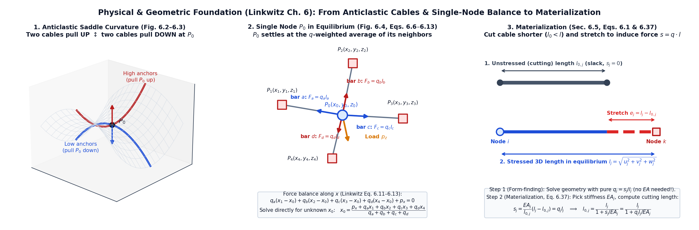
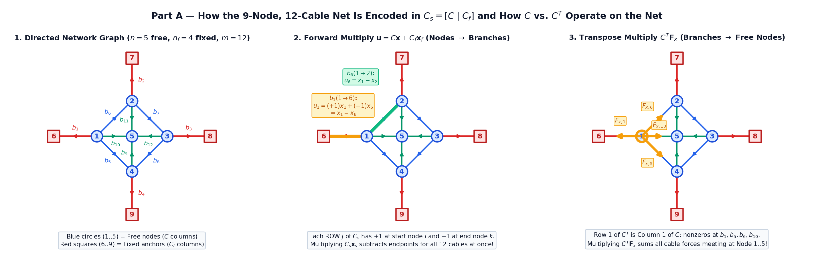
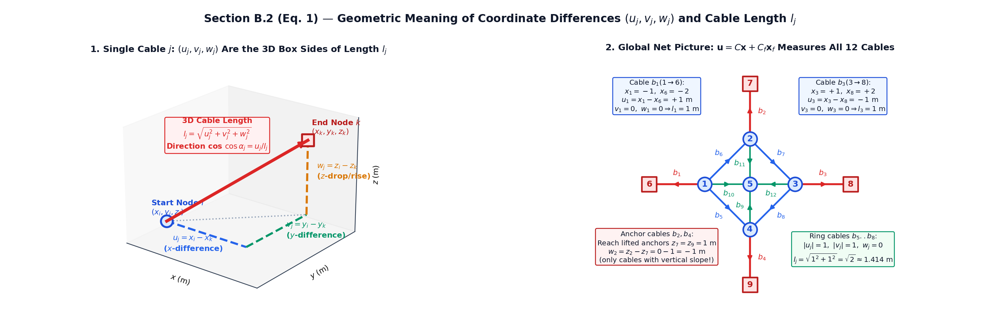
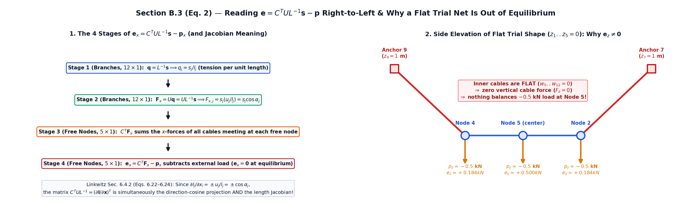
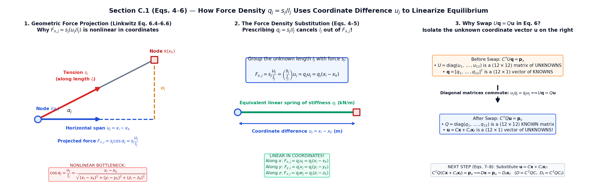
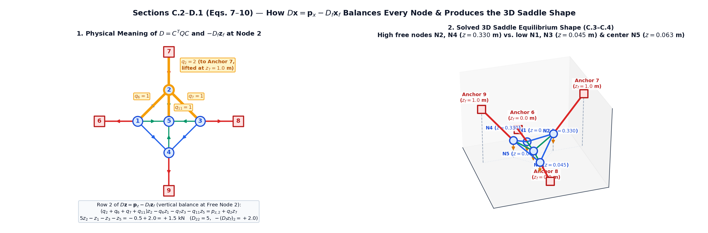
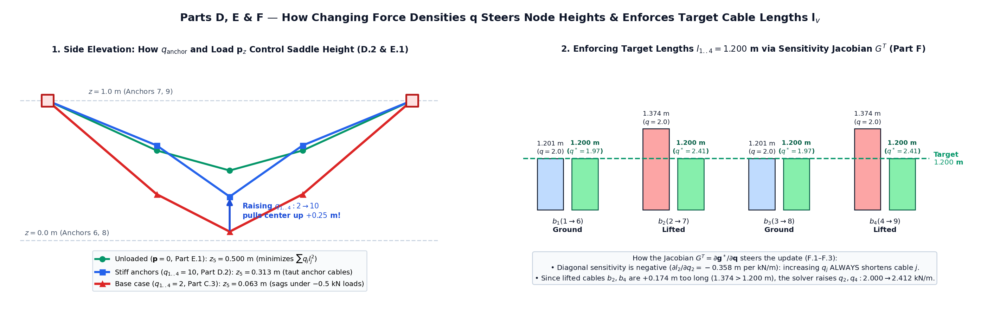

# Force density method with compas_fd

This tutorial builds the **force density method (FDM)** from scratch, following
H.-J. Schek (1974). Start with [Build the force density method step by step](#build-the-force-density-method-step-by-step):
create the network data, construct connectivity, write equilibrium, introduce
force densities, solve the free coordinates, and recover branch forces and reactions.
At D.2 you have a reusable linear solver. Later steps add length and force conditions.

The assumptions below serve as a reference while you work through the steps.
The final sections compare our implementation with `compas_fd`, whose linear
solver computes the same free-node equilibrium coordinates. Its constrained solver
moves selected anchors along geometric constraints; it differs from the tutorial's
iteration on force densities for prescribed branch lengths or forces.

- Repository: <https://github.com/BlockResearchGroup/compas_fd>
- Documentation: <https://blockresearchgroup.github.io/compas_fd>
- PyPI: `pip install compas_fd` (version `0.5.4` of 2024-11-10 was read and run for this note)
- Used by the Rhino plugin described in [compas_fofin](compas_fofin.md); the same
  force-density parametrisation drives the iterative solver in [compas_dr](compas_dr.md).

## Concept and assumptions



### 1. The Physical Picture: Rubber-Band Thought Experiment & Anticlastic Curvature (Linkwitz 2014, Sec. 6.1–6.2)

Imagine stretching a grid of rubber bands inside a rigid 3D frame where two opposite corners are high ($z = 1\text{ m}$) and the other two are low ($z = 0\text{ m}$), as in Klaus Linkwitz's classic thought experiment (Figs. 6.2–6.3):

- **Hanging cables** span between the high anchors, curving upward and pulling every interior intersection node **upward** ($\uparrow$).
- **Standing (arch) cables** span at right angles toward the low anchors, curving downward over the hanging cables and pulling the same interior nodes **downward** ($\downarrow$).
- At every interior node $P_0$, the upward pull of one cable family balances the downward pull of the orthogonal family (plus any external load $\mathbf{p}$). This mutual opposing curvature creates a pretensioned **anticlastic (saddle-shaped) surface** with negative Gaussian curvature. Adding large vertical loads $\mathbf{p}_z$ shifts the surface into a purely hanging or domed **synclastic** shape (Linkwitz Fig. 6.7).

### 2. The Single-Node Picture: Why Equilibrium Is Nonlinear & How $q$ Linearizes It (Linkwitz Sec. 6.2.1–6.2.3, Fig. 6.4)

Before looking at matrices for a whole cable net, consider a **single free node** $P_0(x_0, y_0, z_0)$ connected by four straight pin-jointed cables $a, b, c, d$ to four neighbor points $P_1, P_2, P_3, P_4$ under an external nodal load $(p_x, p_y, p_z)$ (middle panel of the figure above):

1. **Geometric compatibility (3D Pythagoras, Linkwitz Eq. 6.2)**: The stressed 3D length $l_i$ of cable $i$ connecting $P_0$ to neighbor $P_k(x_k, y_k, z_k)$ is the hypotenuse of a 3D right box with coordinate-difference sides $(x_k - x_0,\ y_k - y_0,\ z_k - z_0)$:
   $$
   l_i = \sqrt{(x_k - x_0)^2 + (y_k - y_0)^2 + (z_k - z_0)^2}
   $$
2. **Force projection via direction cosines (Linkwitz Eqs. 6.4–6.8)**: Cable $i$ pulls on $P_0$ along the cable axis with tension $F_i$ (called $s_j$ in Schek's notation). To sum forces along the $x$-axis, we project $F_i$ using the **direction cosine** $\cos\alpha_i$ (the ratio of horizontal coordinate difference to 3D cable length):
   $$
   \cos\alpha_i = \frac{\text{coordinate difference along } x}{\text{spatial distance}} = \frac{x_k - x_0}{l_i}
   \qquad \Longrightarrow \qquad
   F_{i,x} = F_i \cos\alpha_i = F_i \frac{x_k - x_0}{l_i}
   $$
   Summing the $x$-, $y$-, and $z$-components over all four cables $a, b, c, d$ meeting at $P_0$ gives nodal equilibrium (Linkwitz Eq. 6.6):
   $$
   \frac{x_1 - x_0}{l_a} F_a + \frac{x_2 - x_0}{l_b} F_b + \frac{x_3 - x_0}{l_c} F_c + \frac{x_4 - x_0}{l_d} F_d + p_x = 0
   $$
   **Why this is nonlinear**: The unknown coordinate $x_0$ appears not only in the numerator $(x_k - x_0)$, but also buried inside the square root $l_i = \sqrt{(x_k - x_0)^2 + (y_k - y_0)^2 + (z_k - z_0)^2}$ in the denominator, coupling $x_0, y_0, z_0$ together.
3. **The Force Density Trick on One Node (Linkwitz Eqs. 6.9–6.13)**: Define the **force density** $q_i$ ($\text{kN/m}$) of each cable as the ratio of its tension force to its stressed length:
   $$
   q_i := \frac{F_i}{l_i} \quad \left(\text{or } q_j = \frac{s_j}{l_j}\text{ in Schek's notation}\right)
   \qquad \Longrightarrow \qquad
   \text{Example: } l = 2.5\text{ m},\ s = 10\text{ kN} \implies q = \frac{10\text{ kN}}{2.5\text{ m}} = 4\text{ kN/m}
   $$
   If we **prescribe a constant number $q_i$ for each cable**, the troublesome square-root length $l_i$ in the denominator cancels out completely! The horizontal pull of cable $i$ becomes simply $F_{i,x} = q_i (x_k - x_0)$—exact 3D Hooke's law for a zero-rest-length linear spring of stiffness $q_i$. The equilibrium equation at $P_0$ becomes **purely linear** in $x_0$ (Linkwitz Eqs. 6.11–6.13):
   $$
   q_a(x_1 - x_0) + q_b(x_2 - x_0) + q_c(x_3 - x_0) + q_d(x_4 - x_0) + p_x = 0
   \quad \Longleftrightarrow \quad
   (q_a + q_b + q_c + q_d) x_0 = p_x + q_a x_1 + q_b x_2 + q_c x_3 + q_d x_4
   $$
   Solving for $(x_0, y_0, z_0)$ shows that **every free node settles at the $q$-weighted average of its neighbors' coordinates** (plus the load offset):
   $$
   x_0 = \frac{p_x + q_a x_1 + q_b x_2 + q_c x_3 + q_d x_4}{q_a + q_b + q_c + q_d},
   \qquad
   y_0 = \frac{p_y + q_a y_1 + q_b y_2 + q_c y_3 + q_d y_4}{q_a + q_b + q_c + q_d},
   \qquad
   z_0 = \frac{p_z + q_a z_1 + q_b z_2 + q_c z_3 + q_d z_4}{q_a + q_b + q_c + q_d}
   $$

### 3. Two-Step Independence: Form-Finding vs. Materialization (Linkwitz Sec. 6.5) & Scale Invariance (Sec. 6.7)

- **Step 1 — Geometric Form-Finding (no material properties needed)**: Because $q_j = s_j / l_j$ absorbs both the elastic stretch and the cable length into a single prescribed ratio, solving $D \mathbf{x} = \mathbf{p}_x - D_f \mathbf{x}_f$ for the 3D equilibrium shape requires **no knowledge of Young's modulus $E$, cross-sectional area $A$, or unstressed length $l_0$**. Once the equilibrium coordinates $(\mathbf{x}, \mathbf{y}, \mathbf{z})$ are solved, we measure the 3D cable lengths $l_j$ and recover the true axial forces $s_j = q_j l_j$.
- **Step 2 — Materialization / Cutting Pattern (Linkwitz Eqs. 6.1, 6.3, 6.34–6.37)**: To build the physical net, we choose each cable's axial stiffness $EA_j$ ($\text{kN}$). By Hooke's law, a cable of unstressed **cutting length** $l_{0,j}$ stretched by $e_j = l_j - l_{0,j}$ to its equilibrium length $l_j$ carries tension $s_j = \frac{EA_j}{l_{0,j}}(l_j - l_{0,j}) = q_j l_j$. Solving for $l_{0,j}$ gives the exact workshop cutting length for every cable $j$ (right panel of the figure above):
  $$
  l_{0,j} = \frac{l_j}{1 + s_j / EA_j} = \frac{l_j}{1 + q_j l_j / EA_j},
  \qquad \text{or in matrix form: } \mathbf{l}_0 = \left(I + (EA)^{-1} Q L\right)^{-1} \mathbf{l}
  $$
- **Scale Invariance of $(\mathbf{q}, \mathbf{p})$ (Linkwitz Sec. 6.7, Figs. 6.9–6.11)**: Multiplying all force densities $\mathbf{q}$ and external loads $\mathbf{p}$ by the same factor $\lambda > 0$ (e.g., doubling both $\mathbf{q}$ and $\mathbf{p}$) produces the **exact same 3D equilibrium geometry** $(\mathbf{x}, \mathbf{y}, \mathbf{z})$, while scaling the internal cable forces $\mathbf{s}$ and anchor reactions $\mathbf{R}_f$ by $\lambda$. Only the **ratios** among $q_j$ (such as edge-cable to interior-cable ratio, Linkwitz Fig. 6.6) and the ratio $\mathbf{p} / \mathbf{q}$ change the shape!

**Model assumptions (Schek 1974, section 1; Linkwitz 2014, section 6.3):**

- Branches ($j = 1 \dots m$) are straight pin-jointed axial members (cables or bars); external loads act only at the nodes.
- Nodes are partitioned into **free inner nodes** ($n$ nodes whose 3D coordinates $\mathbf{x}, \mathbf{y}, \mathbf{z}$ are **unknown**) and **fixed boundary anchors** ($n_f$ supports whose 3D coordinates $\mathbf{x}_f, \mathbf{y}_f, \mathbf{z}_f$ are **known**). Note: Schek writes $\mathbf{x}, \mathbf{x}_f$ and $C, C_f$ where Linkwitz writes $\mathbf{x}_N, \mathbf{x}_F$ and $\mathbf{C}_N, \mathbf{C}_F$.
- **Sign conventions:** $q_j > 0$ and $s_j > 0$ denote tension ($q_j < 0$ for compression arches/shells). When all $q_j > 0$ and every connected free-node component reaches at least one fixed anchor, $D = C^T Q C$ is symmetric positive-definite with a unique equilibrium shape.
- **Units:** Consistent across coordinates ($\text{m}$), loads ($\text{kN}$), force densities ($\text{kN/m}$), and axial stiffness $EA$ ($\text{kN}$).

## Master symbol, shape & geometric meaning reference (12-branch, 9-node benchmark)

Use this table whenever a letter appears in an equation—it maps every mathematical symbol to its Python variable, matrix shape, and **physical meaning on the cable net**:

| Symbol (Schek / Linkwitz) | Code | Shape | Physical & Geometric Meaning on the Cable Net |
|---|---|---|---|
| $C_s = [C \mid C_f]$ | `C_s` | `(12, 9)` | **Full branch-node incidence matrix** ($m$ cables $\times\ n_s$ total nodes). Row $j$ has $+1$ at start node $i$ and $-1$ at end node $k$: acts as a "tape measure" subtracting endpoint coordinates for cable $j$. |
| $C$ (Linkwitz: $\mathbf{C}_N$) | `C` | `(12, 5)` | **Free-node connectivity slice** (first $n=5$ columns of $C_s$): tells which of the 5 movable interior nodes each cable touches. |
| $C_f$ (Linkwitz: $\mathbf{C}_F$) | `C_f` | `(12, 4)` | **Fixed-anchor connectivity slice** (last $n_f=4$ columns of $C_s$): tells which of the 4 immovable boundary anchors ($6 \dots 9$) each cable touches. |
| $C^T$ (Linkwitz: $\mathbf{C}_N^T$) | `C.T` | `(5, 12)` | **Transpose of $C$ (nodal force collector)**: row $i$ of $C^T$ gathers and sums the signed cable force components meeting at free node $i$. |
| $\mathbf{x}, \mathbf{y}, \mathbf{z}$ ($\mathbf{x}_N$) | `x, y, z` | `(5,)` | **Unknown 3D coordinates** ($\text{m}$) of the $n=5$ free interior nodes (Nodes $1 \dots 5$) that move until forces balance. |
| $\mathbf{x}_f, \mathbf{y}_f, \mathbf{z}_f$ ($\mathbf{x}_F$) | `x_f, y_f, z_f` | `(4,)` | **Known 3D coordinates** ($\text{m}$) of the $n_f=4$ fixed boundary anchors (Nodes $6 \dots 9$). |
| $\mathbf{u}, \mathbf{v}, \mathbf{w}$ | `u, v, w` | `(12,)` | **Cable coordinate differences** ($\text{m}$) along $x, y, z$: for cable $j$ ($i \to k$), $u_j = x_i - x_k$, $v_j = y_i - y_k$, $w_j = z_i - z_k$ are the 3 orthogonal sides of the 3D right box enclosing cable $j$. |
| $U, V, W$ | `np.diag(u)` | `(12, 12)` | **Diagonal matrices of coordinate differences** $\mathrm{diag}(\mathbf{u}), \mathrm{diag}(\mathbf{v}), \mathrm{diag}(\mathbf{w})$: scale each cable $j$ by its own span $u_j, v_j, w_j$. |
| $\mathbf{l}$ / $L$ / $L^{-1}$ | `l` / `L` / `L_inv` | `(12,)` / `(12, 12)` | **Stressed 3D cable lengths** $l_j = \sqrt{u_j^2 + v_j^2 + w_j^2}$ ($\text{m}$), their diagonal matrix $L = \mathrm{diag}(\mathbf{l})$, and inverse $L^{-1} = \mathrm{diag}(1/l_j)$. |
| $\cos\alpha_j, \cos\beta_j, \cos\gamma_j$ | `u/l, v/l, w/l` | `(12,)` | **3D direction cosines** of cable $j$: ratios $u_j/l_j,\ v_j/l_j,\ w_j/l_j$ that project cable tension $s_j$ onto the global $x, y, z$ axes (and equal the length Jacobian $\partial \mathbf{l}/\partial \mathbf{x}$). |
| $\mathbf{s}$ (Linkwitz: $\mathbf{F}$) | `s` | `(12,)` | **Physical cable axial tension forces** $s_j = q_j l_j$ ($\text{kN}$) pulling along each cable's 3D axis. |
| $\mathbf{q}$ / $Q$ | `q` / `Q` | `(12,)` / `(12, 12)` | **Prescribed force densities** $q_j = s_j / l_j$ ($\text{kN/m}$) and diagonal matrix $Q = \mathrm{diag}(\mathbf{q})$: each cable's effective linear spring stiffness per unit coordinate difference. |
| $D = C^T Q C$ ($\mathbf{D}_N$) | `D` | `(5, 5)` | **Free-node stiffness (weighted Laplacian) matrix** ($\text{kN/m}$): diagonal $D_{ii} = \sum q_j$ is total stiffness meeting at free node $i$; off-diagonal $D_{ik} = -q_j$ is coupling to free neighbor $k$. |
| $D_f = C^T Q C_f$ ($\mathbf{D}_F$) | `D_f` | `(5, 4)` | **Fixed-anchor coupling matrix** ($\text{kN/m}$): $-D_f \mathbf{x}_f$ is the constant pull exerted on the free nodes by the fixed boundary anchors. |
| $\mathbf{p}_x, \mathbf{p}_y, \mathbf{p}_z$ | `p_x, p_y, p_z` | `(5,)` | **External nodal loads** ($\text{kN}$) applied at the 5 free nodes (e.g., $\mathbf{p}_z = -0.5\text{ kN}$ gravity load). |
| $\mathbf{b}_x, \mathbf{b}_y, \mathbf{b}_z$ | `b_x, b_y, b_z` | `(5,)` | **Total right-hand-side force vectors** $\mathbf{b}_x = \mathbf{p}_x - D_f \mathbf{x}_f$ ($\text{kN}$): external load plus anchor pull at each free node. |
| $R_{fx}, R_{fy}, R_{fz}$ | `R_f` | `(4, 3)` | **Support reaction forces** $R_f = C_f^T Q U$ ($\text{kN}$) that the 4 fixed anchors must resist to hold the cable net in place. |
| $l_0, e, EA$ | `l_0, e_el, EA` | `(12,)` | **Materialization quantities** (Linkwitz Sec. 6.5): unstressed cutting lengths $l_{0,j} = l_j / (1 + s_j/EA_j)$ ($\text{m}$), elastic stretches $e_j = l_j - l_{0,j}$ ($\text{m}$), and axial stiffnesses $EA_j$ ($\text{kN}$). |
| $g^{\ast}(q)$ / $G^T$ | `g_star` / `G_t` | `(r,)` / `(r, 12)` | **Constraint residuals** (e.g., target length error) and **sensitivity Jacobian** $G^T = \partial g^{\ast} / \partial q$ telling how changing $q_k$ changes constraint $i$. |

<!-- schek-app:start -->

## Build the force density method step by step

Follow the subsections in order (`examples/form_finding/schek_app.py`). Every equation is paired immediately with an explicit numerical matrix example.

| Milestone | What you can do |
|---|---|
| **A.1–A.4** | Represent a network as a branch-node matrix and trace $C^T Q C$ step by step. |
| **B.1–B.3** | Compute branch coordinate differences, lengths, and the 4-stage nonlinear equilibrium residual. |
| **C.1–C.4** | Apply the force-density substitution $q_j = s_j / l_j$, assemble $D$ and $D_f$, solve coordinates, and recover forces. |
| **D.1–D.2** | Package the 3D linear solver and support reactions into a single function. |
| **E.1** | Interpret $q_j$ geometrically as a weight minimizing $\sum q_j l_j^2$. |
| **F.1–F.3** | Enforce target branch lengths and forces via constrained least-squares and the sensitivity Jacobian $G^T$. |
| **G.1–G.5** | Apply the same solver to Schek's 67-node pointed tent and 112-bar grid-shell benchmarks. |

---

## Part A. The network as data

### A.1 Vectors, matrices, and the diagonal trick (section 1.4)

### What Is Happening in the Cable Net (Global Picture)

In our cable net, there are $m = 12$ cables. Whenever we compute a geometric or physical quantity for every cable—such as each cable's horizontal span $u_j = x_i - x_k$, its 3D length $l_j$, its axial tension force $s_j$, or its force density $q_j = s_j / l_j$—we store those 12 numbers in a **column vector** of height $m = 12$.

To multiply cable-by-cable without using slow `for` loops (for example, multiplying each cable's coordinate difference $u_j$ by its own force density $q_j$ to get the horizontal force $F_{x,j} = u_j q_j$), Schek (1974, Sec. 1.4) and Linkwitz (2014, Eq. 6.21) use a simple **case convention**:
* **Lowercase bold letter** ($\mathbf{u}, \mathbf{v}, \mathbf{w}, \mathbf{l}, \mathbf{q}, \mathbf{s}$): a **1D column vector** of size $(m \times 1)$ containing one value per cable.
* **Uppercase letter** ($U, V, W, L, Q$): the **$(m \times m)$ diagonal matrix** formed by placing that vector along the main diagonal and $0$ everywhere else.

### General Equation & Symbol Decoder

$$
U = \mathrm{diag}(\mathbf{u}), \qquad Q = \mathrm{diag}(\mathbf{q}), \qquad U \mathbf{q} = Q \mathbf{u}
$$

* **$\mathbf{u}$ / $U$**: Vector $[u_1, \dots, u_m]^T$ of horizontal coordinate differences ($x_{\text{start}} - x_{\text{end}}$) for each cable, and its $(m \times m)$ diagonal matrix $U = \mathrm{diag}(\mathbf{u})$.
* **$\mathbf{q}$ / $Q$**: Vector $[q_1, \dots, q_m]^T$ of force densities ($s_j / l_j$) for each cable, and its $(m \times m)$ diagonal matrix $Q = \mathrm{diag}(\mathbf{q})$.
* **Why $U \mathbf{q} = Q \mathbf{u}$ matters geometrically**: For cable $j$, row $j$ of $U \mathbf{q}$ computes $u_j q_j$ (horizontal span $\times$ force density $=$ horizontal cable force $F_{x,j}$). Because $u_j q_j = q_j u_j$ for every cable $j$, we can swap which letter is the diagonal matrix and which is the vector! In Section C.1, this swap will let us move the **unknown** coordinate vector $\mathbf{u}$ to the right of the **known** stiffness matrix $Q$.

### Matrix Example

Turning a 3-cable coordinate-difference vector $\mathbf{u}$ into a $(3 \times 3)$ diagonal matrix $U = \mathrm{diag}(\mathbf{u})$:

$$
\mathbf{u} = \begin{bmatrix}
2 \\
-1 \\
3
\end{bmatrix}
\qquad \longrightarrow \qquad
U = \mathrm{diag}(\mathbf{u}) = \begin{bmatrix}
2 & 0 & 0 \\
0 & -1 & 0 \\
0 & 0 & 3
\end{bmatrix}
\begin{matrix}
\leftarrow \text{scales cable 1 by } u_1 = 2\text{ m} \\
\leftarrow \text{scales cable 2 by } u_2 = -1\text{ m} \\
\leftarrow \text{scales cable 3 by } u_3 = 3\text{ m}
\end{matrix}
$$

Multiplying a diagonal matrix by a vector scales each cable row independently without mixing cables, so the factors commute ($U \mathbf{q} = Q \mathbf{u}$):

$$
\underset{U\ (3\times 3)}{\begin{bmatrix}
2 & 0 & 0 \\
0 & -1 & 0 \\
0 & 0 & 3
\end{bmatrix}}
\underset{\mathbf{q}\ (3\times 1)}{\begin{bmatrix}
4 \\
5 \\
6
\end{bmatrix}} =
\underset{Q\ (3\times 3)}{\begin{bmatrix}
4 & 0 & 0 \\
0 & 5 & 0 \\
0 & 0 & 6
\end{bmatrix}}
\underset{\mathbf{u}\ (3\times 1)}{\begin{bmatrix}
2 \\
-1 \\
3
\end{bmatrix}} =
\begin{bmatrix}
8 \\
-5 \\
18
\end{bmatrix}
\begin{matrix}
\leftarrow F_{x,1} = u_1 q_1 = 2 \times 4 = 8\text{ kN} \\
\leftarrow F_{x,2} = u_2 q_2 = -1 \times 5 = -5\text{ kN} \\
\leftarrow F_{x,3} = u_3 q_3 = 3 \times 6 = 18\text{ kN}
\end{matrix}
$$

**Add to your program:**

```python
import numpy as np
from typing import TypeAlias

FloatMatrix: TypeAlias = np.ndarray[tuple[int, int], np.dtype[np.float64]]
FloatVector: TypeAlias = np.ndarray[tuple[int], np.dtype[np.float64]]

u_example = np.array([2.0, -1.0, 3.0])
U_example = np.diag(u_example)
```

* `u_example` is a 1D vector of shape `(3,)`; `np.diag(u_example)` places its entries on the main diagonal of the `(3, 3)` matrix `U_example`.
* In NumPy, `np.diag(u) @ q`, `np.diag(q) @ u`, and element-wise `u * q` all produce the exact same cable-force vector $[8, -5, 18]^T$.

### A.2 Network topology: numbering nodes and branches (section 2.1)

### What Is Happening in the Cable Net (Global Picture)

Before introducing any 3D coordinates $(x, y, z)$ or forces, we describe **who is connected to whom** as a directed graph (Schek 1974, Sec. 2.1; Linkwitz 2014, Sec. 6.4). Our benchmark cable net has $n_s = 9$ nodes and $m = 12$ straight cable segments (**branches**):
1. **Two kinds of nodes**:
   * **$n = 5$ Free Inner Nodes (Nodes $1, 2, 3, 4, 5$, blue circles)**: Interior joints where cables cross. These nodes are **free to move in 3D space**—their equilibrium coordinates $(\mathbf{x}, \mathbf{y}, \mathbf{z})$ are the **unknowns** we want to find.
   * **$n_f = 4$ Fixed Anchor Nodes (Nodes $6, 7, 8, 9$, red squares)**: Rigid boundary supports bolted to the ground or masts. Their 3D coordinates $(\mathbf{x}_f, \mathbf{y}_f, \mathbf{z}_f)$ are **known inputs**.
2. **Why we number free nodes first ($1 \dots 5$) and fixed anchors last ($6 \dots 9$)**: Putting all movable nodes first and all fixed supports last lets us split the connectivity matrix with a single vertical cut into a **free-node block $C$** and a **fixed-anchor block $C_f$**.
3. **Why each cable has an arrow ($i \to k$)**: Assigning an arrow from start node $i(j)$ to end node $k(j)$ defines a consistent reference sign for subtracting coordinates ($x_i - x_k$). Reversing an arrow flips the sign of both $+1/-1$ in $C_s$ and the sign of $u_j$, which cancels out in $C^T Q C$—so the arrow direction is purely a bookkeeping convention and **never changes the physical equilibrium shape** (Linkwitz Sec. 6.4).




### Topological Setup (Schek Fig. 2)

* **Total Nodes** ($n_s = n + n_f = 5 + 4 = 9$):
  * **Free Inner Nodes** ($n = 5$): Nodes $1, 2, 3, 4$ (inner diamond ring) and Node $5$ (center hub).
  * **Fixed Anchor Nodes** ($n_f = 4$): Nodes $6, 7, 8, 9$ (outer perimeter supports).
* **Directed Branches** ($m = 12$ cables): from start node $i(j)$ ($+1$) to end node $k(j)$ ($-1$)
  * **Branches 1–4 (Anchor cables, red):** $b_1(1\to 6),\ b_2(2\to 7),\ b_3(3\to 8),\ b_4(4\to 9)$ — connect the 4 inner ring corners to the 4 outer fixed anchors.
  * **Branches 5–8 (Inner ring cables, blue):** $b_5(1\to 4),\ b_6(1\to 2),\ b_7(2\to 3),\ b_8(3\to 4)$ — form the diamond loop around the 4 inner corners.
  * **Branches 9–12 (Center spoke cables, green):** $b_9(4\to 5),\ b_{10}(1\to 5),\ b_{11}(2\to 5),\ b_{12}(3\to 5)$ — tie the 4 inner corners to the central node $5$.

**Add to your program:**

```python
branches: list[tuple[int, int]] = [
    (1, 6), (2, 7), (3, 8), (4, 9),   # 1-4: free corners to fixed anchors
    (1, 4), (1, 2), (2, 3), (3, 4),   # 5-8: inner ring
    (4, 5), (1, 5), (2, 5), (3, 5),   # 9-12: four spokes to center node 5
]
n, n_f = 5, 4                         # free nodes 1..5, fixed nodes 6..9
m = len(branches)
```

* `branches` is a list of `(start_node, end_node)` tuples for the $m = 12$ directed cables.
* **1-based vs. 0-based indexing:** Schek and Linkwitz number nodes $1 \dots 9$ and branches $1 \dots 12$; subtract `1` when indexing NumPy arrays (`i - 1`, `k - 1`).

### A.3 Branch-node connectivity matrix and partitioning (section 2.1)

### What Is Happening in the Cable Net (Global Picture)

How do we tell linear algebra which nodes each cable connects? We build the **branch-node incidence matrix** $C_s$ of size $(12 \text{ cables} \times 9 \text{ nodes})$ (Linkwitz Sec. 6.4.1, Eqs. 6.14–6.20):
* **Reading across Row $j$ (One Cable's Tape Measure)**: Row $j$ represents cable $b_j$. It has $+1$ in the column of its start node $i$, $-1$ in the column of its end node $k$, and $0$ everywhere else. When we multiply Row $j$ by the column vector of all node coordinates $\mathbf{x}_s = [x_1, \dots, x_9]^T$, the $+1$ picks out $+x_i$, the $-1$ picks out $-x_k$, and all other nodes are multiplied by $0$. Thus **Row $j$ of $C_s$ measures the coordinate span $u_j = x_i - x_k$ of cable $j$** (Panel 2 of the diagram in A.2).
* **Reading down Column $i$ (One Node's Cable Connections)**: Column $i$ represents Node $i$. Its nonzero entries ($+1$ or $-1$) list every cable attached to Node $i$. When we **transpose** $C$ to get $C^T$ ($5 \text{ free nodes} \times 12 \text{ cables}$), Column $i$ of $C$ becomes Row $i$ of $C^T$—which **collects and sums the forces of all cables meeting at Free Node $i$** (Panel 3 of the diagram in A.2).

### General Equation & Symbol Decoder

$$
C_{s(j, i)} = \begin{cases}
+1 & \text{if branch } j \text{ starts at node } i \\
-1 & \text{if branch } j \text{ ends at node } i \\
0 & \text{otherwise}
\end{cases}
\qquad \Longrightarrow \qquad
C_s = \begin{bmatrix} C & C_f \end{bmatrix}
$$

* **$C_s$ $(12 \times 9)$**: Complete branch-node incidence matrix for all 12 cables and all 9 nodes.
* **$C$ $(12 \times 5)$** (Linkwitz: $\mathbf{C}_N$): Left slice (columns $1 \dots 5$) for the **5 free inner nodes** whose positions are unknown.
* **$C_f$ $(12 \times 4)$** (Linkwitz: $\mathbf{C}_F$): Right slice (columns $6 \dots 9$) for the **4 fixed anchor supports** whose positions are known.

### Matrix Example ($12 \text{ cables} \times 9 \text{ nodes}$)

$$
C_s =
\left[\begin{array}{r|ccccc|cccc}
 & n_1 & n_2 & n_3 & n_4 & n_5 & n_6 & n_7 & n_8 & n_9 \\
\hline
b_1\ (1\to 6) & +1 & 0 & 0 & 0 & 0 & -1 & 0 & 0 & 0 \\
b_2\ (2\to 7) & 0 & +1 & 0 & 0 & 0 & 0 & -1 & 0 & 0 \\
b_3\ (3\to 8) & 0 & 0 & +1 & 0 & 0 & 0 & 0 & -1 & 0 \\
b_4\ (4\to 9) & 0 & 0 & 0 & +1 & 0 & 0 & 0 & 0 & -1 \\
\hline
b_5\ (1\to 4) & +1 & 0 & 0 & -1 & 0 & 0 & 0 & 0 & 0 \\
b_6\ (1\to 2) & +1 & -1 & 0 & 0 & 0 & 0 & 0 & 0 & 0 \\
b_7\ (2\to 3) & 0 & +1 & -1 & 0 & 0 & 0 & 0 & 0 & 0 \\
b_8\ (3\to 4) & 0 & 0 & +1 & -1 & 0 & 0 & 0 & 0 & 0 \\
\hline
b_9\ (4\to 5) & 0 & 0 & 0 & +1 & -1 & 0 & 0 & 0 & 0 \\
b_{10}\ (1\to 5) & +1 & 0 & 0 & 0 & -1 & 0 & 0 & 0 & 0 \\
b_{11}\ (2\to 5) & 0 & +1 & 0 & 0 & -1 & 0 & 0 & 0 & 0 \\
b_{12}\ (3\to 5) & 0 & 0 & +1 & 0 & -1 & 0 & 0 & 0 & 0
\end{array}\right]
\begin{matrix}
\\
\leftarrow \text{anchor } b_1:\ +x_1 - x_6 \\
\leftarrow \text{anchor } b_2:\ +x_2 - x_7 \\
\leftarrow \text{anchor } b_3:\ +x_3 - x_8 \\
\leftarrow \text{anchor } b_4:\ +x_4 - x_9 \\
\leftarrow \text{ring } b_5:\ +x_1 - x_4 \\
\leftarrow \text{ring } b_6:\ +x_1 - x_2 \\
\leftarrow \text{ring } b_7:\ +x_2 - x_3 \\
\leftarrow \text{ring } b_8:\ +x_3 - x_4 \\
\leftarrow \text{spoke } b_9:\ +x_4 - x_5 \\
\leftarrow \text{spoke } b_{10}:\ +x_1 - x_5 \\
\leftarrow \text{spoke } b_{11}:\ +x_2 - x_5 \\
\leftarrow \text{spoke } b_{12}:\ +x_3 - x_5
\end{matrix}
$$

* **Left block $C\ (12 \times 5)$:** Free inner nodes ($n_1 \dots n_5$). Notice column $n_1$ has nonzeros in rows $b_1, b_5, b_6, b_{10}$—the exact 4 cables attached to Node 1!
* **Right block $C_f\ (12 \times 4)$:** Fixed outer anchors ($n_6 \dots n_9$). Rows $5 \dots 12$ are all zero in $C_f$ because ring and spoke cables connect only free nodes to each other.
* **Row sum $= 0$:** Every row has one $+1$ (start) and one $-1$ (end), so multiplying row $j$ by a coordinate vector subtracts end from start: $(+1)x_1 + (-1)x_6 = x_1 - x_6$.

**Add to your program:**

```python
C_s: FloatMatrix = np.zeros((m, n + n_f))
for j, (i, k) in enumerate(branches):
    C_s[j, i - 1] = +1.0              # start node i(j): +1 (0-based index)
    C_s[j, k - 1] = -1.0              # end node k(j): -1
C: FloatMatrix = C_s[:, :n]           # (m, n)   free-node columns
C_f: FloatMatrix = C_s[:, n:]         # (m, n_f) fixed-anchor columns
```

* `np.zeros((m, n + n_f))` allocates the `(12, 9)` matrix; `enumerate(branches)` visits each branch `j` (`0..11`) and writes `+1.0` at start column `i - 1` and `-1.0` at end column `k - 1`.
* `C = C_s[:, :n]` slices the first `5` columns (free nodes, shape `(12, 5)`); `C_f = C_s[:, n:]` slices the last `4` columns (fixed anchors, shape `(12, 4)`).

### A.4 Step-by-step matrix multiplication for $C^T Q C$

### What Is Happening in the Cable Net (Global Picture)

In the introduction (Linkwitz Fig. 6.4, Eq. 6.12), we saw that for a single free node $P_0$ connected to neighbors by cables $a, b, c, d$, the left-hand side of nodal equilibrium multiplies $x_0$ by the **sum of force densities meeting at $P_0$** ($\sum q_k$) and subtracts $q_k x_k$ for each neighbor.

How does the matrix triple product $D = C^T Q C$ automatically build those exact sums for **every free node in an arbitrary cable net at once** (Linkwitz Sec. 6.4.3–6.4.4, Eq. 6.26)? Let's trace $C^T (Q C)$ by hand on a **5-branch, 3-free-node mini-network** (free nodes $1, 2, 3$; fixed supports $4, 5$) with distinct force densities $q = [2, 3, 4, 5, 6]^T$:
1. **Start with $C$ (Nodes $\to$ Cables)**: Row $j$ of $C$ says which free nodes cable $j$ connects.
2. **Multiply $Q C$ (Weight each cable by its stiffness $q_j$)**: Diagonal matrix $Q$ multiplies Row $j$ of $C$ by $q_j$, turning $+1$ and $-1$ into $+q_j$ and $-q_j$.
3. **Multiply $C^T (Q C)$ (Collect cable stiffnesses at each free node)**: Row $i$ of $C^T$ gathers all cables touching Free Node $i$. Wherever Cable $j$ touches Node $i$, $( \pm 1 ) \times ( \pm q_j ) = +q_j$ adds onto the **diagonal entry $D_{ii}$**, while the other end of Cable $j$ at Free Neighbor $k$ contributes $(+1) \times (-q_j) = -q_j$ to the **off-diagonal entry $D_{ik}$**!

### 1. Free Connectivity $C\ (5 \times 3)$ and Transpose $C^T\ (3 \times 5)$

$$
C = \begin{bmatrix}
1 & 0 & 0 \\
0 & 1 & 0 \\
1 & -1 & 0 \\
-1 & 0 & 1 \\
0 & 1 & -1
\end{bmatrix}
\begin{matrix}
\leftarrow b_1\ (1\text{ to anchor }4) \\
\leftarrow b_2\ (2\text{ to anchor }5) \\
\leftarrow b_3\ (1\to 2) \\
\leftarrow b_4\ (3\to 1) \\
\leftarrow b_5\ (2\to 3)
\end{matrix}
\qquad \overset{\text{transpose}}{\longrightarrow} \qquad
C^T = \begin{bmatrix}
1 & 0 & 1 & -1 & 0 \\
0 & 1 & -1 & 0 & 1 \\
0 & 0 & 0 & 1 & -1
\end{bmatrix}
\begin{matrix}
\leftarrow \text{Node 1 (touched by } b_1, b_3, b_4\text{)} \\
\leftarrow \text{Node 2 (touched by } b_2, b_3, b_5\text{)} \\
\leftarrow \text{Node 3 (touched by } b_4, b_5\text{)}
\end{matrix}
$$

* **$C$ rows** $=$ cables $(1 \dots 5)$; **$C^T$ rows** $=$ free nodes $(1 \dots 3)$.

### 2. Step 1 — Compute $Q C$ (Force Density per Cable, $5 \times 3$)

Multiply the diagonal matrix $Q = \mathrm{diag}(2, 3, 4, 5, 6)$ by $C$: row $j$ of $C$ is scaled by cable stiffness $q_j$:

$$
Q C =
\underset{Q\ (5\times 5)}{\begin{bmatrix}
2 & 0 & 0 & 0 & 0 \\
0 & 3 & 0 & 0 & 0 \\
0 & 0 & 4 & 0 & 0 \\
0 & 0 & 0 & 5 & 0 \\
0 & 0 & 0 & 0 & 6
\end{bmatrix}}
\underset{C\ (5\times 3)}{\begin{bmatrix}
1 & 0 & 0 \\
0 & 1 & 0 \\
1 & -1 & 0 \\
-1 & 0 & 1 \\
0 & 1 & -1
\end{bmatrix}} =
\underset{Q C\ (5\times 3)}{\begin{bmatrix}
2 & 0 & 0 \\
0 & 3 & 0 \\
4 & -4 & 0 \\
-5 & 0 & 5 \\
0 & 6 & -6
\end{bmatrix}}
\begin{matrix}
\leftarrow q_1 = 2\text{ kN/m} \\
\leftarrow q_2 = 3\text{ kN/m} \\
\leftarrow q_3 = 4\text{ kN/m} \\
\leftarrow q_4 = 5\text{ kN/m} \\
\leftarrow q_5 = 6\text{ kN/m}
\end{matrix}
$$

### 3. Step 2 — Compute $D = C^T (Q C)$ (Sum at Free Nodes, $3 \times 3$)

Multiply $C^T\ (3 \times 5)$ by $Q C\ (5 \times 3)$ to sum the cable force densities meeting at each free node:

$$
D =
\underset{C^T\ (3\times 5)}{\begin{bmatrix}
1 & 0 & 1 & -1 & 0 \\
0 & 1 & -1 & 0 & 1 \\
0 & 0 & 0 & 1 & -1
\end{bmatrix}}
\underset{Q C\ (5\times 3)}{\begin{bmatrix}
2 & 0 & 0 \\
0 & 3 & 0 \\
4 & -4 & 0 \\
-5 & 0 & 5 \\
0 & 6 & -6
\end{bmatrix}} =
\begin{bmatrix}
q_1+q_3+q_4 & -q_3 & -q_4 \\
-q_3 & q_2+q_3+q_5 & -q_5 \\
-q_4 & -q_5 & q_4+q_5
\end{bmatrix}
$$

Substituting $q = [2, 3, 4, 5, 6]^T$:

$$
D =
\begin{bmatrix}
11 & -4 & -5 \\
-4 & 13 & -6 \\
-5 & -6 & 11
\end{bmatrix}
\begin{matrix}
\leftarrow \text{Node 1 total stiffness: } q_1+q_3+q_4 = 2+4+5=11 \\
\leftarrow \text{Node 2 total stiffness: } q_2+q_3+q_5 = 3+4+6=13 \\
\leftarrow \text{Node 3 total stiffness: } q_4+q_5 = 5+6=11
\end{matrix}
$$

* **Diagonal $D_{ii}$ (Self-stiffness of Node $i$):** Sum of $q_j$ of all cables connected to free node $i$ (identical to $(q_a+q_b+q_c+q_d)$ in Linkwitz Eq. 6.12!).
* **Off-diagonal $D_{ik}$ (Coupling between Free Nodes $i$ and $k$):** $-q_j$ of the cable directly connecting free nodes $i$ and $k$ ($0$ if no cable connects them).
* **Properties:** Symmetric ($D = D^T$) and strictly positive-definite when all $q_j > 0$.

**Add to your program:**

```python
C_mini = np.array(
    [[1, 0, 0], [0, 1, 0], [1, -1, 0], [-1, 0, 1], [0, 1, -1]],
    dtype=float,
)
q_mini = np.array([2.0, 3.0, 4.0, 5.0, 6.0])
QC_mini = np.diag(q_mini) @ C_mini
D_mini = C_mini.T @ QC_mini
```

* `C_mini.T` transposes the `(5, 3)` branch-to-node matrix into `(3, 5)` (rows = free nodes).
* `@` is NumPy's matrix multiplication operator: `np.diag(q_mini) @ C_mini` scales each cable row by $q_j$, and `C_mini.T @ QC_mini` sums those weighted rows at each free node.

---

## Part B. Equilibrium, the nonlinear form

### B.1 Inputs: fixed anchor coordinates and nodal loads (section 2.2)

### What Is Happening in the Cable Net (Global Picture)

Now we place our 9-node topological graph into 3D physical space $(x, y, z)$ (where $+z$ points vertically upward):
1. **Boundary Support Frame ($\mathbf{x}_f, \mathbf{y}_f, \mathbf{z}_f$ at Fixed Anchors $6, 7, 8, 9$)**:
   * **Anchors 6 and 8** (left and right, at $x_f = \pm 2\text{ m}, y_f = 0$) are bolted to the **ground** ($z_6 = z_8 = 0.0\text{ m}$).
   * **Anchors 7 and 9** (top and bottom, at $x_f = 0, y_f = \pm 2\text{ m}$) are lifted onto **$1.0\text{ m}$ high masts** ($z_7 = z_9 = 1.0\text{ m}$).
   * Just like Linkwitz's rubber-band box experiment (Figs. 6.2–6.3), having two high anchors ($7, 9$) and two low anchors ($6, 8$) forces the cable net into a doubly-curved **anticlastic saddle**!
2. **External Nodal Loads ($\mathbf{p}_x, \mathbf{p}_y, \mathbf{p}_z$ at Free Nodes $1, 2, 3, 4, 5$)**:
   * No horizontal wind load is applied ($\mathbf{p}_x = \mathbf{p}_y = \mathbf{0}\text{ kN}$).
   * Each of the 5 free interior nodes carries a downward vertical load of $p_{z,i} = -0.5\text{ kN}$ (total vertical load $= 5 \times (-0.5) = -2.5\text{ kN}$).

### Input Vectors, Shapes & Symbol Decoder

* **$C\ (12, 5)$ and $C_f\ (12, 4)$**: Free-node and fixed-anchor connectivity matrices from A.3.
* **$\mathbf{x}_f, \mathbf{y}_f, \mathbf{z}_f\ (4,)$** (Linkwitz: $\mathbf{x}_F, \mathbf{y}_F, \mathbf{z}_F$): **Known** 3D coordinates ($\text{m}$) of the 4 fixed anchors $6, 7, 8, 9$.
* **$\mathbf{p}_x, \mathbf{p}_y, \mathbf{p}_z\ (5,)$**: **Known** external load components ($\text{kN}$) applied at the 5 free nodes $1, 2, 3, 4, 5$.
* **$\mathbf{x}, \mathbf{y}, \mathbf{z}\ (5,)$** (Linkwitz: $\mathbf{x}_N, \mathbf{y}_N, \mathbf{z}_N$): **Unknown** 3D equilibrium coordinates ($\text{m}$) of the 5 free nodes $1 \dots 5$.

### Matrix Example (Inputs)

Fixed anchor coordinates $(4 \times 3)$ and external free-node loads $(5 \times 3)$:

$$
\begin{bmatrix} \mathbf{x}_f & \mathbf{y}_f & \mathbf{z}_f \end{bmatrix} =
\begin{bmatrix}
-2 & 0 & 0 \\
0 & 2 & 1 \\
2 & 0 & 0 \\
0 & -2 & 1
\end{bmatrix}
\begin{matrix}
\leftarrow \text{Anchor 6 (left support, ground } z_6 = 0\text{ m)} \\
\leftarrow \text{Anchor 7 (top support, high mast } z_7 = +1\text{ m)} \\
\leftarrow \text{Anchor 8 (right support, ground } z_8 = 0\text{ m)} \\
\leftarrow \text{Anchor 9 (bottom support, high mast } z_9 = +1\text{ m)}
\end{matrix}
$$

$$
\begin{bmatrix} \mathbf{p}_x & \mathbf{p}_y & \mathbf{p}_z \end{bmatrix} =
\begin{bmatrix}
0 & 0 & -0.5 \\
0 & 0 & -0.5 \\
0 & 0 & -0.5 \\
0 & 0 & -0.5 \\
0 & 0 & -0.5
\end{bmatrix}
\begin{matrix}
\leftarrow \text{Free Node 1 (downward load }-0.5\text{ kN)} \\
\leftarrow \text{Free Node 2 (downward load }-0.5\text{ kN)} \\
\leftarrow \text{Free Node 3 (downward load }-0.5\text{ kN)} \\
\leftarrow \text{Free Node 4 (downward load }-0.5\text{ kN)} \\
\leftarrow \text{Free Node 5 (downward load }-0.5\text{ kN)}
\end{matrix}
$$

**Add to your program:**

```python
x_f: FloatVector = np.array([-2.0, 0.0, 2.0, 0.0], dtype=np.float64)
y_f: FloatVector = np.array([0.0, 2.0, 0.0, -2.0], dtype=np.float64)
z_f: FloatVector = np.array([0.0, 1.0, 0.0, 1.0], dtype=np.float64)
p_x: FloatVector = np.zeros(n, dtype=np.float64)
p_y: FloatVector = np.zeros(n, dtype=np.float64)
p_z: FloatVector = np.full(n, -0.5, dtype=np.float64)
```

* `x_f, y_f, z_f` are `(4,)` vectors for fixed anchors $6 \dots 9$ (anchors $7$ and $9$ lifted to $z_f = 1.0\text{ m}$).
* `np.zeros(n)` sets horizontal loads `p_x, p_y` to zero; `np.full(n, -0.5)` sets a downward vertical load of $-0.5\text{ kN}$ on all $n = 5$ free nodes.

### B.2 Coordinate differences and cable lengths, equation (1)

### What Is Happening in the Cable Net (Global Picture)

Suppose we place the 5 free nodes at any trial positions $(\mathbf{x}, \mathbf{y}, \mathbf{z})$. How long is each of the 12 cables, and how far does each cable span along the $x$-, $y$-, and $z$-axes?

Look at a single cable $j$ running from start node $i(j)$ to end node $k(j)$ (Panel 1 of the figure below; Linkwitz Eq. 6.2 & Eqs. 6.15–6.20):
* **$(u_j, v_j, w_j)$ are the 3 orthogonal sides of a 3D right box enclosing cable $j$**:
  $$
  u_j = x_i - x_k \quad (\text{span along } x), \qquad
  v_j = y_i - y_k \quad (\text{span along } y), \qquad
  w_j = z_i - z_k \quad (\text{vertical drop/rise along } z)
  $$
* **$l_j$ is the 3D space diagonal (hypotenuse) of that box**: By the 3D Pythagorean theorem, the physical stressed length of cable $j$ is $l_j = \sqrt{u_j^2 + v_j^2 + w_j^2}$.
* **How the matrix formula $\mathbf{u} = C \mathbf{x} + C_f \mathbf{x}_f$ computes all 12 cables at once**:
  * Why is there a `+` sign between $C \mathbf{x}$ and $C_f \mathbf{x}_f$ when we are *subtracting* coordinates? Because the $-1$ for the end node is **already stored inside $C$ or $C_f$**!
  * For **Anchor Cable $b_1\ (1 \to 6)$**, start node $1$ is a *free node* (in $C$ with $+1$) and end node $6$ is a *fixed anchor* (in $C_f$ with $-1$). So Row 1 of $C \mathbf{x}$ contributes $+x_1$, Row 1 of $C_f \mathbf{x}_f$ contributes $-x_6$, and adding them gives $u_1 = (+x_1) + (-x_6) = x_1 - x_6$.
  * For **Ring Cable $b_6\ (1 \to 2)$**, both endpoints are *free nodes*, so Row 6 of $C \mathbf{x}$ computes $x_1 - x_2$ directly while Row 6 of $C_f \mathbf{x}_f$ is $0$.



### General Equations (Eq. 1) & Symbol Decoder

$$
\mathbf{u} = C \mathbf{x} + C_f \mathbf{x}_f, \qquad
\mathbf{v} = C \mathbf{y} + C_f \mathbf{y}_f, \qquad
\mathbf{w} = C \mathbf{z} + C_f \mathbf{z}_f, \qquad
l_j = \sqrt{u_j^2 + v_j^2 + w_j^2}
$$

* **$\mathbf{u}, \mathbf{v}, \mathbf{w}\ (12 \times 1)$**: Column vectors of coordinate differences ($x_i - x_k$, $y_i - y_k$, $z_i - z_k$ in $\text{m}$) for all 12 cables.
* **$C \mathbf{x}\ (12 \times 1)$**: Contribution from the 5 free interior nodes $\mathbf{x}$.
* **$C_f \mathbf{x}_f\ (12 \times 1)$**: Contribution from the 4 fixed boundary anchors $\mathbf{x}_f$ (nonzero only in rows $1 \dots 4$ for the 4 anchor cables).
* **$\mathbf{l}\ (12 \times 1)$ & $L^{-1}\ (12 \times 12)$**: Vector of 3D Euclidean cable lengths $l_j$ ($\text{m}$), and the diagonal inverse-length matrix $L^{-1} = \mathrm{diag}(1/l_1, \dots, 1/l_{12})$.

### Matrix Example (Evaluated on Flat Trial Coordinates)

Let's test a **flat trial guess** where all 5 free nodes lie on the ground plane $z = 0$: $\mathbf{x} = [-1, 0, 1, 0, 0]^T$, $\mathbf{y} = [0, -1, 0, 1, 0]^T$, $\mathbf{z} = [0, 0, 0, 0, 0]^T$:

$$
\underset{\mathbf{u}\ (12\times 1)}{\begin{bmatrix}
1 \\
0 \\
-1 \\
0 \\
-1 \\
-1 \\
-1 \\
1 \\
0 \\
-1 \\
0 \\
1
\end{bmatrix}} =
\underset{C\ (12\times 5)}{\begin{bmatrix}
1 & 0 & 0 & 0 & 0 \\
0 & 1 & 0 & 0 & 0 \\
0 & 0 & 1 & 0 & 0 \\
0 & 0 & 0 & 1 & 0 \\
1 & 0 & 0 & -1 & 0 \\
1 & -1 & 0 & 0 & 0 \\
0 & 1 & -1 & 0 & 0 \\
0 & 0 & 1 & -1 & 0 \\
0 & 0 & 0 & 1 & -1 \\
1 & 0 & 0 & 0 & -1 \\
0 & 1 & 0 & 0 & -1 \\
0 & 0 & 1 & 0 & -1
\end{bmatrix}}
\underset{\mathbf{x}\ (5\times 1)}{\begin{bmatrix}
-1 \\
0 \\
1 \\
0 \\
0
\end{bmatrix}} +
\underset{C_f\ (12\times 4)}{\begin{bmatrix}
-1 & 0 & 0 & 0 \\
0 & -1 & 0 & 0 \\
0 & 0 & -1 & 0 \\
0 & 0 & 0 & -1 \\
0 & 0 & 0 & 0 \\
0 & 0 & 0 & 0 \\
0 & 0 & 0 & 0 \\
0 & 0 & 0 & 0 \\
0 & 0 & 0 & 0 \\
0 & 0 & 0 & 0 \\
0 & 0 & 0 & 0 \\
0 & 0 & 0 & 0
\end{bmatrix}}
\underset{\mathbf{x}_f\ (4\times 1)}{\begin{bmatrix}
-2 \\
0 \\
2 \\
0
\end{bmatrix}}
$$

Collecting all three coordinate-difference vectors $\mathbf{u}, \mathbf{v}, \mathbf{w}$ and the resulting 3D cable lengths $l_j = \sqrt{u_j^2 + v_j^2 + w_j^2}$:

$$
\begin{bmatrix} \mathbf{u} & \mathbf{v} & \mathbf{w} \end{bmatrix} =
\begin{bmatrix}
1 & 0 & 0 \\
0 & -3 & -1 \\
-1 & 0 & 0 \\
0 & 3 & -1 \\
-1 & -1 & 0 \\
-1 & 1 & 0 \\
-1 & -1 & 0 \\
1 & -1 & 0 \\
0 & 1 & 0 \\
-1 & 0 & 0 \\
0 & -1 & 0 \\
1 & 0 & 0
\end{bmatrix},
\qquad
\mathbf{l} =
\begin{bmatrix}
1 \\
\sqrt{10} \\
1 \\
\sqrt{10} \\
\sqrt{2} \\
\sqrt{2} \\
\sqrt{2} \\
\sqrt{2} \\
1 \\
1 \\
1 \\
1
\end{bmatrix}
\approx
\begin{bmatrix}
1.000 \\
3.162 \\
1.000 \\
3.162 \\
1.414 \\
1.414 \\
1.414 \\
1.414 \\
1.000 \\
1.000 \\
1.000 \\
1.000
\end{bmatrix}
\begin{matrix}
\leftarrow b_1\ (1\to 6):\ \text{flat ground cable, } l_1 = 1\text{ m} \\
\leftarrow b_2\ (2\to 7):\ \text{climbs to } z_7=1\text{ m},\ l_2 = \sqrt{0^2+(-3)^2+(-1)^2}=\sqrt{10} \\
\leftarrow b_3\ (3\to 8):\ \text{flat ground cable, } l_3 = 1\text{ m} \\
\leftarrow b_4\ (4\to 9):\ \text{climbs to } z_9=1\text{ m},\ l_4 = \sqrt{10}\text{ m} \\
\leftarrow b_5\ (1\to 4):\ \text{45}^\circ\text{ diagonal in } xy\text{ plane, } l_5 = \sqrt{2}\text{ m} \\
\leftarrow b_6\ (1\to 2):\ l_6 = \sqrt{2}\text{ m} \\
\leftarrow b_7\ (2\to 3):\ l_7 = \sqrt{2}\text{ m} \\
\leftarrow b_8\ (3\to 4):\ l_8 = \sqrt{2}\text{ m} \\
\leftarrow b_9\ (4\to 5):\ \text{flat spoke, } l_9 = 1\text{ m} \\
\leftarrow b_{10}\ (1\to 5):\ \text{flat spoke, } l_{10} = 1\text{ m} \\
\leftarrow b_{11}\ (2\to 5):\ \text{flat spoke, } l_{11} = 1\text{ m} \\
\leftarrow b_{12}\ (3\to 5):\ \text{flat spoke, } l_{12} = 1\text{ m}
\end{matrix}
$$

Placing $1 / l_j$ on the main diagonal gives the $(12 \times 12)$ inverse-length matrix $L^{-1}$:

$$
L^{-1} = \mathrm{diag}(1 / \mathbf{l}) = \mathrm{diag}\left(1,\ \tfrac{1}{\sqrt{10}},\ 1,\ \tfrac{1}{\sqrt{10}},\ \tfrac{1}{\sqrt{2}},\ \dots,\ 1\right)
$$

**Add to your program:**

```python
def coordinate_differences(
    C: FloatMatrix,
    x: FloatVector,
    y: FloatVector,
    z: FloatVector,
    C_f: FloatMatrix,
    x_f: FloatVector,
    y_f: FloatVector,
    z_f: FloatVector,
) -> tuple[FloatVector, FloatVector, FloatVector, FloatVector]:
    """Branch differences (u, v, w) and lengths l of shape (m,)."""
    u = C @ x + C_f @ x_f
    v = C @ y + C_f @ y_f
    w = C @ z + C_f @ z_f
    l = np.sqrt(u**2 + v**2 + w**2)
    return u, v, w, l
```

* `u = C @ x + C_f @ x_f` evaluates $(12, 5) \times (5,) + (12, 4) \times (4,) \to (12,)$, computing $x_{\text{start}} - x_{\text{end}}$ for all 12 cables in one vectorized step.
* `np.sqrt(u**2 + v**2 + w**2)` squares each vector element-wise (`**2`), sums them, and takes the square root to get the `(12,)` length vector `l`.
* **Source of nonlinearity:** $l_j$ traps the unknown coordinates $\mathbf{x}, \mathbf{y}, \mathbf{z}$ inside a square root.

### B.3 Nonlinear equilibrium in 4 stages, equation (2)

### What Is Happening in the Cable Net (Global Picture)

Suppose each cable $j$ carries an axial tension force $s_j$ ($\text{kN}$) pulling along its 3D sloped axis. How do we check whether the 5 free interior nodes are in 3D static equilibrium?

As Linkwitz shows in Sec. 6.2.2 (Eqs. 6.4–6.8) and Sec. 6.4.2 (Eqs. 6.22–6.24):
1. **Projecting 3D Cable Tension onto $(x, y, z)$ via Direction Cosines**:
   * Cable $j$ is inclined in 3D space with **direction cosines** $\cos\alpha_j = u_j / l_j$, $\cos\beta_j = v_j / l_j$, and $\cos\gamma_j = w_j / l_j$.
   * Therefore, the components of cable tension $s_j$ along the three global axes are:
     $$
     F_{x,j} = s_j \cos\alpha_j = u_j \frac{s_j}{l_j}, \qquad
     F_{y,j} = s_j \cos\beta_j = v_j \frac{s_j}{l_j}, \qquad
     F_{z,j} = s_j \cos\gamma_j = w_j \frac{s_j}{l_j}
     $$
   * In matrix form, $U L^{-1} \mathbf{s}$ computes $F_{x,j} = u_j (s_j / l_j)$ for all 12 cables at once!
2. **Linkwitz's Jacobian Identity (Sec. 6.4.2, Eqs. 6.22–6.24)**:
   * Differentiating cable length $l_j = \sqrt{(x_i-x_k)^2 + (y_i-y_k)^2 + (z_i-z_k)^2}$ with respect to free coordinate $x_i$ gives $\frac{\partial l_j}{\partial x_i} = \frac{x_i - x_k}{l_j} = \frac{u_j}{l_j} = \cos\alpha_j$.
   * Across the entire net, the matrix product $C^T U L^{-1} = \left(\frac{\partial \mathbf{l}}{\partial \mathbf{x}}\right)^T$ is **simultaneously the geometric direction-cosine projection matrix and the transpose of the length Jacobian**!
3. **Why our flat trial net fails equilibrium (Panel 2 of the figure below)**:
   * In our flat trial guess ($z_1 \dots z_5 = 0$), all 8 inner ring and spoke cables ($b_5 \dots b_{12}$) lie completely flat in the horizontal plane ($w_5 \dots w_{12} = 0$).
   * A horizontal cable has **zero vertical force component** ($F_{z,j} = s_j (0 / l_j) = 0$)! So at Center Node 5, the 4 flat spokes provide $0\text{ kN}$ of upward lift to resist the $-0.5\text{ kN}$ downward load, leaving an unbalanced vertical residual $e_{z,5} = +0.500\text{ kN}$. The net **must sag downward in 3D** so the inner cables acquire vertical slope $w_j \neq 0$!



### General Equation (Eq. 2) & Symbol Decoder

Read the equilibrium residual equation **from right to left** in 4 physical stages:

$$
\mathbf{e}_x = \underset{\text{Stage 3: sum at free nodes}}{C^T} \quad \underset{\text{Stage 2: multiply by } u_j}{U} \quad \underset{\text{Stage 1: } q_j = s_j / l_j}{L^{-1} \mathbf{s}} \quad - \quad \underset{\text{Stage 4: external load}}{\mathbf{p}_x}
$$

* **$\mathbf{s}\ (12 \times 1)$**: Vector of axial cable tension forces $s_j$ ($\text{kN}$).
* **$L^{-1} \mathbf{s}\ (12 \times 1)$ (Stage 1)**: Divides each cable's tension $s_j$ by its 3D length $l_j$ to get $q_j = s_j / l_j$ ($\text{kN/m}$).
* **$U (L^{-1} \mathbf{s})\ (12 \times 1)$ (Stage 2)**: Multiplies each cable's $s_j / l_j$ by its horizontal span $u_j = x_i - x_k$ to get the horizontal cable force $F_{x,j} = s_j (u_j / l_j)$ ($\text{kN}$).
* **$C^T (U L^{-1} \mathbf{s})\ (5 \times 1)$ (Stage 3)**: Sums the horizontal cable forces meeting at each of the 5 free nodes.
* **$\mathbf{e}_x, \mathbf{e}_y, \mathbf{e}_z\ (5 \times 1)$ (Stage 4)**: Out-of-balance force residual ($\text{kN}$) at each free node after subtracting external load $\mathbf{p}$. Equilibrium requires $\mathbf{e}_x = \mathbf{e}_y = \mathbf{e}_z = \mathbf{0}$.

### Stage-by-Stage Matrix Breakdown (Flat Trial Shape with $s_j = 1\text{ kN}$)

#### Stage 1 — Force-to-Length Ratios on Each Cable: $\mathbf{q} = L^{-1} \mathbf{s}\ (12 \times 1)$

Divides each cable tension $s_j = 1\text{ kN}$ by its trial length $l_j$ from B.2:

$$
\mathbf{q} = L^{-1} \mathbf{s} =
\begin{bmatrix}
1 \\
\tfrac{1}{\sqrt{10}} \\
1 \\
\tfrac{1}{\sqrt{10}} \\
\tfrac{1}{\sqrt{2}} \\
\tfrac{1}{\sqrt{2}} \\
\tfrac{1}{\sqrt{2}} \\
\tfrac{1}{\sqrt{2}} \\
1 \\
1 \\
1 \\
1
\end{bmatrix}
\approx
\begin{bmatrix}
1.000 \\
0.316 \\
1.000 \\
0.316 \\
0.707 \\
0.707 \\
0.707 \\
0.707 \\
1.000 \\
1.000 \\
1.000 \\
1.000
\end{bmatrix}\text{ kN/m}
$$

#### Stage 2 — Projected 3D Cable Force Components: $\mathbf{F}_x = U \mathbf{q},\ \mathbf{F}_y = V \mathbf{q},\ \mathbf{F}_z = W \mathbf{q}\ (12 \times 1)$

Multiplies each cable's $q_j = s_j / l_j$ by its coordinate difference $u_j, v_j, w_j$ to get the $(x, y, z)$ force components in every cable (notice $\mathbf{F}_z$ is zero in rows $5 \dots 12$ because those cables are flat!):

$$
\mathbf{F}_x = U \mathbf{q} =
\begin{bmatrix}
1 \\
0 \\
-1 \\
0 \\
-\tfrac{1}{\sqrt{2}} \\
-\tfrac{1}{\sqrt{2}} \\
-\tfrac{1}{\sqrt{2}} \\
\tfrac{1}{\sqrt{2}} \\
0 \\
-1 \\
0 \\
1
\end{bmatrix},
\qquad
\mathbf{F}_y = V \mathbf{q} =
\begin{bmatrix}
0 \\
-\tfrac{3}{\sqrt{10}} \\
0 \\
\tfrac{3}{\sqrt{10}} \\
-\tfrac{1}{\sqrt{2}} \\
\tfrac{1}{\sqrt{2}} \\
-\tfrac{1}{\sqrt{2}} \\
-\tfrac{1}{\sqrt{2}} \\
1 \\
0 \\
-1 \\
0
\end{bmatrix},
\qquad
\mathbf{F}_z = W \mathbf{q} =
\begin{bmatrix}
0 \\
-\tfrac{1}{\sqrt{10}} \\
0 \\
-\tfrac{1}{\sqrt{10}} \\
0 \\
0 \\
0 \\
0 \\
0 \\
0 \\
0 \\
0
\end{bmatrix}
$$

#### Stage 3 — Collect & Sum Cable Forces at the 5 Free Nodes: $C^T \mathbf{F}_x\ (5 \times 1)$

Transposed connectivity $C^T\ (5 \times 12)$ sums the cable forces meeting at each free node $1 \dots 5$:

$$
C^T \mathbf{F}_x =
\underset{C^T\ (5\times 12)}{\begin{bmatrix}
1 & 0 & 0 & 0 & 1 & 1 & 0 & 0 & 0 & 1 & 0 & 0 \\
0 & 1 & 0 & 0 & 0 & -1 & 1 & 0 & 0 & 0 & 1 & 0 \\
0 & 0 & 1 & 0 & 0 & 0 & -1 & 1 & 0 & 0 & 0 & 1 \\
0 & 0 & 0 & 1 & -1 & 0 & 0 & -1 & 1 & 0 & 0 & 0 \\
0 & 0 & 0 & 0 & 0 & 0 & 0 & 0 & -1 & -1 & -1 & -1
\end{bmatrix}}
\underset{\mathbf{F}_x\ (12\times 1)}{\begin{bmatrix}
1 \\
0 \\
-1 \\
0 \\
-0.707 \\
-0.707 \\
-0.707 \\
0.707 \\
0 \\
-1 \\
0 \\
1
\end{bmatrix}} =
\begin{bmatrix}
-1.414 \\
0 \\
1.414 \\
0 \\
0
\end{bmatrix}
\begin{matrix}
\leftarrow \text{Node 1} \\
\leftarrow \text{Node 2} \\
\leftarrow \text{Node 3} \\
\leftarrow \text{Node 4} \\
\leftarrow \text{Node 5}
\end{matrix}
$$

For example, Row 1 sums the four cables attached to Free Node 1 ($b_1, b_5, b_6, b_{10}$):

$$
(C^T \mathbf{F}_x)_1 = F_{x,1} + F_{x,5} + F_{x,6} + F_{x,10} = 1 - 0.707 - 0.707 - 1 = -1.414\text{ kN}
$$

#### Stage 4 — Subtract Applied Loads to Check Equilibrium: $\mathbf{e} = C^T \mathbf{F} - \mathbf{p}\ (5 \times 1)$

$$
\mathbf{e}_x =
\begin{bmatrix}
-1.414 \\
0 \\
1.414 \\
0 \\
0
\end{bmatrix} -
\begin{bmatrix}
0 \\
0 \\
0 \\
0 \\
0
\end{bmatrix} =
\begin{bmatrix}
-1.414 \\
0 \\
1.414 \\
0 \\
0
\end{bmatrix},
\qquad
\mathbf{e}_y =
\begin{bmatrix}
0 \\
-3.363 \\
0 \\
3.363 \\
0
\end{bmatrix} -
\begin{bmatrix}
0 \\
0 \\
0 \\
0 \\
0
\end{bmatrix} =
\begin{bmatrix}
0 \\
-3.363 \\
0 \\
3.363 \\
0
\end{bmatrix}
$$

$$
\mathbf{e}_z =
\begin{bmatrix}
0 \\
-0.316 \\
0 \\
-0.316 \\
0
\end{bmatrix} -
\begin{bmatrix}
-0.5 \\
-0.5 \\
-0.5 \\
-0.5 \\
-0.5
\end{bmatrix} =
\begin{bmatrix}
0.500 \\
0.184 \\
0.500 \\
0.184 \\
0.500
\end{bmatrix}
\begin{matrix}
\leftarrow \text{Node 1 out of balance (0 vertical cable pull vs. }-0.5\text{ kN load)} \\
\leftarrow \text{Node 2 out of balance (cable } b_2\text{ pulls up }0.316\text{ kN vs. }-0.5\text{ kN load)} \\
\leftarrow \text{Node 3 out of balance (0 vertical cable pull vs. }-0.5\text{ kN load)} \\
\leftarrow \text{Node 4 out of balance (cable } b_4\text{ pulls up }0.316\text{ kN vs. }-0.5\text{ kN load)} \\
\leftarrow \text{Node 5 out of balance (all 4 spokes flat }\Rightarrow 0\text{ vertical pull!)}
\end{matrix}
$$

**Add to your program:**

```python
def equilibrium_error(x, y, z, s):
    """Eq. (2): C^T U L^-1 s - p along (x, y, z). Zero means equilibrium."""
    u, v, w, l = coordinate_differences(C, x, y, z, C_f, x_f, y_f, z_f)
    L_inv = np.diag(1.0 / l)
    return (
        C.T @ np.diag(u) @ L_inv @ s - p_x,
        C.T @ np.diag(v) @ L_inv @ s - p_y,
        C.T @ np.diag(w) @ L_inv @ s - p_z,
    )


x_guess = np.array([-1.0, 0.0, 1.0, 0.0, 0.0])   # flat guess for free nodes
y_guess = np.array([0.0, -1.0, 0.0, 1.0, 0.0])
z_guess = np.zeros(n)
s_guess = np.ones(m)                             # 1 kN in every branch
ex, ey, ez = equilibrium_error(x_guess, y_guess, z_guess, s_guess)
```

* `L_inv = np.diag(1.0 / l)` builds the `(12, 12)` diagonal inverse-length matrix $L^{-1}$, and `C.T @ np.diag(u) @ L_inv @ s - p_x` chains Stages 1–4 right-to-left.
* Solving Eq. (2) directly for $\mathbf{x}, \mathbf{y}, \mathbf{z}$ is nonlinear because $L^{-1}$ divides by $\sqrt{u_j^2 + v_j^2 + w_j^2}$. Part C eliminates $L^{-1}$ with a single substitution.

---

## Part C. The force density trick: a linear system

### C.1 The force density trick and the diagonal swap, equations (4) to (6)

### What Is Happening in the Cable Net (Global Picture)

In Section B.3, we saw why solving for the equilibrium coordinates $(\mathbf{x}, \mathbf{y}, \mathbf{z})$ is normally a **nonlinear** nightmare: to project cable $j$'s tension $s_j$ onto the $x$-axis, we must multiply by the direction cosine $\cos\alpha_j = \frac{u_j}{l_j} = \frac{x_i - x_k}{\sqrt{(x_i-x_k)^2 + (y_i-y_k)^2 + (z_i-z_k)^2}}$, which traps the unknown coordinates inside a square root in the denominator (Panel 1 of the figure below; Linkwitz Eqs. 6.4–6.8).

How do Schek (1974, Eqs. 4–6) and Linkwitz (2014, Sec. 6.2.3, Eqs. 6.9–6.11) eliminate that square root in one stroke?
1. **The Force Density Substitution ($q_j := s_j / l_j$)**:
   * Instead of prescribing the cable force $s_j$ ($\text{kN}$) in advance, we prescribe the **force density** $q_j = s_j / l_j$ ($\text{kN/m}$)—the ratio of cable tension to stressed cable length.
   * When we substitute $s_j = q_j l_j$ into the projected force $F_{x,j} = s_j \frac{u_j}{l_j}$, **the unknown length $l_j$ in the numerator and denominator cancels out completely** (Panel 2 of the figure below):
     $$
     F_{x,j} = s_j \cos\alpha_j = s_j \frac{u_j}{l_j} = (q_j l_j) \frac{u_j}{l_j} = q_j u_j = q_j (x_i - x_k)
     $$
   * **Physical meaning**: Prescribing a constant $q_j$ turns cable $j$ into an idealized **zero-rest-length 3D linear spring of stiffness $q_j$**! Its horizontal pull $F_{x,j} = q_j(x_i - x_k)$ depends *only* on the horizontal coordinate difference $u_j = x_i - x_k$, its $y$-pull $F_{y,j} = q_j v_j$ depends *only* on $y_i - y_k$, and its vertical pull $F_{z,j} = q_j w_j$ depends *only* on $z_i - z_k$—decoupling the three spatial axes $(x, y, z)$!
2. **Why We Swap $U \mathbf{q} = Q \mathbf{u}$ in Eq. 6 (Panel 3 of the figure below)**:
   * Replacing $L^{-1}\mathbf{s}$ with $\mathbf{q}$ in Eq. (2) gives $C^T U \mathbf{q} = \mathbf{p} _ x$. Here the **unknown** coordinate differences $u_1 \dots u _ {12}$ are trapped inside the $(12 \times 12)$ diagonal matrix $U$, while the **known** force densities sit in the vector $\mathbf{q}$.
   * To solve a linear system, we need all **known** matrices on the left and the **unknown** vector on the right! Using the diagonal commutation rule from A.1 ($u_j q_j = q_j u_j \iff U \mathbf{q} = Q \mathbf{u}$), we swap them so the known stiffness matrix $Q = \mathrm{diag}(\mathbf{q})$ multiplies the unknown coordinate-difference vector $\mathbf{u}$:
     $$
     C^T U \mathbf{q} = C^T Q \mathbf{u} = \mathbf{p}_x
     $$



### General Equations (Eqs. 4–6) & Complete Symbol-by-Symbol Decoder

$$
q_j = \frac{s_j}{l_j} \quad (\mathbf{q} = L^{-1} \mathbf{s})
\qquad \Longrightarrow \qquad
F_{x, j} = s_j \frac{u_j}{l_j} = (q_j l_j) \frac{u_j}{l_j} = q_j u_j = q_j (x_i - x_k)
$$

$$
C^T U \mathbf{q} = C^T Q \mathbf{u} = \mathbf{p}_x, \qquad
C^T V \mathbf{q} = C^T Q \mathbf{v} = \mathbf{p}_y, \qquad
C^T W \mathbf{q} = C^T Q \mathbf{w} = \mathbf{p}_z
$$

Every letter in Eqs. 4–6 has a direct geometric meaning on the cable net:
* **$u_j$ (and vector $\mathbf{u}$ of shape $12 \times 1$)**: **Horizontal coordinate difference along the $x$-axis** for cable $j$, $u_j = x_i - x_k$ ($\text{m}$), where $x_i$ is the start node's $x$-coordinate and $x_k$ is the end node's $x$-coordinate. (Similarly, $v_j = y_i - y_k$ along $y$, and $w_j = z_i - z_k$ along $z$.)
* **$U = \mathrm{diag}(\mathbf{u})$ (shape $12 \times 12$)**: Diagonal matrix with the 12 unknown horizontal cable spans $u_1, \dots, u_{12}$ on its main diagonal.
* **$l_j$ (and $L^{-1} = \mathrm{diag}(1/\mathbf{l})$ of shape $12 \times 12$)**: Stressed 3D length $l_j = \sqrt{u_j^2 + v_j^2 + w_j^2}$ ($\text{m}$) of cable $j$, and its inverse diagonal matrix.
* **$u_j / l_j = \cos\alpha_j$**: **Direction cosine** of cable $j$ with respect to the $x$-axis—the geometric ratio that projects the 3D sloped cable tension onto the horizontal $x$-direction.
* **$s_j$ (and vector $\mathbf{s}$ of shape $12 \times 1$)**: Physical axial tension force ($\text{kN}$) pulling along cable $j$.
* **$q_j$ (and vector $\mathbf{q}$ of shape $12 \times 1$, matrix $Q = \mathrm{diag}(\mathbf{q})$ of shape $12 \times 12$)**: **Prescribed force density** $q_j = s_j / l_j$ ($\text{kN/m}$) of cable $j$—tension per unit stressed length.
* **$F_{x,j} = q_j u_j = q_j(x_i - x_k)$**: Horizontal $x$-component of the axial force ($\text{kN}$) in cable $j$.
* **$C^T$ (shape $5 \times 12$)**: Transpose of the free-node connectivity matrix, which collects and sums the cable force components $F_{x,j}$ meeting at each of the 5 free nodes.
* **$\mathbf{p}_x$ (shape $5 \times 1$)**: External horizontal loads ($\text{kN}$) applied at the 5 free nodes.

### Matrix Example (Prescribed Force Densities on the 12-Cable Net)

Following Schek (1974, Sec. 2.2) and Linkwitz's boundary-to-interior ratio rule (Sec. 6.5, Fig. 6.6), we assign a higher force density $q = 2\text{ kN/m}$ to the 4 outer anchor cables (branches 1–4) and $q = 1\text{ kN/m}$ to the 8 inner ring and spoke cables (branches 5–12):

$$
\mathbf{q} = \begin{bmatrix}
2 & 2 & 2 & 2 & 1 & 1 & 1 & 1 & 1 & 1 & 1 & 1
\end{bmatrix}^T\text{ kN/m}
$$

$$
Q = \mathrm{diag}(\mathbf{q}) =
\begin{bmatrix}
2 & & & & & \\
 & \ddots & & & & \\
 & & 2 & & & \\
 & & & 1 & & \\
 & & & & \ddots & \\
 & & & & & 1
\end{bmatrix}_{(12\times 12)}
$$

**Add to your program:**

```python
q = np.array([2, 2, 2, 2, 1, 1, 1, 1, 1, 1, 1, 1], dtype=float)
```

* `q` is a 1D NumPy array of shape `(12,)` holding the prescribed force density $q_j$ ($\text{kN/m}$) for each branch.
* **Predict:** If $q$ on the 4 anchor cables is raised from $2.0$ to $10.0\text{ kN/m}$, does center node 5 move higher or sag lower? (Checked in D.2.)

### C.2 System matrices $D$ and $D_f$, equations (7) and (8)

### What Is Happening in the Cable Net (Global Picture)

In Section C.1 we reached the linear cable-force balance $C^T Q \mathbf{u} = \mathbf{p}_x$. Now we connect the branch coordinate differences $\mathbf{u}$ back to the **actual node coordinates** by substituting $\mathbf{u} = C \mathbf{x} + C_f \mathbf{x}_f$ from Eq. (1) (Linkwitz Sec. 6.4.3, Eqs. 6.25–6.33):

$$
C^T Q (\mathbf{u}) = C^T Q (C \mathbf{x} + C_f \mathbf{x}_f) = \underset{D\ (5\times 5)}{(C^T Q C)} \mathbf{x} + \underset{D_f\ (5\times 4)}{(C^T Q C_f)} \mathbf{x}_f = \mathbf{p}_x
$$

Moving the **known** fixed-anchor term $D_f \mathbf{x}_f$ to the right-hand side leaves only the **unknown** free-node coordinates $\mathbf{x}$ on the left:

$$
D \mathbf{x} = \mathbf{p}_x - D_f \mathbf{x}_f, \qquad
D \mathbf{y} = \mathbf{p}_y - D_f \mathbf{y}_f, \qquad
D \mathbf{z} = \mathbf{p}_z - D_f \mathbf{z}_f
$$

#### How Row $i$ of $D \mathbf{z} = \mathbf{p}_z - D_f \mathbf{z}_f$ Matches Linkwitz's Single-Node Equation (Panel 1 of Figure Below)
Let's read **Row 2** (vertical equilibrium at **Free Node 2**) directly on the cable net and compare it with Linkwitz Eq. 6.12:
* Free Node 2 is pulled by **4 cables**: anchor cable $b_2$ ($q_2 = 2$, connected to Fixed Anchor 7 at height $z_7 = 1.0\text{ m}$), ring cables $b_6$ ($q_6 = 1$, to Free Node 1) and $b_7$ ($q_7 = 1$, to Free Node 3), and spoke cable $b_{11}$ ($q_{11} = 1$, to Center Free Node 5).
* Writing vertical force balance $\sum q_j (z_2 - z_{\text{neighbor}}) = p_{z,2}$ at Node 2 gives:
  $$
  \underset{D_{22} = 5}{(q_2 + q_6 + q_7 + q_{11})} z_2 - \underset{D_{21}=-1}{q_6} z_1 - \underset{D_{23}=-1}{q_7} z_3 - \underset{D_{25}=-1}{q_{11}} z_5 = \underset{p_{z,2} = -0.5}{p_{z,2}} + \underset{-(D_f \mathbf{z}_f)_2 = +2.0}{q_2 z_7}
  \quad \Longleftrightarrow \quad
  5 z_2 - z_1 - z_3 - z_5 = -0.5 + 2.0 = +1.5\text{ kN}
  $$
* **Why is the right-hand side $b_{z,2} = +1.5\text{ kN}$ positive at Node 2?** Because Fixed Anchor 7 sits high up at $z_7 = 1.0\text{ m}$ and pulls Node 2 **upward** with force $+q_2 z_7 = +2.0\text{ kN}$, overcoming the $-0.5\text{ kN}$ downward gravity load to leave a net $+1.5\text{ kN}$ upward pull!
* By contrast, at **Center Node 5** (Row 5), all 4 attached spoke cables connect only to other *free* nodes (no fixed anchors), so Row 5 of $D_f$ is $[0, 0, 0, 0]$ and its right-hand side is purely the gravity load $b_{z,5} = -0.5\text{ kN}$:
  $$
  (q_9 + q_{10} + q_{11} + q_{12}) z_5 - q_{10} z_1 - q_{11} z_2 - q_{12} z_3 - q_9 z_4 = 4 z_5 - z_1 - z_2 - z_3 - z_4 = -0.5\text{ kN}
  $$



### General Equations (Eqs. 7–8) & Symbol Decoder

$$
(C^T Q C)\mathbf{x} + (C^T Q C_f)\mathbf{x}_f = \mathbf{p}_x
\qquad \Longrightarrow \qquad
D \mathbf{x} = \mathbf{p}_x - D_f \mathbf{x}_f = \mathbf{b}_x
$$

* **$D = C^T Q C\ (5 \times 5)$** (Linkwitz: $\mathbf{D} _ N$): **Free-node stiffness matrix** ($\text{kN/m}$). Diagonal $D _ {ii}$ is the sum of $q_j$ of all cables meeting at Free Node $i$; off-diagonal $D _ {ik} = -q_j$ is the negative force density of the cable connecting Free Nodes $i$ and $k$.
* **$D_f = C^T Q C_f\ (5 \times 4)$** (Linkwitz: $\mathbf{D}_F$): **Fixed-anchor coupling matrix** ($\text{kN/m}$). Entry $(i, m)$ is $-q_j$ if cable $j$ connects Free Node $i$ to Fixed Anchor $m$.
* **$-D_f \mathbf{x}_f,\ -D_f \mathbf{y}_f,\ -D_f \mathbf{z}_f\ (5 \times 1)$**: Constant pull ($\text{kN}$) exerted on the 5 free nodes by the 4 fixed boundary anchors.
* **$\mathbf{b}_x, \mathbf{b}_y, \mathbf{b}_z\ (5 \times 1)$**: Total right-hand-side force vectors $\mathbf{b}_x = \mathbf{p}_x - D_f \mathbf{x}_f$ ($\text{kN}$) combining external loads and anchor pulls.

### 1. Traceable Structure of $D$ (Schek Fig. 4, setting $q_j = j$)

To see which branch populates each entry of $D = C^T Q C$, set $q_j = j$:

$$
D =
\begin{bmatrix}
q_1+q_5+q_6+q_{10} & -q_6 & 0 & -q_5 & -q_{10} \\
-q_6 & q_2+q_6+q_7+q_{11} & -q_7 & 0 & -q_{11} \\
0 & -q_7 & q_3+q_7+q_8+q_{12} & -q_8 & -q_{12} \\
-q_5 & 0 & -q_8 & q_4+q_5+q_8+q_9 & -q_9 \\
-q_{10} & -q_{11} & -q_{12} & -q_9 & q_9+q_{10}+q_{11}+q_{12}
\end{bmatrix}
$$

Evaluating with $q_j = j\ (1 \dots 12)$:

$$
D_{(q_j = j)} =
\begin{bmatrix}
22 & -6 & 0 & -5 & -10 \\
-6 & 26 & -7 & 0 & -11 \\
0 & -7 & 30 & -8 & -12 \\
-5 & 0 & -8 & 26 & -9 \\
-10 & -11 & -12 & -9 & 42
\end{bmatrix}
$$

### 2. Actual Matrices $D$, $D_f$, and Right-Hand Sides for $\mathbf{q} = [2,2,2,2,1,\dots,1]^T$

$$
D = C^T Q C =
\begin{bmatrix}
5 & -1 & 0 & -1 & -1 \\
-1 & 5 & -1 & 0 & -1 \\
0 & -1 & 5 & -1 & -1 \\
-1 & 0 & -1 & 5 & -1 \\
-1 & -1 & -1 & -1 & 4
\end{bmatrix}
\begin{matrix}
\leftarrow \text{Node 1: } q_1+q_5+q_6+q_{10} = 2+1+1+1=5 \\
\leftarrow \text{Node 2: } q_2+q_6+q_7+q_{11} = 2+1+1+1=5 \\
\leftarrow \text{Node 3: } q_3+q_7+q_8+q_{12} = 2+1+1+1=5 \\
\leftarrow \text{Node 4: } q_4+q_5+q_8+q_9 = 2+1+1+1=5 \\
\leftarrow \text{Node 5: } q_9+q_{10}+q_{11}+q_{12} = 1+1+1+1=4
\end{matrix}
$$

$$
D_f = C^T Q C_f =
\begin{bmatrix}
-2 & 0 & 0 & 0 \\
0 & -2 & 0 & 0 \\
0 & 0 & -2 & 0 \\
0 & 0 & 0 & -2 \\
0 & 0 & 0 & 0
\end{bmatrix}
\begin{matrix}
\leftarrow \text{Node 1 coupled to Anchor 6 via } b_1\ (-q_1 = -2) \\
\leftarrow \text{Node 2 coupled to Anchor 7 via } b_2\ (-q_2 = -2) \\
\leftarrow \text{Node 3 coupled to Anchor 8 via } b_3\ (-q_3 = -2) \\
\leftarrow \text{Node 4 coupled to Anchor 9 via } b_4\ (-q_4 = -2) \\
\leftarrow \text{Node 5 (interior hub, no direct anchor cable)}
\end{matrix}
$$

Evaluating the right-hand side $\mathbf{b}_z = \mathbf{p}_z - D_f \mathbf{z}_f$ for the vertical axis:

$$
\mathbf{b}_z = \mathbf{p}_z - D_f \mathbf{z}_f =
\begin{bmatrix}
-0.5 \\
-0.5 \\
-0.5 \\
-0.5 \\
-0.5
\end{bmatrix} -
\begin{bmatrix}
-2 & 0 & 0 & 0 \\
0 & -2 & 0 & 0 \\
0 & 0 & -2 & 0 \\
0 & 0 & 0 & -2 \\
0 & 0 & 0 & 0
\end{bmatrix}
\begin{bmatrix}
0 \\
1 \\
0 \\
1
\end{bmatrix} =
\begin{bmatrix}
-0.5 \\
-0.5 \\
-0.5 \\
-0.5 \\
-0.5
\end{bmatrix} -
\begin{bmatrix}
0 \\
-2.0 \\
0 \\
-2.0 \\
0
\end{bmatrix} =
\begin{bmatrix}
-0.5 \\
1.5 \\
-0.5 \\
1.5 \\
-0.5
\end{bmatrix}
\begin{matrix}
\leftarrow \text{Node 1 (Anchor 6 at } z_6=0 \Rightarrow \text{only load }-0.5\text{ kN)} \\
\leftarrow \text{Node 2 (Anchor 7 at } z_7=1 \text{ pulls up }+2.0 - 0.5 = +1.5\text{ kN)} \\
\leftarrow \text{Node 3 (Anchor 8 at } z_8=0 \Rightarrow \text{only load }-0.5\text{ kN)} \\
\leftarrow \text{Node 4 (Anchor 9 at } z_9=1 \text{ pulls up }+2.0 - 0.5 = +1.5\text{ kN)} \\
\leftarrow \text{Node 5 (no anchor pull }\Rightarrow \text{only load }-0.5\text{ kN)}
\end{matrix}
$$

**Add to your program:**

```python
Q = np.diag(q)
D = C.T @ Q @ C                                 # (n, n)   eq. (8)
D_f = C.T @ Q @ C_f                             # (n, n_f)
rhs = np.c_[p_x - D_f @ x_f, p_y - D_f @ y_f, p_z - D_f @ z_f]
```

* `Q = np.diag(q)` builds the `(12, 12)` diagonal force-density matrix; `D = C.T @ Q @ C` is `(5, 5)` and `D_f = C.T @ Q @ C_f` is `(5, 4)`.
* `np.c_[...]` stacks the three `(5,)` right-hand side vectors $[b_x \mid b_y \mid b_z]$ side-by-side into a `(5, 3)` matrix `rhs`.

### C.3 Direct linear solve for free node coordinates, equation (9)

### What Is Happening in the Cable Net (Global Picture)

Because $D = C^T Q C$ is constant and symmetric positive-definite, we solve the three $(5 \times 5)$ linear systems $D\mathbf{x} = \mathbf{b}_x$, $D\mathbf{y} = \mathbf{b}_y$, and $D\mathbf{z} = \mathbf{b}_z$ in **one direct step**—no initial coordinate guess and no iteration required (Schek Eq. 9; Linkwitz Eqs. 6.31–6.33)!

Look at the solved 3D saddle shape in Panel 2 of the diagram in C.2 and check how every node obeys Linkwitz's **$q$-weighted average rule** (Eq. 6.13):
* **Why $z_2 = z_4 = 0.330\text{ m}$ are the highest free nodes**: Nodes 2 and 4 are pulled upward by the lifted anchors 7 and 9 ($z_7 = z_9 = 1.0\text{ m}$, $q_2 = q_4 = 2$):
  $$
  z_2 = \frac{p_{z,2} + q_2 z_7 + q_6 z_1 + q_7 z_3 + q_{11} z_5}{q_2 + q_6 + q_7 + q_{11}} = \frac{-0.5 + 2(1.0) + 1(0.045) + 1(0.045) + 1(0.063)}{5} = \frac{1.652}{5} \approx 0.330\text{ m}
  $$
* **Why $z_1 = z_3 = 0.045\text{ m}$ stay near the ground**: Nodes 1 and 3 are tied to ground anchors 6 and 8 ($z_6 = z_8 = 0.0\text{ m}$, $q_1 = q_3 = 2$), which hold them down against the upward pull of ring cables from Nodes 2 and 4.
* **Why Center Node 5 sits at $z_5 = 0.063\text{ m}$**: Node 5 is pulled up by the 4 corner nodes (average height $\frac{0.045 + 0.330 + 0.045 + 0.330}{4} = 0.1875\text{ m}$) and pulled down by its own $-0.5\text{ kN}$ load divided by total spoke stiffness $D_{55} = 4\text{ kN/m}$:
  $$
  z_5 = \frac{p_{z,5} + q_{10}z_1 + q_{11}z_2 + q_{12}z_3 + q_9 z_4}{q_9 + q_{10} + q_{11} + q_{12}} = \frac{-0.5 + 0.045 + 0.330 + 0.045 + 0.330}{4} = 0.1875 - 0.125 = 0.0625 \approx 0.063\text{ m}
  $$

### General Equations (Eq. 9)

$$
D \mathbf{x} = \mathbf{p}_x - D_f \mathbf{x}_f, \qquad
D \mathbf{y} = \mathbf{p}_y - D_f \mathbf{y}_f, \qquad
D \mathbf{z} = \mathbf{p}_z - D_f \mathbf{z}_f
$$

### Matrix Example (Vertical Equilibrium Solve $D \mathbf{z} = \mathbf{b}_z$ and 3D Solution)

$$
\underset{D\ (5\times 5)}{\begin{bmatrix}
5 & -1 & 0 & -1 & -1 \\
-1 & 5 & -1 & 0 & -1 \\
0 & -1 & 5 & -1 & -1 \\
-1 & 0 & -1 & 5 & -1 \\
-1 & -1 & -1 & -1 & 4
\end{bmatrix}}
\underset{\mathbf{z}\ (5\times 1)}{\begin{bmatrix}
z_1 \\
z_2 \\
z_3 \\
z_4 \\
z_5
\end{bmatrix}} =
\underset{\mathbf{b}_z\ (5\times 1)}{\begin{bmatrix}
-0.5 \\
1.5 \\
-0.5 \\
1.5 \\
-0.5
\end{bmatrix}}
\qquad \overset{\text{solve}}{\longrightarrow} \qquad
\mathbf{z} =
\begin{bmatrix}
0.045 \\
0.330 \\
0.045 \\
0.330 \\
0.063
\end{bmatrix}\text{ m}
$$

Combining all three solved coordinate vectors $\mathbf{x}, \mathbf{y}, \mathbf{z}\ (5 \times 3)$:

$$
\begin{bmatrix} \mathbf{x} & \mathbf{y} & \mathbf{z} \end{bmatrix} =
\begin{bmatrix}
-0.800 & 0.000 & 0.045 \\
0.000 & 0.800 & 0.330 \\
0.800 & 0.000 & 0.045 \\
0.000 & -0.800 & 0.330 \\
0.000 & 0.000 & 0.063
\end{bmatrix}
\begin{matrix}
\leftarrow \text{Node 1 (low corner tied to ground Anchor 6)} \\
\leftarrow \text{Node 2 (high corner pulled up by lifted Anchor 7)} \\
\leftarrow \text{Node 3 (low corner tied to ground Anchor 8)} \\
\leftarrow \text{Node 4 (high corner pulled up by lifted Anchor 9)} \\
\leftarrow \text{Node 5 (center saddle hub)}
\end{matrix}
$$

**Add to your program:**

```python
x: FloatVector = np.linalg.solve(D, p_x - D_f @ x_f)    # eq. (9)
y: FloatVector = np.linalg.solve(D, p_y - D_f @ y_f)
z: FloatVector = np.linalg.solve(D, p_z - D_f @ z_f)
```

* `np.linalg.solve(D, b)` solves the $(5 \times 5)$ linear system $D \mathbf{x} = \mathbf{b}$ directly via LU factorization without forming $D^{-1}$.
* All three axes share the exact same left-hand matrix `D`; only the right-hand side vector `p - D_f @ x_f` changes per axis.

### C.4 Recovering cable lengths, forces, materialization cutting lengths, and verification, equation (10)

### What Is Happening in the Cable Net (Global Picture)

Now that the 3D equilibrium positions $(\mathbf{x}, \mathbf{y}, \mathbf{z})$ of the 5 free nodes are known, we complete the two post-processing steps that turn abstract force densities $q_j$ into a real, buildable cable net:
1. **Recovering Stressed Lengths $\mathbf{l}$ and Axial Forces $\mathbf{s} = Q \mathbf{l}$ (Schek Eq. 10)**:
   * Plugging the solved coordinates $(\mathbf{x}, \mathbf{y}, \mathbf{z})$ into Eq. (1) gives the true 3D equilibrium coordinate differences $(\mathbf{u}, \mathbf{v}, \mathbf{w})$ and stressed cable lengths $l_j = \sqrt{u_j^2 + v_j^2 + w_j^2}$.
   * Since $q_j = s_j / l_j$ by definition, multiplying each cable's force density $q_j$ by its equilibrium length $l_j$ gives its physical axial tension force $s_j = q_j l_j$ ($\text{kN}$).
   * Plugging $(\mathbf{x}, \mathbf{y}, \mathbf{z}, \mathbf{s})$ back into the nonlinear equilibrium equation (Eq. 2 from B.3) yields $\max |\mathbf{e}| = 4.44 \times 10^{-16}\text{ kN} \approx 0$—proving that our single linear solve found the **exact nonlinear 3D equilibrium shape**!
2. **Materialization — Computing Unstressed Workshop Cutting Lengths $\mathbf{l}_0$ (Linkwitz Sec. 6.5, Eqs. 6.34–6.37)**:
   * Up to this point, we needed **no material properties** ($E$ or $A$). Now suppose we fabricate the net from steel cables with axial stiffness $EA_j = 500\text{ kN}$ (e.g., $E = 160\text{ kN/mm}^2$, cross-sectional area $A = 3.125\text{ mm}^2$).
   * To carry tension $s_j = q_j l_j$ when stretched to length $l_j$ in the structure, each cable $j$ must be **cut slightly shorter** in the workshop to an unstressed cutting length $l_{0,j} < l_j$.
   * By Hooke's law (Linkwitz Eqs. 6.1, 6.3, 6.34–6.37), the elastic elongation is $e_j = l_j - l_{0,j} = \frac{s_j l_{0,j}}{EA_j}$, which solves directly for the unstressed cutting length:
     $$
     l_{0,j} = \frac{l_j}{1 + s_j / EA_j} = \frac{l_j}{1 + q_j l_j / EA_j},
     \qquad \text{or in matrix form: } \mathbf{l}_0 = \left(I + (EA)^{-1} Q L\right)^{-1} \mathbf{l}
     $$

### General Equations (Schek Eq. 10 & Linkwitz Eq. 6.37)

$$
s_j = q_j l_j \quad (\mathbf{s} = Q \mathbf{l} = L \mathbf{q}), \qquad
\mathbf{e}_x = C^T U L^{-1} \mathbf{s} - \mathbf{p}_x = \mathbf{0}, \qquad
l_{0,j} = \frac{l_j}{1 + s_j / EA_j}
$$

### Matrix Example (Solved Lengths $\mathbf{l}$, Forces $\mathbf{s}$, and Cutting Lengths $\mathbf{l}_0$ for $EA = 500\text{ kN}$)

$$
\underset{\mathbf{q}\ (\text{kN/m})}{\begin{bmatrix}
2.0 \\
2.0 \\
2.0 \\
2.0 \\
1.0 \\
\vdots \\
1.0 \\
1.0
\end{bmatrix}} \odot
\underset{\mathbf{l}\ (\text{m})}{\begin{bmatrix}
1.201 \\
1.374 \\
1.201 \\
1.374 \\
1.167 \\
\vdots \\
0.844 \\
0.800
\end{bmatrix}} =
\underset{\mathbf{s}\ (\text{kN})}{\begin{bmatrix}
2.402 \\
2.748 \\
2.402 \\
2.748 \\
1.167 \\
\vdots \\
0.844 \\
0.800
\end{bmatrix}}
\qquad \overset{EA_j = 500\text{ kN}}{\longrightarrow} \qquad
\underset{\mathbf{l}_0\ (\text{m, cutting})}{\begin{bmatrix}
1.195 \\
1.367 \\
1.195 \\
1.367 \\
1.164 \\
\vdots \\
0.842 \\
0.799
\end{bmatrix}}
\begin{matrix}
\leftarrow b_1\ (\text{stretch } e_1 = 5.7\text{ mm}) \\
\leftarrow b_2\ (\text{lifted anchor, } e_2 = 7.5\text{ mm}) \\
\leftarrow b_3\ (\text{stretch } e_3 = 5.7\text{ mm}) \\
\leftarrow b_4\ (\text{lifted anchor, } e_4 = 7.5\text{ mm}) \\
\leftarrow b_5..b_8\ (\text{ring, } e_j = 2.7\text{ mm}) \\
\vdots \\
\leftarrow b_9, b_{11}\ (\text{high spokes, } e_j = 1.4\text{ mm}) \\
\leftarrow b_{10}, b_{12}\ (\text{low spokes, } e_j = 1.3\text{ mm})
\end{matrix}
$$

**Add to your program:**

```python
u, v, w, l = coordinate_differences(C, x, y, z, C_f, x_f, y_f, z_f)
s = l * q                                       # eq. (10): axial forces (kN)
EA = np.full(m, 500.0)                          # Linkwitz Sec. 6.5: axial stiffness EA (kN)
l_cutting = l / (1.0 + s / EA)                  # Linkwitz eq. (6.37): unstressed cutting lengths (m)
e_stretch = l - l_cutting                       # elastic elongation e = l - l_0 (m)
xyz_free = np.c_[x, y, z]
max_eq_error = max(
    np.abs(e).max() for e in equilibrium_error(x, y, z, s)
)
```

* `coordinate_differences` recomputes the equilibrium cable lengths `l` from the solved coordinates `(x, y, z)`.
* `s = l * q` multiplies element-by-element (`*`, equivalent to $Q \mathbf{l}$) to recover axial forces: among branches with equal $q$, **longer branches carry larger tension**.
* `l_cutting = l / (1.0 + s / EA)` implements Linkwitz Eq. (6.37), giving the exact unstressed workshop cutting lengths $\mathbf{l}_0$ so that stretching each cable into place induces tension $\mathbf{s}$.
* `max_eq_error` evaluates to `4.44e-16` (machine zero), confirming exact nonlinear 3D equilibrium.

---

## Part D. The form-finding loop

### D.1 Complete linear form-finding function and support reactions (figure 3)

### What Is Happening in the Cable Net (Global Picture)

Now we package all of Steps A.3 through C.4 into a single 15-line function `form_finding` (matching Linkwitz's flowchart in Fig. 6.8) and add the final physical piece: **the 3D support reaction forces $\mathbf{R}_f$ at the 4 fixed anchors $6, 7, 8, 9$** (Schek Eq. 5, Fig. 3):
* **How $C_f^T Q \mathbf{U}_{xyz}$ computes support reactions**:
  * Just as $C^T\ (5 \times 12)$ collects cable forces meeting at the 5 **free** nodes, $C_f^T\ (4 \times 12)$ collects cable forces meeting at the 4 **fixed** anchors $6, 7, 8, 9$!
  * Multiplying $\mathbf{R} _ f = C_f^T Q \mathbf{U} _ {xyz}$ sums the 3D force components $(q_j u_j,\ q_j v_j,\ q_j w_j)$ of all cables attached to each fixed anchor.
* **What the reaction numbers tell us physically on the cable net**:
  * **Horizontal self-balance**: Anchor 6 pulls left ($R_{6x} = -2.400\text{ kN}$) and Anchor 8 pulls right ($R_{8x} = +2.400\text{ kN}$), while Anchor 7 pulls up-plan ($R_{7y} = +2.400\text{ kN}$) and Anchor 9 pulls down-plan ($R_{9y} = -2.400\text{ kN}$)—all horizontal reactions sum to zero ($\sum R_{fx} = \sum R_{fy} = 0$).
  * **Vertical load transfer (hanging vs. standing cable action)**: Look at the vertical reactions $R_{fz}$:
    * The two **lifted anchors 7 and 9** ($z_7 = z_9 = 1.0\text{ m}$) carry a large upward reaction $R_{7z} = R_{9z} = +1.339\text{ kN}$ each ($+2.678\text{ kN}$ total)—their cables act as **hanging cables** supporting the net and the gravity load.
    * The two **ground anchors 6 and 8** ($z_6 = z_8 = 0.0\text{ m}$) actually have a **negative (downward) reaction** $R_{6z} = R_{8z} = -0.089\text{ kN}$! Why? Because Free Nodes 1 and 3 sit slightly *above* the ground ($z_1 = z_3 = 0.045\text{ m} > 0$), so Anchors 6 and 8 must **hold Nodes 1 and 3 down** against the upward pull of the saddle—exact anticlastic prestress action (Linkwitz Fig. 6.2–6.3)!
    * Summing all 4 vertical anchor reactions gives $-0.089 + 1.339 - 0.089 + 1.339 = +2.500\text{ kN}$, which balances the $5 \times (-0.5\text{ kN}) = -2.500\text{ kN}$ external gravity load to machine precision!


### General Equations (3-Column Matrix Form & Eq. 5 Reactions) & Symbol Decoder

Stack coordinates into $\mathbf{X} = [\mathbf{x} \mid \mathbf{y} \mid \mathbf{z}]\ (n \times 3)$, $\mathbf{X}_f = [\mathbf{x}_f \mid \mathbf{y}_f \mid \mathbf{z}_f]\ (n_f \times 3)$, and loads $\mathbf{P} = [\mathbf{p}_x \mid \mathbf{p}_y \mid \mathbf{p}_z]\ (n \times 3)$:

$$
D \mathbf{X} = \mathbf{P} - D_f \mathbf{X}_f, \qquad
\mathbf{U}_{xyz} = C \mathbf{X} + C_f \mathbf{X}_f, \qquad
\mathbf{R}_f = C_f^T Q \mathbf{U}_{xyz}
$$

* **$\mathbf{X}\ (5 \times 3)$**: Matrix of solved 3D coordinates $[\mathbf{x}, \mathbf{y}, \mathbf{z}]$ of the 5 free nodes ($\text{m}$).
* **$\mathbf{X}_f\ (4 \times 3)$**: Matrix of known 3D coordinates $[\mathbf{x}_f, \mathbf{y}_f, \mathbf{z}_f]$ of the 4 fixed anchors ($\text{m}$).
* **$\mathbf{U}_{xyz}\ (12 \times 3)$**: Matrix of 3D cable coordinate differences $[\mathbf{u}, \mathbf{v}, \mathbf{w}]$ ($\text{m}$).
* **$Q \mathbf{U}_{xyz}\ (12 \times 3)$**: Matrix of 3D cable force components $[F_x, F_y, F_z]$ ($\text{kN}$) for all 12 cables.
* **$\mathbf{R} _ f = C_f^T Q \mathbf{U} _ {xyz}\ (4 \times 3)$**: Matrix of 3D support reaction forces $[R _ {fx}, R _ {fy}, R _ {fz}]$ ($\text{kN}$) at the 4 fixed anchors $6 \dots 9$.

### Matrix Example (Support Reactions $\mathbf{R} _ f = C_f^T Q \mathbf{U} _ {xyz}$)

Summing cable pulls at the 4 fixed anchors ($4 \times 3$):

$$
\mathbf{R}_f = C_f^T Q \mathbf{U}_{xyz} =
\begin{bmatrix}
R_{6x} & R_{6y} & R_{6z} \\
R_{7x} & R_{7y} & R_{7z} \\
R_{8x} & R_{8y} & R_{8z} \\
R_{9x} & R_{9y} & R_{9z}
\end{bmatrix} =
\begin{bmatrix}
-2.400 & 0.000 & -0.089 \\
0.000 & 2.400 & 1.339 \\
2.400 & 0.000 & -0.089 \\
0.000 & -2.400 & 1.339
\end{bmatrix}
\begin{matrix}
\leftarrow \text{Anchor 6 (ground: holds Node 1 down with }-0.089\text{ kN)} \\
\leftarrow \text{Anchor 7 (lifted mast: supports }+1.339\text{ kN upward)} \\
\leftarrow \text{Anchor 8 (ground: holds Node 3 down with }-0.089\text{ kN)} \\
\leftarrow \text{Anchor 9 (lifted mast: supports }+1.339\text{ kN upward)}
\end{matrix}
$$

**Add to your program:**

```python
def form_finding(branches, n_free, xyz_fixed, q, p):
    """Schek section 2 in one call. xyz_fixed: (n_f, 3); p: (n_free, 3)."""
    n_s = n_free + len(xyz_fixed)
    C_s = np.zeros((len(branches), n_s))
    for j, (i, k) in enumerate(branches):
        C_s[j, i - 1], C_s[j, k - 1] = 1.0, -1.0               # sec. 2.1
    C, C_f = C_s[:, :n_free], C_s[:, n_free:]
    Q = np.diag(q)
    D, D_f = C.T @ Q @ C, C.T @ Q @ C_f                        # eq. (8)
    xyz = np.vstack([
        np.linalg.solve(D, p[:, a] - D_f @ xyz_fixed[:, a])
        for a in range(3)
    ]).T                                                       # eq. (9)
    uvw = C @ xyz + C_f @ xyz_fixed                            # eq. (1)
    l = np.linalg.norm(uvw, axis=1)
    s = l * q                                                  # eq. (10)
    reactions = C_f.T @ Q @ uvw                                # eq. (5)
    return xyz, l, s, reactions
```

* `np.vstack([...]).T` solves axes `a = 0, 1, 2` ($x, y, z$) and stacks them as columns into `xyz` of shape `(n_free, 3)`.
* `uvw = C @ xyz + C_f @ xyz_fixed` computes `[u | v | w]` as an `(m, 3)` matrix, and `np.linalg.norm(uvw, axis=1)` computes the Euclidean length $\sqrt{u_j^2 + v_j^2 + w_j^2}$ of each row.
* **Global Equilibrium Check:** `reactions = C_f.T @ Q @ uvw` gives $\sum_{i=6}^9 R_{iz} = +2.500\text{ kN}$, which exactly balances the total downward load $\sum_{i=1}^5 p_{iz} = -2.500\text{ kN}$.

### D.2 Parameter study: moving anchors, changing force densities, and scale invariance

### What Is Happening in the Cable Net (Global Picture)

How do a designer's three main controls—**anchor positions $\mathbf{X}_f$**, **force density ratios $\mathbf{q}$**, and **overall force scale $\lambda$**—affect the cable net's 3D geometry and the linear system $D \mathbf{X} = \mathbf{P} - D_f \mathbf{X}_f$?
1. **Moving Fixed Anchors $\mathbf{X}_f$ (Case 2)**:
   * Because $\mathbf{X}_f$ only appears on the **right-hand side** $\mathbf{P} - D_f \mathbf{X}_f$, shifting all 4 anchors upward by $+1.0\text{ m}$ leaves the stiffness matrix $D = C^T Q C$ **completely unchanged** (any matrix factorization of $D$ can be reused!). Every free node simply translates upward by $+1.0\text{ m}$ ($z_5: 0.063 \to 1.063\text{ m}$).
2. **Changing Force Density Ratios $\mathbf{q}$ (Case 3, Panel 1 of Figure Below; Linkwitz Fig. 6.6)**:
   * Raising the force density of the 4 anchor cables from $q_{1..4} = 2\text{ kN/m}$ to $q_{1..4} = 10\text{ kN/m}$ (a $10:1$ edge-to-interior ratio) makes the anchor cables 5 times stiffer.
   * This **rebuilds $D$ and $D_f$**, pulls the 4 corner free nodes outward and tauter toward the anchors, and lifts Center Node 5 from $z_5 = 0.063\text{ m}$ up to $z_5 = 0.313\text{ m}$!
3. **Scale Invariance of $(\mathbf{q}, \mathbf{P})$ (Case 4; Linkwitz Sec. 6.7, Figs. 6.9–6.11)**:
   * What if we multiply **both** the force density vector $\mathbf{q}$ and the external load $\mathbf{P}$ by the same scalar factor $\lambda = 2$ (so $2\mathbf{q}$ and $2\mathbf{P}$)?
   * Both sides of $D \mathbf{X} = \mathbf{P} - D_f \mathbf{X}_f$ are multiplied by $2$, which cancels out: $(2D)\mathbf{X} = 2\mathbf{P} - (2D_f)\mathbf{X}_f \iff D\mathbf{X} = \mathbf{P} - D_f\mathbf{X}_f$.
   * **Result**: The 3D equilibrium coordinates $\mathbf{X}$ and cable lengths $\mathbf{l}$ remain **100% identical** ($\max |\Delta \mathbf{X}| = 0$), while the internal cable tensions $\mathbf{s}$ and support reactions $\mathbf{R}_f$ double!



### Matrix Comparison Across 4 Runs

| Case | Matrix $D\ (5\times 5)$ | RHS $\mathbf{P} - D_f \mathbf{X}_f$ | Center Height $z_5\ (\text{m})$ | Max Cable Force $\max(\mathbf{s})$ |
|---|---|---|---|---|
| **1. Base case** ($q_{\text{anchor}} = 2,\ \mathbf{p}_z = -0.5$) | built once | base | $0.063\text{ m}$ | $2.748\text{ kN}$ |
| **2. All anchors lifted** $+1\text{ m}$ | **unchanged** | updated | $1.063\text{ m}$ | $2.748\text{ kN}$ |
| **3. Stiffer anchors** ($q_{\text{anchor}} = 10,\ \mathbf{p}_z = -0.5$) | **rebuilt** | updated | $0.313\text{ m}$ | $4.732\text{ kN}$ |
| **4. Scale invariance** ($2\mathbf{q},\ 2\mathbf{p}_z$, Linkwitz Sec. 6.7) | scaled by $2\times$ | scaled by $2\times$ | **$0.063\text{ m}$ (identical!)** | **$5.496\text{ kN}$ ($2\times$)** |

**Add to your program:**

```python
xyz_fixed = np.c_[x_f, y_f, z_f]
p = np.c_[p_x, p_y, p_z]
xyz1, l1, s1, R1 = form_finding(branches, n, xyz_fixed, q, p)

# Case 2: shift fixed anchor heights by +1 m (only RHS changes)
xyz2, *_ = form_finding(
    branches, n, xyz_fixed + np.array([0.0, 0.0, 1.0]), q, p
)

# Case 3: raise anchor force densities to 10 kN/m (D is rebuilt)
q_stiff_anchors = np.where(np.arange(m) < 4, 10.0, 1.0)
xyz3, *_ = form_finding(branches, n, xyz_fixed, q_stiff_anchors, p)

# Case 4: Linkwitz Sec. 6.7 scale invariance — doubling both q and p leaves geometry identical
xyz4, l4, s4, R4 = form_finding(branches, n, xyz_fixed, 2.0 * q, 2.0 * p)
scale_invariance_xyz_diff = np.abs(xyz4 - xyz1).max()
z_center_cases = (xyz1[4, 2], xyz2[4, 2], xyz3[4, 2], xyz4[4, 2])
```

* `xyz_fixed + np.array([0.0, 0.0, 1.0])` broadcasts $+1.0\text{ m}$ to the $z$ coordinate of all 4 anchors without changing `D`.
* `np.where(np.arange(m) < 4, 10.0, 1.0)` raises $q$ on the first 4 branches from $2$ to $10\text{ kN/m}$ (rebuilding `D`), pulling center node 5 up from $0.063\text{ m}$ to $0.313\text{ m}$.
* `scale_invariance_xyz_diff` is `0.0`: multiplying both `q` and `p` by `2.0` leaves `xyz4` identical to `xyz1` while doubling forces `s4 = 2 * s1` (Linkwitz Sec. 6.7).

---

## Part E. What the force densities mean

### E.1 Geometric meaning of force densities (section 4)

### What Is Happening in the Cable Net (Global Picture)

Why does increasing a cable's force density $q_j$ always pull its endpoints closer together and shorten $l_j$? Schek (1974, Section 4, Eqs. 37–40) proves a fundamental variational principle (**Theorem 1**):

For an unloaded cable net ($\mathbf{P} = \mathbf{0}$), the equilibrium coordinates $(\mathbf{x}, \mathbf{y}, \mathbf{z})$ that solve $D\mathbf{X} = -D_f\mathbf{X}_f$ are the **unique global minimizer of the $q$-weighted sum of squared cable lengths**:

$$
\Phi(\mathbf{x}, \mathbf{y}, \mathbf{z}) = \sum_{j=1}^m q_j l_j^2 = \sum_{j=1}^m q_j \left(u_j^2 + v_j^2 + w_j^2\right)
$$

* **Physical spring-energy picture**: A zero-rest-length linear spring of stiffness $q_j$ stretched to length $l_j$ stores potential energy $\frac{1}{2} q_j l_j^2$. Therefore, $\frac{1}{2}\Phi(\mathbf{x}, \mathbf{y}, \mathbf{z}) = \frac{1}{2}\sum q_j l_j^2$ is literally the **total elastic potential energy of the cable net**, and static equilibrium is the minimum-energy state $\nabla \Phi = \mathbf{0}$!
* **How $q_j$ acts as a geometric penalty weight**:
  * Giving a cable a **large $q_j$** places a heavy penalty on $l_j^2$ in $\Phi$, forcing the optimizer (nature!) to keep that cable **short and taut**.
  * Giving a cable a **small $q_j$** places a light penalty on $l_j^2$, allowing that cable to **stretch longer** to accommodate its neighbors.
* **Look at the unloaded saddle (`xyz0`, green curve in Panel 1 of the diagram in D.2)**: When gravity load is removed ($\mathbf{P} = \mathbf{0}$), symmetry between the two ground anchors ($z = 0\text{ m}$) and the two lifted anchors ($z = 1.0\text{ m}$) places Center Node 5 at the exact midpoint height $z_5 = 0.500\text{ m}$, with low corners $z_1 = z_3 = 0.357\text{ m}$ and high corners $z_2 = z_4 = 0.643\text{ m}$ ($0.357 + 0.643 = 1.000\text{ m}$).

### General Equations (Eqs. 37–40, Theorems 1 & 2) & Symbol Decoder

$$
\Phi(\mathbf{x}, \mathbf{y}, \mathbf{z}) = \mathbf{u}^T Q \mathbf{u} + \mathbf{v}^T Q \mathbf{v} + \mathbf{w}^T Q \mathbf{w} = \sum_{j=1}^m q_j l_j^2 \longrightarrow \min
$$

Setting the gradient with respect to the free coordinates to zero ($\frac{\partial \mathbf{u}}{\partial \mathbf{x}} = C$) recovers the linear equilibrium equation:

$$
\frac{\partial \Phi}{\partial \mathbf{x}} = 2 C^T Q \mathbf{u} = 2 (C^T Q C \mathbf{x} + C^T Q C_f \mathbf{x}_f) = 2 (D \mathbf{x} + D_f \mathbf{x}_f) = \mathbf{0}
$$

* **$\Phi(\mathbf{x}, \mathbf{y}, \mathbf{z})$**: Weighted sum of squared cable lengths ($\text{kN}\cdot\text{m}$), equal to twice the potential energy of the zero-rest-length spring net.
* **$\mathbf{u}^T Q \mathbf{u} = \sum q_j u_j^2$**: Quadratic form measuring the $q$-weighted sum of squared $x$-spans (and similarly $\mathbf{v}^T Q \mathbf{v}$ along $y$, $\mathbf{w}^T Q \mathbf{w}$ along $z$).
* **Theorem 1:** $q_j$ weights $l_j^2$ in the energy sum—a **large $q_j$ forces cable $j$ to stay short**; a **small $q_j$ allows it to stretch**.
* **Theorem 2 (Constant-Force / Minimal-Length Net):** If we iteratively update $q_j = c / l_j$, then at convergence every cable carries the **exact same tension force** $s_j = q_j l_j = c$ and the net minimizes the unweighted sum of cable lengths $\sum l_j$.

### Matrix Example (Unloaded Equilibrium $\mathbf{P} = \mathbf{0}$)

$$
\mathbf{X}_0 = \begin{bmatrix}
-0.800 & 0.000 & 0.357 \\
0.000 & 0.800 & 0.643 \\
0.800 & 0.000 & 0.357 \\
0.000 & -0.800 & 0.643 \\
0.000 & 0.000 & 0.500
\end{bmatrix}
\begin{matrix}
\leftarrow \text{Node 1 (symmetric low saddle corner, } z_1 = 5/14 \approx 0.357\text{ m)} \\
\leftarrow \text{Node 2 (symmetric high saddle corner, } z_2 = 9/14 \approx 0.643\text{ m)} \\
\leftarrow \text{Node 3 (symmetric low saddle corner, } z_3 = 5/14 \approx 0.357\text{ m)} \\
\leftarrow \text{Node 4 (symmetric high saddle corner, } z_4 = 9/14 \approx 0.643\text{ m)} \\
\leftarrow \text{Node 5 (exact saddle midpoint } z_5 = 0.500\text{ m)}
\end{matrix}
$$

$$
\nabla \Phi(\mathbf{X}_0) = 2 C^T Q \mathbf{U}_0 = \mathbf{0}_{5\times 3}
$$

**Add to your program:**

```python
xyz0, l0, s0, _ = form_finding(
    branches, n, xyz_fixed, q, np.zeros((n, 3))
)
uvw0 = C @ xyz0 + C_f @ xyz_fixed
gradient = 2 * C.T @ np.diag(q) @ uvw0             # Theorem 1: dPhi/dX == 0
max_grad_unloaded = np.abs(gradient).max()
q_const = 1.0 / l0                                 # Theorem 2: q = 1 / l
s_uniform = l0 * q_const                           # all forces equal 1.0 kN
```

* Passing `np.zeros((n, 3))` sets external loads $\mathbf{P} = \mathbf{0}$; `max_grad_unloaded` evaluates to `8.88e-16` ($\approx 0$), confirming Theorem 1.
* With `q_const = 1.0 / l0`, the recovered forces `s_uniform = l0 * q_const` are `[1, 1, ..., 1]` $\text{kN}$ across all 12 cables, confirming Theorem 2.

---

## Part F. Asking for lengths and forces

### F.1 Target length and force constraints, equation (11)

### What Is Happening in the Cable Net (Global Picture)

In Parts C and D, we chose a force density vector $\mathbf{q}$ and accepted whatever cable lengths $\mathbf{l}(\mathbf{q})$ and forces $\mathbf{s}(\mathbf{q})$ came out of the linear solve. For example, with $\mathbf{q} = [2, 2, 2, 2, 1, \dots, 1]^T$:
* Ground anchor cables $b_1, b_3$ came out with length $l_1 = l_3 = 1.201\text{ m}$ (almost $1.200\text{ m}$).
* Lifted anchor cables $b_2, b_4$ came out much longer: $l_2 = l_4 = 1.374\text{ m}$ ($+17.4\text{ cm}$ longer!) because they have to climb vertically from $z_2 = 0.330\text{ m}$ up to the mast tops at $z_7 = z_9 = 1.000\text{ m}$ (red bars in Panel 2 of the diagram in D.2).

What if the structural engineer or fabricator specifies that **all 4 anchor cables $b_1 \dots b_4$ must have the exact same stressed length $l_v = 1.200\text{ m}$** (or that specific cables must carry a target tension $s_v$)?
* Because every equilibrium state is parameterized by $\mathbf{q}$, the solved lengths $\mathbf{l}(\mathbf{q})$ and forces $\mathbf{s}(\mathbf{q})$ are **functions of $\mathbf{q}$**.
* We collect the mismatches between the current equilibrium lengths/forces and their target values into a **constraint residual vector** $\mathbf{g}^{\ast}(\mathbf{q})$ (Schek Sec. 3.1, Eq. 11) and seek a force density vector $\mathbf{q}^{\ast} > \mathbf{0}$ that drives $\mathbf{g}^{\ast}(\mathbf{q}^{\ast}) = \mathbf{0}$!

### General Equation (Eq. 11) & Symbol Decoder

$$
\mathbf{g}^*(\mathbf{q}) = \begin{bmatrix}
\mathbf{l}_{\text{constrained}}(\mathbf{q}) - \mathbf{l}_v \\
\mathbf{s}_{\text{constrained}}(\mathbf{q}) - \mathbf{s}_v
\end{bmatrix} = \mathbf{0}
$$

* **$\mathbf{g}^*(\mathbf{q})\ (r \times 1)$**: Vector of $r$ constraint errors (residuals) evaluated at the current equilibrium shape for force densities $\mathbf{q}$.
* **$\mathbf{l}_{\text{constrained}}(\mathbf{q})$ & $\mathbf{l}_v$**: Equilibrium lengths of the constrained cables at $\mathbf{q}$, and their prescribed target lengths ($\text{m}$).
* **$\mathbf{s}_{\text{constrained}}(\mathbf{q})$ & $\mathbf{s}_v$**: Equilibrium forces of the constrained cables at $\mathbf{q}$, and their prescribed target forces ($\text{kN}$).

### Matrix Example (Requiring Anchor Cables 1–4 to Have Length $1.200\text{ m}$)

At our initial $\mathbf{q} = [2, 2, 2, 2, 1, \dots, 1]^T$, the 4 anchor cables have lengths $\mathbf{l}_{1..4} = [1.201, 1.374, 1.201, 1.374]^T\text{ m}$:

$$
\mathbf{g}^*(\mathbf{q}) =
\underset{\mathbf{l}_{1..4}(\mathbf{q})}{\begin{bmatrix}
1.201 \\
1.374 \\
1.201 \\
1.374
\end{bmatrix}} -
\underset{\mathbf{l}_v}{\begin{bmatrix}
1.200 \\
1.200 \\
1.200 \\
1.200
\end{bmatrix}} =
\begin{bmatrix}
+0.001 \\
+0.174 \\
+0.001 \\
+0.174
\end{bmatrix}\text{ m}
\begin{matrix}
\leftarrow \text{Branch 1 (ground anchor cable: } +1\text{ mm error)} \\
\leftarrow \text{Branch 2 (lifted anchor cable: } +17.4\text{ cm too long!)} \\
\leftarrow \text{Branch 3 (ground anchor cable: } +1\text{ mm error)} \\
\leftarrow \text{Branch 4 (lifted anchor cable: } +17.4\text{ cm too long!)}
\end{matrix}
$$

**Add to your program:**

```python
length_rows = [0, 1, 2, 3]                    # the four anchor branches
target_lengths = np.full(4, 1.2)              # target length 1.2 m on each
g_lengths = l[length_rows] - target_lengths   # constraint residual vector
```

* `l[length_rows] - target_lengths` slices the 4 anchor cable lengths (`[0, 1, 2, 3]`) and subtracts $1.2\text{ m}$ to form the `(4,)` residual vector `g_lengths`.
* Here 4 equations constrain 12 unknown force densities $\mathbf{q}$ ($r = 4 < m = 12$), forming an underdetermined nonlinear system solved by least-squares iteration in F.2.

### F.2 Iterative solver for prescribed lengths and forces (sections 3.1 to 3.6)

### What Is Happening in the Cable Net (Global Picture)

How do we find a force density vector $\mathbf{q}^*$ that makes all 4 anchor cables exactly $1.200\text{ m}$ long while keeping the entire 9-node net in 3D static equilibrium?
* **Every trial step is an exact equilibrium shape**: At iteration $k$, we pass the current candidate $\mathbf{q}^{(k)}$ into our linear `form_finding` solver (Section D.1). That immediately gives the 3D equilibrium coordinates $\mathbf{X}(\mathbf{q}^{(k)})$, cable lengths $\mathbf{l}(\mathbf{q}^{(k)})$, and forces $\mathbf{s}(\mathbf{q}^{(k)})$.
* **Physical feedback loop**:
  * In F.1 we saw that lifted anchor cables $b_2$ and $b_4$ were $+17.4\text{ cm}$ too long ($1.374\text{ m} > 1.200\text{ m}$).
  * From Theorem 1 (Section E.1), we know that **increasing $q_j$ shortens cable $j$**.
  * Therefore, the least-squares optimizer automatically **raises $q_2$ and $q_4$ from $2.000 \to 2.412\text{ kN/m}$** (pulling Nodes 2 and 4 closer to Anchors 7 and 9) and slightly lowers $q_1$ and $q_3$ from $2.000 \to 1.972\text{ kN/m}$ until all four anchor cables hit $l_1^* = l_2^* = l_3^* = l_4^* = 1.200\text{ m}$ (green bars in Panel 2 of the diagram in D.2)!

### Iteration Loop

$$
\mathbf{q}^{(k)} \xrightarrow{\text{linear solve } D(\mathbf{q}^{(k)})\mathbf{X} = \mathbf{B}} \mathbf{l}(\mathbf{q}^{(k)}),\ \mathbf{s}(\mathbf{q}^{(k)}) \xrightarrow{\text{check mismatch}} \mathbf{g}^*(\mathbf{q}^{(k)}) \xrightarrow{\text{Jacobian update } \Delta\mathbf{q}} \mathbf{q}^{(k+1)}
$$

### Matrix Example (Before vs. After Optimization on Anchor Cables 1–4)

$$
\text{Initial:}\quad
\mathbf{q}_{1..4}^{(0)} =
\begin{bmatrix} 2.000 \\ 2.000 \\ 2.000 \\ 2.000 \end{bmatrix}\text{ kN/m},
\qquad
\mathbf{l}_{1..4}^{(0)} =
\begin{bmatrix} 1.201 \\ 1.374 \\ 1.201 \\ 1.374 \end{bmatrix}\text{ m}
$$

$$
\text{Solved:}\quad
\mathbf{q}_{1..4}^* =
\begin{bmatrix} 1.972 \\ 2.412 \\ 1.972 \\ 2.412 \end{bmatrix}\text{ kN/m},
\qquad
\mathbf{l}_{1..4}^* =
\begin{bmatrix} 1.200 \\ 1.200 \\ 1.200 \\ 1.200 \end{bmatrix}\text{ m}
$$

* Because branches 2 and 4 were too long ($1.374 > 1.200\text{ m}$), the solver automatically increased $q_2, q_4$ from $2.000 \to 2.412\text{ kN/m}$ to pull them shorter.

**Add to your program:**

```python
from scipy.optimize import least_squares


def fit_force_densities(
    branches, n_free, xyz_fixed, q_start, p,
    length_rows=(), l_v=(), force_rows=(), s_v=(),
):
    """Find q > 0 whose equilibrium shape matches target l_v and s_v."""
    length_rows, force_rows = list(length_rows), list(force_rows)
    l_v, s_v = np.asarray(l_v, float), np.asarray(s_v, float)

    def residual(q_trial):
        _, l_cur, s_cur, _ = form_finding(
            branches, n_free, xyz_fixed, q_trial, p
        )
        return np.r_[l_cur[length_rows] - l_v, s_cur[force_rows] - s_v]

    found = least_squares(residual, q_start, bounds=(1e-9, np.inf))
    xyz_opt, l_opt, s_opt, _ = form_finding(
        branches, n_free, xyz_fixed, found.x, p
    )
    max_err = np.abs(found.fun).max()
    return found.x, xyz_opt, l_opt, s_opt, found.nfev, max_err


q_c, xyz_c, l_c, s_c, tries_c, err_c = fit_force_densities(
    branches, n, xyz_fixed, q, p,
    length_rows=[0, 1, 2, 3], l_v=[1.2] * 4,
)

q_m, xyz_m, l_m, s_m, tries_m, err_m = fit_force_densities(
    branches, n, xyz_fixed, q, p,
    length_rows=[8, 9, 10, 11], l_v=[0.9] * 4,
    force_rows=[0, 1, 2, 3], s_v=[2.0] * 4,
)
```

* `residual(q_trial)` runs the linear `form_finding` solver at candidate `q_trial` and concatenates length errors `l_cur[length_rows] - l_v` and force errors `s_cur[force_rows] - s_v` via `np.r_[...]`.
* `scipy.optimize.least_squares` adjusts `q` until `residual` reaches zero (`found.x` is the optimal $\mathbf{q}^*$), while `bounds=(1e-9, np.inf)` enforces $q_j > 0$ so cables never go slack or compressive.

### F.3 Sensitivity Jacobian $G^T = \partial \mathbf{g}^* / \partial \mathbf{q}$ (sections 3.2 to 3.5)

### What Is Happening in the Cable Net (Global Picture)

How does the optimizer in F.2 know *which* force densities $q_j$ to increase or decrease, and by *how much*, to fix a length error? It uses the **sensitivity Jacobian matrix** $G^T = \frac{\partial \mathbf{g}^*}{\partial \mathbf{q}}$ of shape $(r \times m)$ (Schek Sec. 3.2–3.5, Eqs. 28–35):
1. **Step 1 — How nudging $q_j$ moves the free nodes ($\frac{\partial \mathbf{x}}{\partial \mathbf{q}} = -D^{-1} C^T U$)**:
   * Differentiating the equilibrium equation $C^T Q \mathbf{u}(\mathbf{q}) = \mathbf{p}_x$ with respect to $\mathbf{q}$ by the product rule gives:
     $$
     C^T \frac{\partial (Q \mathbf{u})}{\partial \mathbf{q}} = C^T U + \underset{D}{(C^T Q C)} \frac{\partial \mathbf{x}}{\partial \mathbf{q}} = \mathbf{0}
     \qquad \Longrightarrow \qquad
     \frac{\partial \mathbf{x}}{\partial \mathbf{q}} = -D^{-1} C^T U
     $$
   * **Physical meaning on the net**: When you tighten cable $j$ by $\Delta q_j$, it applies an unbalanced pair of forces $\pm u_j \Delta q_j$ at its two endpoints ($C^T U$), and the inverse stiffness matrix $-D^{-1}$ tells how all 5 free nodes shift in 3D space in response!
   * Look at the vertical sensitivity matrix $\frac{\partial \mathbf{z}}{\partial \mathbf{q}_{1..4}}$ below: increasing $q_2$ (the cable tied to high Anchor 7 at $z_7 = 1\text{ m}$) pulls Node 2 **upward** at $+0.175\text{ m}$ per $(\text{kN/m})$, whereas increasing $q_1$ (tied to ground Anchor 6 at $z_6 = 0\text{ m}$) pulls Node 1 **downward** at $-0.012\text{ m}$ per $(\text{kN/m})$.
2. **Step 2 — How those node movements change the cable lengths ($G^T = \frac{\partial \mathbf{l}}{\partial \mathbf{q}}$)**:
   * Projecting the node displacements onto the cable directions via Linkwitz's length Jacobian $L^{-1}(U C \frac{\partial \mathbf{x}}{\partial \mathbf{q}} + V C \frac{\partial \mathbf{y}}{\partial \mathbf{q}} + W C \frac{\partial \mathbf{z}}{\partial \mathbf{q}})$ gives $G^T$.
   * **Why the diagonal entries of $G^T$ are negative ($-0.313, -0.358$)**: Tightening cable $j$ ($\Delta q_j > 0$) always pulls its own endpoints closer together ($\Delta l_j < 0$). Since cable 2 had length error $+0.174\text{ m}$ and sensitivity $G^T_{2,2} = -0.358\text{ m/(kN/m)}$, a single linear estimate predicts $\Delta q_2 \approx -\frac{+0.174}{-0.358} \approx +0.49\text{ kN/m}$ (close to the exact nonlinear step $+0.412\text{ kN/m}$!).

### General Equations (Eqs. 28 & 31) & Symbol Decoder

$$
\frac{\partial \mathbf{x}}{\partial \mathbf{q}} = -D^{-1} C^T U, \qquad
\frac{\partial \mathbf{y}}{\partial \mathbf{q}} = -D^{-1} C^T V, \qquad
\frac{\partial \mathbf{z}}{\partial \mathbf{q}} = -D^{-1} C^T W, \qquad
G^T = \frac{\partial \mathbf{g}^*}{\partial \mathbf{q}}
$$

* **$\frac{\partial \mathbf{x}}{\partial \mathbf{q}}, \frac{\partial \mathbf{y}}{\partial \mathbf{q}}, \frac{\partial \mathbf{z}}{\partial \mathbf{q}}\ (5 \times 12)$**: Sensitivity matrices telling how many meters each free node $i \in \{1..5\}$ moves along $x, y, z$ per unit increase in cable $j$'s force density $q_j$.
* **$D^{-1}\ (5 \times 5)$**: Inverse of the free-node stiffness matrix (flexibility matrix of the cable net).
* **$G^T = \frac{\partial \mathbf{g}^*}{\partial \mathbf{q}}\ (r \times 12)$**: Constraint Jacobian matrix whose entry $(i, j)$ is the rate of change of constraint $i$ with respect to force density $q_j$.

### Matrix Example (Anchor Length Jacobian $G^T_{1..4,\ 1..4}$ and Height Sensitivity)

Leading $(4 \times 4)$ block of $G^T\ (4 \times 12)$ for the 4 anchor lengths with respect to $q_1 \dots q_4$:

$$
G^T_{1..4,\ 1..4} =
\begin{bmatrix}
-0.313 & 0.002 & 0.073 & 0.002 \\
0.002 & -0.358 & 0.002 & 0.044 \\
0.073 & 0.002 & -0.313 & 0.002 \\
0.002 & 0.044 & 0.002 & -0.358
\end{bmatrix}
\begin{matrix}
\leftarrow \partial l_1 / \partial q_{1..4}\ (\text{raising } q_1\text{ shortens } l_1\text{ by }-0.313\text{ m per kN/m}) \\
\leftarrow \partial l_2 / \partial q_{1..4}\ (\text{raising } q_2\text{ shortens } l_2\text{ by }-0.358\text{ m per kN/m}) \\
\leftarrow \partial l_3 / \partial q_{1..4}\ (\text{raising } q_3\text{ shortens } l_3\text{ by }-0.313\text{ m per kN/m}) \\
\leftarrow \partial l_4 / \partial q_{1..4}\ (\text{raising } q_4\text{ shortens } l_4\text{ by }-0.358\text{ m per kN/m})
\end{matrix}
$$

Vertical coordinate sensitivity $\partial \mathbf{z} / \partial \mathbf{q}_{1..4}\ (5 \times 4)$:

$$
\frac{\partial \mathbf{z}}{\partial \mathbf{q}_{1..4}} = -D^{-1} C^T W_{:, 1..4} =
\begin{bmatrix}
-0.012 & 0.060 & -0.003 & 0.060 \\
-0.004 & 0.175 & -0.004 & 0.041 \\
-0.003 & 0.060 & -0.012 & 0.060 \\
-0.004 & 0.041 & -0.004 & 0.175 \\
-0.006 & 0.084 & -0.006 & 0.084
\end{bmatrix}
\begin{matrix}
\leftarrow \text{Node 1 (pulled down }-0.012\text{ by } q_1,\text{ lifted }+0.060\text{ by } q_2, q_4\text{)} \\
\leftarrow \text{Node 2 (rises strongly }+0.175\text{ m per kN/m when } q_2\text{ is tightened!)} \\
\leftarrow \text{Node 3 (pulled down }-0.012\text{ by } q_3,\text{ lifted }+0.060\text{ by } q_2, q_4\text{)} \\
\leftarrow \text{Node 4 (rises strongly }+0.175\text{ m per kN/m when } q_4\text{ is tightened!)} \\
\leftarrow \text{Node 5 (center rises }+0.084\text{ m per kN/m when } q_2\text{ or } q_4\text{ is tightened)}
\end{matrix}
$$

**Add to your program:**

```python
def sensitivity(q_vec, rows, step=1e-6):
    """Finite-difference Jacobian d(l[rows]) / dq of shape (r, m)."""
    base = form_finding(branches, n, xyz_fixed, q_vec, p)[1][rows]
    G_t = np.zeros((len(rows), len(q_vec)))
    for j in range(len(q_vec)):
        q_nudged = q_vec.copy()
        q_nudged[j] += step
        l_nudged = form_finding(branches, n, xyz_fixed, q_nudged, p)[1][rows]
        G_t[:, j] = (l_nudged - base) / step
    return G_t


G_t = sensitivity(q, [0, 1, 2, 3])
```

* Column `j` of `G_t` (`shape (4, 12)`) is computed by copying `q`, nudging `q_nudged[j] += step` (`1e-6`), re-running `form_finding`, and dividing the length change by `step`.
* These finite differences match Schek's analytic Jacobian formulas (Eqs. 31, 34, 35 in `schek_equations.py`) to 3 decimal places.

---

## Part G. The paper's examples, recomputed

### G.1 Larger network: the 67-node, 110-branch pointed tent (section 5, figure 5)

Apply the exact same `form_finding` function without modification to Schek's larger pointed-tent network ($n = 61$ free nodes, $n_f = 6$ fixed supports including high apex node 67, $m = 110$ branches).


### Problem Dimensions & Prescribed Force Densities

| Matrix / Vector | Fig. 2 Net (Parts A–F) | Fig. 5 Tent (Part G) |
|---|---|---|
| Connectivity $C_s = [C \mid C_f]$ | $(12 \times 5)\ \big\|\ (12 \times 4)$ | $(110 \times 61)\ \big\|\ (110 \times 6)$ |
| Diagonal Force Density $Q$ | $(12 \times 12)$ | $(110 \times 110)$ |
| Free System Matrix $D = C^T Q C$ | $(5 \times 5)$ | $(61 \times 61)$ |

$$
q_j = \begin{cases}
100.0 & \text{29 border cables (stiff edge)} \\
0.5 & \text{10 radial apex cables (long)} \\
1.0 & \text{71 interior field cables}
\end{cases}
$$

**Add to your program:**

```python
FIG5_PX = {   # plan positions read off the printed figure (pixels, y down)
    1: (162, 368), 2: (150, 591), 3: (182, 345), 4: (165, 618),
    5: (247, 230), 6: (190, 666), 7: (217, 611), 8: (315, 405),
    9: (360, 305), 10: (265, 198), 11: (430, 95), 12: (452, 105),
    13: (537, 132), 14: (445, 368), 15: (413, 448), 16: (357, 593),
    17: (250, 773), 18: (412, 703), 19: (282, 836), 20: (445, 951),
    21: (527, 921), 22: (567, 909), 23: (595, 801), 24: (472, 678),
    25: (455, 581), 26: (480, 477), 27: (519, 420), 28: (662, 172),
    29: (664, 346), 30: (665, 445), 31: (639, 451), 32: (599, 476),
    33: (588, 492), 34: (571, 515), 35: (562, 536), 36: (559, 568),
    37: (561, 596), 38: (573, 632), 39: (592, 661), 40: (624, 683),
    41: (652, 696), 42: (694, 703), 43: (732, 821), 44: (737, 851),
    45: (837, 230), 46: (787, 365), 47: (719, 448), 48: (749, 463),
    49: (793, 506), 50: (807, 546), 51: (809, 596), 52: (804, 628),
    53: (752, 686), 54: (864, 239), 55: (964, 385), 56: (919, 526),
    57: (977, 514), 58: (919, 643), 59: (989, 653), 60: (992, 676),
    61: (857, 811), 62: (97, 494), 63: (362, 981), 64: (999, 763),
    65: (954, 270), 66: (340, 68), 67: (685, 571),
}
BORDER = [
    62, 2, 4, 6, 17, 19, 63, 20, 21, 22, 44, 61, 64, 60, 59,
    57, 55, 65, 54, 45, 28, 13, 12, 11, 66, 10, 5, 3, 1,
]
INNER_RING = [
    31, 30, 47, 48, 49, 50, 51, 52, 53, 42,
    41, 40, 39, 38, 37, 36, 35, 34, 33, 32,
]
MIDDLE_RING = [27, 29, 46, 56, 58, 43, 23, 24, 25, 26]
SPOKES = [31, 33, 35, 37, 39, 41, 53, 51, 49, 47]
OTHER = [
    (30, 29), (32, 27), (34, 26), (36, 25), (38, 24), (40, 23),
    (42, 43), (52, 58), (50, 56), (48, 46), (27, 14), (29, 28),
    (46, 45), (56, 57), (58, 59), (43, 44), (23, 22), (24, 18),
    (25, 16), (26, 15), (1, 2), (4, 7), (6, 7), (7, 8), (3, 8),
    (8, 9), (5, 9), (9, 12), (9, 14), (13, 14), (10, 11), (8, 15),
    (14, 15), (15, 16), (7, 16), (16, 18), (17, 18), (18, 21),
    (19, 20), (61, 60), (59, 58), (57, 56), (46, 45), (28, 29),
    (54, 55),
]
ring = lambda nodes: [
    (nodes[i], nodes[(i + 1) % len(nodes)]) for i in range(len(nodes))
]
seen, branches5 = set(), []
all_edges5 = (
    ring(BORDER) + ring(INNER_RING) + ring(MIDDLE_RING)
    + [(k, 67) for k in SPOKES] + OTHER
)
for e in all_edges5:
    if tuple(sorted(e)) not in seen:
        seen.add(tuple(sorted(e)))
        branches5.append(e)
border5 = {tuple(sorted(e)) for e in ring(BORDER)}
xy = np.array([FIG5_PX[k] for k in range(1, 68)], dtype=float)
xy = xy * np.array([0.04, -0.04])
xy -= xy[66]                                  # apex at the plan origin
free5, fixed5 = 61, [62, 63, 64, 65, 66, 67]
q5 = np.array([
    100.0 if tuple(sorted(e)) in border5 else 0.5 if 67 in e else 1.0
    for e in branches5
])
p5 = np.zeros((free5, 3))
p5[:, 2] = -0.4
is_spoke = np.array([67 in e for e in branches5])
is_border = np.array([tuple(sorted(e)) in border5 for e in branches5])
touches_border = np.array([any(k in BORDER for k in e) for e in branches5])


def anchors5(apex_dx=0.0, apex_dy=0.0, apex_h=16.0):
    A = np.c_[xy[61:67], np.zeros(6)]
    A[5] += [apex_dx, apex_dy, apex_h]
    return A


shapes = {}


def keep(name, brs, xyz_free_nodes, xyz_fixed_nodes, fixed_nodes):
    shapes[name] = {
        "branches": [list(e) for e in brs],
        "xyz": np.vstack([xyz_free_nodes, xyz_fixed_nodes]).tolist(),
        "fixed": list(fixed_nodes),
    }
```

* Boolean masks `is_spoke`, `is_border`, and `touches_border` (`shape (110,)`) classify each branch so we can selectively modify $q$ or slice lengths `l[is_spoke]`.
* A $200\times$ ratio between border cables ($q = 100$) and radial cables ($q = 0.5$) keeps the boundary scallops taut while letting the radial cables drape steeply to the $16\text{ m}$ apex.

### G.2 Figure 6: shifting fixed support coordinates

Translate the high apex support (node 67) horizontally in plan by $(\Delta x, \Delta y) = (0, 0),\ (6, 2),\ (12, 4)\text{ m}$. Because $\mathbf{q}$ is unchanged, $D\ (61 \times 61)$ is invariant and only the right-hand side $\mathbf{P} - D_f \mathbf{X}_f$ updates.


### Apex Shift Summary

| Run | Apex Shift $(\Delta x, \Delta y)$ | Radial Length Range | Vertical Apex Reaction $R_{67, z}$ |
|---|---|---|---|
| `fig6_1` | $(0, 0)\text{ m}$ | $8.1\text{ to }9.0\text{ m}$ | $38.9\text{ kN}$ |
| `fig6_2` | $(6, 2)\text{ m}$ | $8.0\text{ to }9.3\text{ m}$ | $38.9\text{ kN}$ |
| `fig6_3` | $(12, 4)\text{ m}$ | $8.4\text{ to }10.9\text{ m}$ | $38.9\text{ kN}$ |

**Add to your program:**

```python
fig6_shifts = [("fig6_1", (0, 0)), ("fig6_2", (6, 2)), ("fig6_3", (12, 4))]
for name, (dx, dy) in fig6_shifts:
    xyz_6, l_6, s_6, R_6 = form_finding(
        branches5, free5, anchors5(dx, dy), q5, p5
    )
    keep(name, branches5, xyz_6, anchors5(dx, dy), fixed5)

xyz_fig1, *_ = form_finding(branches5, free5, anchors5(), q5, p5)
keep("fig1", branches5, xyz_fig1, anchors5(), fixed5)
```

* Shifting the apex horizontally changes only the $x$ and $y$ right-hand sides; the $z$ system $D \mathbf{z} = \mathbf{p}_z - D_f \mathbf{z}_f$ is completely untouched, so the vertical apex reaction stays constant at $38.9\text{ kN}$.

### G.3 Figures 7 and 8: varying radial and border force densities

Vary the radial force density $q_{\text{spoke}} \in \{1.0, 0.7, 0.3\}$ (Fig. 7) and border force density $q_{\text{border}} \in \{10, 5, 1\}$ (Fig. 8), rebuilding $D = C^T Q C$ each time.


### Parameter Study Results

| Fig. 7 Run | $q_{\text{spoke}}$ | Radial Lengths | Fig. 8 Run | $q_{\text{border}}$ | Border Lengths |
|---|---|---|---|---|---|
| `fig7_1` | $1.0$ | $5.0\text{ to }5.9\text{ m}$ | `fig8_1` | $10.0$ | $3.4\text{ to }4.8\text{ m}$ |
| `fig7_2` | $0.7$ | $6.5\text{ to }7.4\text{ m}$ | `fig8_2` | $5.0$ | $3.5\text{ to }4.9\text{ m}$ |
| `fig7_3` | $0.3$ | $10.6\text{ to }11.6\text{ m}$ | `fig8_3` | $1.0$ | $2.9\text{ to }6.5\text{ m}$ |

**Add to your program:**

```python
for name, qs in zip(["fig7_1", "fig7_2", "fig7_3"], [1.0, 0.7, 0.3]):
    q_spoke_run = np.where(is_spoke, qs, q5)
    xyz_7, l_7, *_ = form_finding(
        branches5, free5, anchors5(), q_spoke_run, p5
    )
    keep(name, branches5, xyz_7, anchors5(), fixed5)

for name, qb in zip(["fig8_1", "fig8_2", "fig8_3"], [10.0, 5.0, 1.0]):
    q_border_run = np.where(is_border, qb, q5)
    xyz_8, l_8, *_ = form_finding(
        branches5, free5, anchors5(), q_border_run, p5
    )
    keep(name, branches5, xyz_8, anchors5(), fixed5)
```

* `np.where(is_spoke, qs, q5)` replaces $q$ only on the 10 radial spokes (`is_spoke == True`) and keeps `q5` elsewhere.
* Reducing $q_{\text{spoke}}$ from $1.0 \to 0.3$ doubles the radial cable lengths ($5.5\text{ m} \to 11.1\text{ m}$), making the tent steeper and more pointed.

### G.4 Figure 9: prescribed length constraints on 62 interior branches

Constrain all $r = 62$ interior branches not touching the boundary ($10$ radial cables set to $l_{\text{radial}}$, $52$ ring/field cables scaled by `ring_factor`) across $m = 110$ force densities.

### Constrained Runs (62 Equations in 110 Unknowns)

| Run | Target $l_{\text{radial}}$ | Ring Scale Factor | Evaluations | $\max \|\mathbf{g}^*(\mathbf{q})\|$ |
|---|---|---|---|---|
| `fig9_1` | $6.0\text{ m}$ | $1.25 \times \mathbf{l}_{\text{base}}$ | $35$ | $3.8 \times 10^{-9}\text{ m}$ |
| `fig9_2` | $6.0\text{ m}$ | $0.85 \times \mathbf{l}_{\text{base}}$ | $38$ | $6.3 \times 10^{-12}\text{ m}$ |
| `fig9_3` | $4.5\text{ m}$ | $0.70 \times \mathbf{l}_{\text{base}}$ | $47$ | $9.1 \times 10^{-10}\text{ m}$ |

**Add to your program:**

```python
base_l = form_finding(branches5, free5, anchors5(), q5, p5)[1]
inner = [j for j in range(len(branches5)) if not touches_border[j]]
fig9_runs = [
    ("fig9_1", (6.0, 1.25)),
    ("fig9_2", (6.0, 0.85)),
    ("fig9_3", (4.5, 0.70)),
]
for name, (l_radial, ring_factor) in fig9_runs:
    l_v = [
        l_radial if is_spoke[j] else base_l[j] * ring_factor
        for j in inner
    ]
    q_k, xyz_9, l_9, s_9, tries_9, err_9 = fit_force_densities(
        branches5, free5, anchors5(), q5, p5,
        length_rows=inner, l_v=l_v,
    )
    keep(name, branches5, xyz_9, anchors5(), fixed5)
```

* Bounded trust-region least squares satisfies all 62 length constraints to $\sim 10^{-9}\text{ m}$ on all three cases.

### G.5 Figure 10: 8x8 grid-shell of 112 bars

Generate an $8 \times 8$ orthogonal grid ($n = 60$ free nodes, $n_f = 4$ corner supports, $m = 112$ bars) and solve three benchmark problems: (10.1) hanging net of 112 equal-length $1.0\text{ m}$ bars under self-weight, (10.2) prestressed saddle with raised corners, and (10.3) mixed equal-length and equal-force constraints.

### Summary of the Three 112-Bar Cases

| Case | Corner Supports | Load $\mathbf{P}$ | Constraints | Result |
|---|---|---|---|---|
| `fig10_1` | 4 corners at 80% span | bar weight | $l_j = 1.0\text{ m}\ (\forall j=1..112)$ | $\|\mathbf{e}_l\| \le 7.6\times 10^{-10}\text{ m},\ s \in [0.12, 2.77]\text{ kN}$ |
| `fig10_2` | 2 corners lifted to $3\text{ m}$ | $\mathbf{0}$ | linear ($q_{\text{border}}=10, q_{\text{in}}=1$) | $l_{\text{in}} \in [0.65, 0.81]\text{ m}$ |
| `fig10_3` | 2 corners lifted to $3\text{ m}$ | $\mathbf{0}$ | equal inner $l$ + equal link $s$ | $\|\mathbf{g}^*\| \le 1.6\times 10^{-8}$ |

**Add to your program:**

```python
g = 8
gid = {(i, k): i * g + k + 1 for i in range(g) for k in range(g)}
grid_h = [(gid[i, k], gid[i, k + 1]) for i in range(g) for k in range(g - 1)]
grid_v = [(gid[i, k], gid[i + 1, k]) for i in range(g - 1) for k in range(g)]
grid = grid_h + grid_v
corners = [gid[0, 0], gid[0, g - 1], gid[g - 1, g - 1], gid[g - 1, 0]]
order = [
    v for v in range(1, g * g + 1) if v not in corners
] + corners
renum = {old: new + 1 for new, old in enumerate(order)}
grid = [(renum[a_], renum[b_]) for a_, b_ in grid]
flat = np.array(
    [[(v - 1) % g, (v - 1) // g, 0.0] for v in order], dtype=float
)
on_edge = lambda v: (
    (order[v - 1] - 1) // g in (0, g - 1),
    (order[v - 1] - 1) % g in (0, g - 1),
)
grid_border = np.array([
    (on_edge(a_)[0] and on_edge(b_)[0])
    or (on_edge(a_)[1] and on_edge(b_)[1])
    for a_, b_ in grid
])
grid_touch = np.array([
    any(on_edge(v)[0] or on_edge(v)[1] for v in e) for e in grid
])
weight = 0.15                                       # kN per bar
degree = np.bincount(np.array(grid).ravel())[1:]
p10 = np.zeros((g * g - 4, 3))
p10[:, 2] = -0.5 * weight * degree[: g * g - 4]
anchors10 = flat[-4:].copy()
anchors10[:, :2] = (anchors10[:, :2] - 3.5) * 0.8 + 3.5

# Case 10.1: 112 equal-length 1.0 m bars under self-weight
q_10_1, xyz_10_1, l_10_1, s_10_1, tries_10_1, err_10_1 = (
    fit_force_densities(
        grid, g * g - 4, anchors10, np.ones(112), p10,
        length_rows=range(112), l_v=[1.0] * 112,
    )
)
keep("fig10_1", grid, xyz_10_1, anchors10, [renum[c] for c in corners])

# Case 10.2: two corners lifted to 3 m, linear solve
anchors10b = anchors10.copy()
anchors10b[[0, 2], 2] = 3.0
q10 = np.where(grid_border, 10.0, 1.0)
xyz_10_2, l_10_2, s_10_2, R_10_2 = form_finding(
    grid, g * g - 4, anchors10b, q10, np.zeros_like(p10)
)
keep("fig10_2", grid, xyz_10_2, anchors10b, [renum[c] for c in corners])

# Case 10.3: equal inner lengths and equal link forces near border
inner10 = [
    j for j in range(112) if not grid_border[j] and not grid_touch[j]
]
link10 = [
    j for j in range(112) if not grid_border[j] and grid_touch[j]
]
q_10_3, xyz_10_3, l_10_3, s_10_3, tries_10_3, err_10_3 = (
    fit_force_densities(
        grid, g * g - 4, anchors10b, q10, np.zeros_like(p10),
        length_rows=inner10, l_v=[l_10_2[inner10].mean()] * len(inner10),
        force_rows=link10, s_v=[s_10_2[link10].mean()] * len(link10),
    )
)
keep("fig10_3", grid, xyz_10_3, anchors10b, [renum[c] for c in corners])
```

* `order` renumbers the $8 \times 8$ grid so the $60$ free nodes come first (`1..60`) and the $4$ corner supports come last (`61..64`), matching our `[C | C_f]` partition rule from A.2.
* `degree = np.bincount(np.array(grid).ravel())[1:]` counts how many bars meet at each node so each bar's weight ($0.15\text{ kN}$) is lumped half-and-half onto its two endpoints.
* **Key Takeaway (`fig10_1`):** Even when all 112 bars have identical length $l_j = 1.000\text{ m}$, their forces span a $23\times$ range ($0.12\text{ to } 2.77\text{ kN}$)—uniform geometry does not imply uniform force.

### G.6 Export computed shapes for figure generation

Write all computed 3D shapes (`fig1`, `fig5_plan`, `fig6_1`..`fig10_3`) to `shapes.json` so `schek_1974_figures.py` can plot them.

**Add to your program:**

```python
import json
from pathlib import Path

keep(
    "fig5_plan",
    branches5,
    np.c_[xy[:61], np.zeros(61)],
    np.c_[xy[61:], np.zeros(6)],
    fixed5,
)
base_dir = (
    Path(__file__).resolve().parent if "__file__" in dir() else Path(".")
)
out = base_dir / "viewer_scenes/json/shapes.json"
out.parent.mkdir(parents=True, exist_ok=True)
out.write_text(json.dumps(shapes))
```

* `shapes` maps each figure name to its branch list, its $(n_s \times 3)$ coordinate table, and fixed node indices; `json.dumps` serializes the dictionary to `shapes.json`.

<!-- schek-app:end -->

## Implementation in compas_fd 0.5.4

Compared with the application above: `fd_numpy` performs the same linear solve as the
`form_finding` function in D.1, using sparse matrices (figure 3's loop, one call per shape). The
constrained loop of section 3, prescribed lengths or forces by iterating on $q$, is
**not** in `compas_fd`; its `fd_constrained_numpy` instead moves anchors on geometric
constraints between linear solves. The iterative solver in [compas_dr](compas_dr.md)
reaches prescribed forces and lengths through its `fpre` / `lpre` terms.


### Linear solver

```python
from compas_fd.solvers import fd_numpy

result = fd_numpy(
    vertices=vertices,    # (n_s, 3) all node coordinates (free and fixed)
    fixed=fixed,          # indices of fixed anchor nodes
    edges=edges,          # list of (i, k) index pairs; i -> +1, k -> -1 in C
    forcedensities=q,     # one float per edge
    loads=loads,          # (n_s, 3) nodal loads, optional (defaults to zero)
)
result.vertices           # (n_s, 3) equilibrium coordinates
result.residuals          # (n_s, 3) p - C^T Q C x (zero at free nodes)
result.forces             # (m, 1)   q * l
result.lengths            # (m, 1)   strained lengths
```

Internally (`solvers/fd_numerical_data.py`, `solvers/fd_numpy.py`):

| symbol in Schek | name in code | construction |
|---|---|---|
| $C_s$ | `C` | `connectivity_matrix(edges, "csr")` |
| $C$ (free columns) | `Ci` | `C[:, free]` |
| $C_f$ | `Cf` | `C[:, fixed]` |
| $Q$ | `Q` | `diags([q.flatten()], [0])` |
| $D$ | `Ai` | `Ci.T @ Q @ Ci` |
| $D_f$ | `Af` | `Ci.T @ Q @ Cf` |
| full $C_s^{t} Q C_s$ | `A` | `C.T @ Q @ C` (used only for residuals) |
| right-hand side of (8) | `b` | `p[free] - Af @ xyz[fixed]` |
| (9) | — | `xyz[free] = spsolve(Ai, b)` |
| $l$ | `lengths` | `normrow(C @ xyz)` |
| (10) | `forces` | `q * lengths` |
| residual | `residuals` | `p - A @ xyz` |

The compas-FoFin GitBook shows the same lines verbatim as the "matrix formulation".
Node ordering is free: the code selects columns by index, so fixed nodes need not
be last as Schek advises. Vertex and edge ordering of the outputs equals the input
ordering. `Result` is a `NamedTuple`; `vertices` is a new array built from the input
list, not the input list itself.

### Constrained solver

```python
from compas.geometry import Line
from compas_fd.constraints import Constraint
from compas_fd.solvers import fd_constrained_numpy

constraints = [None] * len(vertices)
# allow vertex k to slide along a line
constraints[k] = Constraint(Line([0, 0, 0], [1, 0, 0]))

result = fd_constrained_numpy(
    vertices=vertices,
    fixed=fixed,
    edges=edges,
    forcedensities=q,
    loads=loads,
    constraints=constraints,  # aligned with vertices; None = unconstrained
    kmax=100,
    tol_res=1e-3,
    tol_disp=1e-3,
    damping=0.1,
    selfweight=None,          # optional callable xyz -> (n_s, 1) weights
)
```

Each iteration: solve the linear system with the constrained vertices treated as
fixed; compute residuals; for every constrained vertex set `location` and
`residual` on its constraint, call `update(damping)`, which moves the vertex by
`damping × tangent` (the residual component along the constraint) and re-projects
it onto the geometry; collect the tangential residuals. Convergence requires the
largest tangential residual below `tol_res`. Constrained vertices must therefore
be listed in `fixed`; a constraint on a free vertex is ignored by the linear solve.

Constraint geometries are registered on `Constraint(geometry)`: `Vector`,
`Frame`, `Line`, `Plane`, `Circle`, `NurbsCurve`, `NurbsSurface`
(`constraints/__init__.py`). Each subclass defines `project`, `compute_tangent`,
`compute_normal`, `update`, `compute_param`.

`compas_fd.loads.SelfweightCalculator(mesh, density, thickness_attr_name="t")`
returns a callable that multiplies each vertex's tributary area (a quarter of each
adjacent face, from the current coordinates) by thickness × density.

### Caveats found while reading the source

- In `fd_constrained_numpy`, `xyz_prev = numdata.xyz` binds the same array that
  the linear solve then overwrites in place, so the displacement test
  `_is_converged_disp` compares the array with itself and is always true; only
  the tangential-residual test actually stops the loop (0.5.4).
- With `constraints` all `None`, the constrained solver returns the linear
  result after one iteration.
- `fd_numpy` has no input validation: an edge index out of range raises inside
  `connectivity_matrix`, mismatched lengths of `forcedensities` and `edges` raise in
  `diags`/`dot`, and a free node not connected to any fixed node by a path of positive $q$
  makes `Ai` singular (`spsolve` warns and returns `nan`/`inf`).
- `requirements.txt` lists only `compas`; `numpy` and `scipy` arrive through
  `compas`. Tested here with compas 2.15.1, numpy 2.4.6, scipy 1.17.1.

## Verification

**Benchmark from the chapter README.** Four fixed nodes at $(\pm 1, \pm 1, 0)$, one
free node at the origin connected to all four, $q = 1$ N/m on every edge, load
$(0, 0, -1)$ N on the free node. Vertical equilibrium gives
$4 \cdot q \cdot (0 - z) = 1$, so $z = -0.25$ m independent of the cable lengths
(that is the whole point of equation 8).

Run with `compas_fd` 0.5.4 (`fd_numpy`):

| quantity | value |
|---|---|
| free node | $(0, 0, -0.25)$; error below $10^{-12}$ m |
| residual at free node | $(0, 0, 0)$ |
| edge length | 1.436140662 m $= \sqrt{1 + 1 + 0.0625}$ |
| edge force | 1.436140662 N $= q\ l$ |
| residual at support $(-1, -1, 0)$ | $(1, 1, -0.25)$ N, the force the cable exerts on the support |

The support residuals sum to $(0, 0, -1)$, i.e. the applied load, as they must.

**Structure of D (Schek figure 4).** Building $C_s$ for the 9-node, 12-branch graph
of figure 2 and setting $q_j = j$ gives
$D_{11} = q_1 + q_5 + q_6 + q_{10} = 22$,
$D_{33} = q_3 + q_7 + q_8 + q_{12} = 30$,
$D_{55} = q_9 + q_{10} + q_{11} + q_{12} = 42$
and off-diagonals $-q_j$ exactly as printed in the paper. (Branch 5 joins nodes 1
and 4; the scanned figure is ambiguous there, but figure 4 fixes it.)

**Theorem 1.** For random anchors and random $q \in [0.5, 3]$ on that graph, the
unloaded FDM solution and a BFGS minimiser of $\sum_j q_j l_j^{2}$ agree to
$4 \times 10^{-8}$.

**Jacobian (31) and damped iteration (20 to 25).** Implemented literally for
$r = 4$ prescribed strained lengths on the same graph: the analytic $G_d^{t}$ matches
finite differences to $9 \times 10^{-8}$, and the modified damped scheme with
$a_j = 0.8$ and $P^{-1} = 10^{-6} I$ reaches the prescribed lengths to $10^{-12}$
in 17 iterations while the free-node residual stays at machine precision. These
checks are part of `examples/form_finding/schek_equations.py`.

## References and provenance

- Schek, H.-J. (1974). *The force density method for form finding and computation
  of general networks.* Computer Methods in Applied Mechanics and Engineering 3,
  115–134. <https://doi.org/10.1016/0045-7825(74)90045-0>. Read in full from the
  publisher PDF (20 pages; OCR text checked against page images for every equation
  cited above). Received 26 June 1973; work done within SFB 64, Stuttgart, for the
  Munich Olympic roofs (references 16 and 17 of the paper).
- Linkwitz, K. (2014). *Chapter 6: Force density method — Design of a timber shell.*
  In S. Adriaenssens, P. Block, D. Veenendaal & C. Williams (eds.), *Shell
  Structures for Architecture: Form Finding and Optimization*, Routledge, pp. 59–69.
  Provides the physical rubber-band box thought experiment for anticlastic vs.
  synclastic curvature (Sec. 6.1–6.2, Figs. 6.2–6.3 & 6.7), the single-node 4-bar
  derivation of direction cosines and the $q$-weighted average coordinates
  (Sec. 6.2.1–6.2.3, Fig. 6.4, Eqs. 6.1–6.13), the Jacobian identity
  $(\partial \mathbf{f}(\mathbf{x})/\partial \mathbf{x})^T = C^T U L^{-1}$ (Sec. 6.4.2,
  Eqs. 6.22–6.24), the materialization cutting-length equation
  $\mathbf{l}_0 = (I + (EA)^{-1} Q L)^{-1} \mathbf{l}$ (Sec. 6.5, Eqs. 6.34–6.37),
  and the scale invariance of $(\mathbf{q}, \mathbf{p})$ (Sec. 6.7, Figs. 6.9–6.11).
- Block Research Group. *Force Densities Method*, compas-FoFin GitBook,
  <https://blockresearchgroup.gitbook.io/compas-fofin/theoretical-background/force-densities-method>
  (read 2026-10-15). Gives the single-node motivation, the rope analogy for $q$,
  and the NumPy/SciPy snippet reproduced above. It cites Schek (1974);
  Veenendaal & Block (2012), *An overview and comparison of structural form finding
  methods for general networks*, Int. J. Solids Struct. 49, 3741–3753,
  <https://doi.org/10.1016/j.ijsolstr.2012.08.008>; and Adriaenssens, Block,
  Veenendaal & Williams (eds., 2014), *Shell Structures for Architecture: Form
  Finding and Optimization*, Routledge.
- Source read: `BlockResearchGroup/compas_fd` at commit `7ee3c5a` (0.5.4, 2024-11-10):
  `solvers/fd_numpy.py`, `solvers/fd_constrained_numpy.py`,
  `solvers/fd_numerical_data.py`, `solvers/result.py`, `constraints/*.py`,
  `loads/selfweight.py`. MIT licence.
- Verification status: benchmark and the four numerical checks above were run on
  2026-10-15 with compas_fd 0.5.4 in a throw-away virtual environment; the runnable NumPy derivation and equation checks are in
  `examples/form_finding/`. A standalone package benchmark, reusable adapter,
  MCP tool, and repository test remain to be added (see chapter README).

[Chapter README](README.md) · [compas_dr](compas_dr.md) · [compas_fofin](compas_fofin.md)
