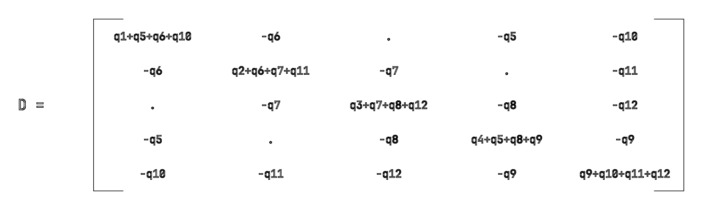

# Force density method with compas_fd

`compas_fd` implements the **force density method (FDM)** of H.-J. Schek (1974):
given the connectivity of a pin-jointed network, the positions of its fixed nodes,
the nodal loads, and one *force density* per branch, the equilibrium coordinates of
all free nodes follow from **one linear system**. A constrained, iterative variant
moves selected anchors along geometric constraints between linear solves.

- Repository: <https://github.com/BlockResearchGroup/compas_fd>
- Documentation: <https://blockresearchgroup.github.io/compas_fd>
- PyPI: `pip install compas_fd` (version `0.5.4` of 2024-11-10 was read and run for this note)
- Used by the Rhino plugin described in [compas_fofin](compas_fofin.md); the same
  force-density parametrisation drives the iterative solver in [compas_dr](compas_dr.md).

## Concept and assumptions

**Force density.** For branch $j$ with axial force $s_j$ and strained length $l_j$,

$$
q_j = \frac{s_j}{l_j}
$$

Dimension: force / length (N/m, kN/m). The same force gives a larger $q$ in a
shorter branch. Schek calls $q$ the "network description parameter": prescribing
$q$ for every branch selects exactly one equilibrium shape.

**Model assumptions (Schek 1974, section 1).**

- Branches are straight axial members (cables or bars) connected by frictionless pins.
- Loads act only at nodes.
- No material law is needed for the linear method; the branches may be elastic or
  inextensible. Material enters only through the optional *unstrained length*
  constraints of the nonlinear extension (section 3.5).
- Nodes are either **free** (unknown coordinates) or **fixed** (prescribed coordinates).
- No geometric restriction is imposed on the shape: the only requirement is
  nodal equilibrium.

**Sign conventions.**

- $q_j \gt 0$ and $s_j \gt 0$: tension. A net with all $q_j \gt 0$ and no isolated free
  node has a positive-definite equation matrix and a unique solution.
- $q_j \lt 0$: compression. `compas_fd` accepts negative values (FormFinder uses them
  for compression-only funiculars), but mixed signs can make the matrix singular
  or indefinite; check the residuals.
- Loads $p$ are external forces on nodes in global $x, y, z$; gravity is a negative $p_z$
  when $z$ points up.
- The **residual** returned by the solver is $r = p - C^{t} Q C x$. At free nodes it is
  zero at convergence. At a fixed node it equals the resultant force the connected
  branches exert on the support, so the **support reaction** is $-r$.

**Units.** The method is unit-agnostic as long as coordinates, loads, and force
densities are consistent (e.g. m, kN, kN/m). Forces returned are $q \cdot l$ in the
load unit; lengths are in the coordinate unit.

<!-- schek-app:start -->

## The application, section by section

This is one program, `examples/form_finding/schek_app.py`, read from top to
bottom. Every subsection is one section of the paper: what the paper says, the
lines that add it to the program, and what those lines print when the file is
run. The program is derived from the paper only (NumPy, nothing else); the
comparison with `compas_fd` comes after it. This section is generated from the
program by `build_note.py`, so code, output and text cannot drift apart.

### Notation (section 1.4)

The paper writes a vector as a lower-case letter and the diagonal matrix built from
it as the same capital letter: for the vector $u$ the matrix $U$ has $u$ on its
diagonal. A general matrix is a capital letter, $C^{t}$ is the transpose. In the
program a vector is a 1-D NumPy array, the diagonal matrix is `np.diag(u)`, the
transpose is `C.T`, and `@` is the matrix product.

```python
import numpy as np

np.set_printoptions(precision=3, suppress=True, linewidth=120)


def diag(vector):
    """The paper's capital-letter matrix of a vector: U = diag(u)."""
    return np.diag(vector)


def show(name, M, rows=None, cols=None, fmt="{:>7.2f}", zero="      ."):
    """Print a matrix the way the paper prints figures 2 and 4: a dot for a zero."""
    M = np.atleast_2d(M)
    print(f"{name}  shape {M.shape}")
    if cols is not None:
        print("     " + "".join(f"{c:>7}" for c in cols))
    for r, row in enumerate(M):
        label = f"{rows[r]:>4} " if rows is not None else "     "
        print(label + "".join(zero if abs(v) < 1e-12 else fmt.format(v) for v in row))
```

### Section 2.1: the branch-node matrix

Number the nodes $1 \ldots n_s$ and the branches $1 \ldots m$ in any order, but put
the nodes that will be fixed at the end: $n$ free nodes first, then $n_f$ fixed ones,
$n_s = n + n_f$. For every branch $j$ record its two end nodes $i(j)$ and $k(j)$. The
branch-node matrix $C_s$ has one row per branch and one column per node:

$$
c(j, i) =
\begin{cases}
+1 & \text{if } i = i(j) \\
-1 & \text{if } i = k(j) \\
0 & \text{otherwise}
\end{cases}
$$

Because the fixed nodes come last, the matrix splits into two column blocks,
$C_s = [C \quad C_f]$: $C$ ($m \times n$) for the free nodes and $C_f$
($m \times n_f$) for the fixed ones. The example is the network of the paper's
figure 2: nodes 1 to 5 free, 6 to 9 fixed, 12 branches.


*Fig. 2, redrawn: the graph and its branch-node matrix.*

```python
branches = [(1, 6), (2, 7), (3, 8), (4, 9),      # 1-4: one branch from each free corner to its anchor
            (1, 4), (1, 2), (2, 3), (3, 4),      # 5-8: the ring
            (4, 5), (1, 5), (2, 5), (3, 5)]      # 9-12: four spokes to the centre node 5
n, n_f = 5, 4                                    # free nodes 1..5, fixed nodes 6..9
m = len(branches)

C_s = np.zeros((m, n + n_f))
for j, (i, k) in enumerate(branches):
    C_s[j, i - 1] = +1.0                          # node i(j): +1   (Python indices start at 0)
    C_s[j, k - 1] = -1.0                          # node k(j): -1
C = C_s[:, :n]                                    # (m, n)   free columns
C_f = C_s[:, n:]                                  # (m, n_f) fixed columns

show("C_s = [C  C_f]   (figure 2)", C_s, range(1, m + 1), range(1, n + n_f + 1), fmt="{:>7.0f}")
```

Printed:

```text
C_s = [C  C_f]   (figure 2)  shape (12, 9)
           1      2      3      4      5      6      7      8      9
   1       1      .      .      .      .     -1      .      .      .
   2       .      1      .      .      .      .     -1      .      .
   3       .      .      1      .      .      .      .     -1      .
   4       .      .      .      1      .      .      .      .     -1
   5       1      .      .     -1      .      .      .      .      .
   6       1     -1      .      .      .      .      .      .      .
   7       .      1     -1      .      .      .      .      .      .
   8       .      .      1     -1      .      .      .      .      .
   9       .      .      .      1     -1      .      .      .      .
  10       1      .      .      .     -1      .      .      .      .
  11       .      1      .      .     -1      .      .      .      .
  12       .      .      1      .     -1      .      .      .      .
```

### Section 2.2: the data of the problem

The nodes are points $P_i = (x_i, y_i, z_i)$. The free coordinates form the
$n$-vectors $x, y, z$ (the unknowns); the fixed coordinates form the $n_f$-vectors
$x_f, y_f, z_f$ (given). Every free node carries a load with components
$p_x, p_y, p_z$ (given). Every branch has a length $l_j$ and a force $s_j$ (unknown).

These numbers are not in the paper: the anchors are placed on a square, two of them
lifted, and a small downward load acts on every free node.

```python
x_f = np.array([-2.0, 0.0, 2.0, 0.0])             # anchors 6, 7, 8, 9
y_f = np.array([0.0, -2.0, 0.0, 2.0])
z_f = np.array([0.0, 1.0, 0.0, 1.0])             # two anchors lifted by 1 m
p_x = np.zeros(n)
p_y = np.zeros(n)
p_z = np.full(n, -0.5)                            # 0.5 kN downward at every free node
```

### Equations (1) and (2): equilibrium with the unknown forces

Multiplying the coordinates by the branch-node matrix gives, for every branch, the
difference of the coordinates of its two end nodes (1):

$$
u = C x + C_f x_f, \qquad v = C y + C_f y_f, \qquad w = C z + C_f z_f
$$

Dividing by the length gives the direction cosines $u_j / l_j$, and multiplying by the
force gives the force components. Summing them at every free node (that is what
$C^{t}$ does) must give the load. This is the equilibrium (2):

$$
C^{t} U L^{-1} s = p_x, \qquad C^{t} V L^{-1} s = p_y, \qquad C^{t} W L^{-1} s = p_z
$$

It is **nonlinear** in the coordinates: $u, v, w$ and $l$ all depend on them and $l$
holds a square root. The function below evaluates it for any trial geometry; for a
random guess it is not satisfied.

```python
def coordinate_differences(x, y, z):
    """Eq. (1).  Returns u, v, w and the lengths l (each of shape (m,))."""
    u = C @ x + C_f @ x_f
    v = C @ y + C_f @ y_f
    w = C @ z + C_f @ z_f
    l = np.sqrt(u**2 + v**2 + w**2)
    return u, v, w, l


def equilibrium_error(x, y, z, s):
    """Eq. (2): C^t U L^-1 s - p for the three axes.  All zeros means the net is in equilibrium."""
    u, v, w, l = coordinate_differences(x, y, z)
    L_inv = diag(1.0 / l)
    return (C.T @ diag(u) @ L_inv @ s - p_x,
            C.T @ diag(v) @ L_inv @ s - p_y,
            C.T @ diag(w) @ L_inv @ s - p_z)


x_guess = np.array([-1.0, 0.0, 1.0, 0.0, 0.0])    # a flat guess for the free nodes
y_guess = np.array([0.0, -1.0, 0.0, 1.0, 0.0])
z_guess = np.zeros(n)
s_guess = np.ones(m)                              # 1 kN in every branch
ex, ey, ez = equilibrium_error(x_guess, y_guess, z_guess, s_guess)
print("out of balance at the free nodes for the flat guess, z direction:", ez)
```

Printed:

```text
out of balance at the free nodes for the flat guess, z direction: [ 0.5   -0.207  0.5   -0.207  0.5  ]
```

### Equations (4) to (8): the force density turns (2) into a linear system

Define for every branch the force density (4), the ratio of force to length:

$$
q = L^{-1} s \qquad\text{i.e.}\qquad q_j = s_j / l_j
$$

Written with $q$, the equilibrium (2) becomes (5), $C^{t} U q = p_x$ and so on.
A diagonal matrix times a vector is an element-wise product, so the factors can be
swapped (6): $U q = Q u$. Insert (1) for $u$ and the geometry appears outside the
matrix (7):

$$
C^{t} Q C x + C^{t} Q C_f x_f = p_x \qquad \text{(and the same for } y, z)
$$

With the abbreviations $D = C^{t} Q C$ and $D_f = C^{t} Q C_f$ this is (8):

$$
D x = p_x - D_f x_f, \qquad D y = p_y - D_f y_f, \qquad D z = p_z - D_f z_f
$$

$D$ is built from the topology and $q$ alone. Its diagonal entry for node $i$ is
the sum of the $q$ of the branches at $i$, its entry $(i, k)$ is $-q_j$ for the
branch joining $i$ and $k$, zero otherwise. That is the paper's figure 4.



*Fig. 4, redrawn: the structure of $D$ for the graph of fig. 2.*

The paper's figures stop here: figure 2 is $C_s$ and figure 4 is the pattern of
$D$. The numbers that give an actual shape, the anchors $x_f$, the loads $p$, the
values of $q$ and the matrix $D_f$, are not drawn. The program has all of them.

```python
q = np.array([2, 2, 2, 2, 1, 1, 1, 1, 1, 1, 1, 1], dtype=float)   # one force density per branch: the design input

Q = diag(q)
D = C.T @ Q @ C                                   # (n, n)   eq. (8)
D_f = C.T @ Q @ C_f                               # (n, n_f)

show("D = C^t Q C   (figure 4 with numbers)", D, range(1, n + 1), range(1, n + 1))
show("D_f = C^t Q C_f", D_f, range(1, n + 1), range(n + 1, n + n_f + 1))
show("right-hand sides  p - D_f x_f  (columns x, y, z)", np.c_[p_x - D_f @ x_f, p_y - D_f @ y_f, p_z - D_f @ z_f],
     range(1, n + 1), ["x", "y", "z"])
```

Printed:

```text
D = C^t Q C   (figure 4 with numbers)  shape (5, 5)
           1      2      3      4      5
   1    5.00  -1.00      .  -1.00  -1.00
   2   -1.00   5.00  -1.00      .  -1.00
   3       .  -1.00   5.00  -1.00  -1.00
   4   -1.00      .  -1.00   5.00  -1.00
   5   -1.00  -1.00  -1.00  -1.00   4.00
D_f = C^t Q C_f  shape (5, 4)
           6      7      8      9
   1   -2.00      .      .      .
   2       .  -2.00      .      .
   3       .      .  -2.00      .
   4       .      .      .  -2.00
   5       .      .      .      .
right-hand sides  p - D_f x_f  (columns x, y, z)  shape (5, 3)
           x      y      z
   1   -4.00      .  -0.50
   2       .  -4.00   1.50
   3    4.00      .  -0.50
   4       .   4.00   1.50
   5       .      .  -0.50
```

### Equations (9) and (10): solve

One linear solve per axis gives the free coordinates (9), and the lengths of the
solved geometry times the force densities give the forces (10):

$$
x = D^{-1}(p_x - D_f x_f), \quad y = D^{-1}(p_y - D_f y_f), \quad z = D^{-1}(p_z - D_f z_f),
\qquad s = L q
$$

The paper's conclusions: the system is linear; $D$ is positive definite for a
prestressed net ($q_j \gt 0$) without isolated free nodes, so the solution exists and is
unique; and every vector $q$ gives exactly one equilibrium shape, so $q$ is the right
set of design parameters. Checking (2) on the result confirms the equilibrium.

```python
x = np.linalg.solve(D, p_x - D_f @ x_f)            # eq. (9)
y = np.linalg.solve(D, p_y - D_f @ y_f)
z = np.linalg.solve(D, p_z - D_f @ z_f)
u, v, w, l = coordinate_differences(x, y, z)      # eq. (1) on the solution
s = l * q                                         # eq. (10)

show("free node coordinates (columns x, y, z)", np.c_[x, y, z], range(1, n + 1), ["x", "y", "z"])
print("lengths l:", l)
print("forces  s:", s)
print("equilibrium error (2) on the solution:", max(np.abs(e).max() for e in equilibrium_error(x, y, z, s)))
```

Printed:

```text
free node coordinates (columns x, y, z)  shape (5, 3)
           x      y      z
   1   -0.80      .   0.04
   2       .  -0.80   0.33
   3    0.80      .   0.04
   4       .   0.80   0.33
   5       .      .   0.06
lengths l: [1.201 1.374 1.201 1.374 1.167 1.167 1.167 1.167 0.844 0.8   0.844 0.8  ]
forces  s: [2.402 2.748 2.402 2.748 1.167 1.167 1.167 1.167 0.844 0.8   0.844 0.8  ]
equilibrium error (2) on the solution: 4.440892098500626e-16
```

### Figure 3: the form-finding loop as one function

Figure 3 of the paper is the workflow: build $C$, build $D$ and the right-hand
sides, solve, compute lengths and forces, look at the shape, then change the fixed
points or the load (only the right-hand side changes), the force densities ($D$ is
rebuilt), or the connectivity ($C$ is rebuilt), and solve again. The whole linear
method is this function.


*Fig. 3, redrawn: the diagram of the form finding.*

```python
def form_finding(branches, n_free, xyz_fixed, q, p):
    """Schek section 2 as one call.  xyz_fixed: (n_f, 3); p: (n_free, 3) loads; q: (m,)."""
    n_s = n_free + len(xyz_fixed)
    C_s = np.zeros((len(branches), n_s))
    for j, (i, k) in enumerate(branches):
        C_s[j, i - 1], C_s[j, k - 1] = 1.0, -1.0                      # section 2.1
    C, C_f = C_s[:, :n_free], C_s[:, n_free:]
    D, D_f = C.T @ diag(q) @ C, C.T @ diag(q) @ C_f                    # eq. (8)
    xyz = np.vstack([np.linalg.solve(D, p[:, a] - D_f @ xyz_fixed[:, a]) for a in range(3)]).T   # eq. (9)
    uvw = C @ xyz + C_f @ xyz_fixed                                    # eq. (1), three columns
    l = np.linalg.norm(uvw, axis=1)
    s = l * q                                                          # eq. (10)
    reactions = -(C_f.T @ diag(q) @ uvw)                               # eq. (5) at the fixed nodes
    return xyz, l, s, reactions


xyz_fixed = np.c_[x_f, y_f, z_f]
p = np.c_[p_x, p_y, p_z]
xyz1, l1, s1, R1 = form_finding(branches, n, xyz_fixed, q, p)
print("same solution from the function:", np.allclose(xyz1[:, 2], z))
print("reactions at the anchors (sum of z components equals the total load):", R1[:, 2], R1[:, 2].sum())

# a change of fixed points: only the right-hand side changes
xyz2, *_ = form_finding(branches, n, xyz_fixed + np.array([0, 0, 1.0]), q, p)
# a change of force densities: D is rebuilt
xyz3, *_ = form_finding(branches, n, xyz_fixed, np.where(np.arange(m) < 4, 10.0, 1.0), p)
print("centre node height: base %.3f | anchors lifted by 1 m %.3f | anchor branches q = 10: %.3f" % (xyz1[4, 2], xyz2[4, 2], xyz3[4, 2]))
```

Printed:

```text
same solution from the function: True
reactions at the anchors (sum of z components equals the total load): [ 0.089 -1.339  0.089 -1.339] -2.5000000000000004
centre node height: base 0.062 | anchors lifted by 1 m 1.063 | anchor branches q = 10: 0.313
```

### Section 4: what the force densities mean geometrically

Forget forces for a moment and ask for the node positions that make the weighted
sum of squared branch lengths smallest, with weights $P$ (40):

$$
u^{t} P u + v^{t} P v + w^{t} P w \to \min
$$

Setting the derivative with respect to $x$ to zero, with $\partial u / \partial x = C$
(38), gives $(C^{t} P C) x = -(C^{t} P C_f) x_f$ (41): exactly (8) with $Q = P$ and
no load. **Theorem 1:** an unloaded net with force densities $q$ is the net whose
sum of squared branch lengths weighted by $q$ is minimal. **Theorem 2:** choosing
$q_j = c / l_j$ makes every force $s_j = q_j l_j = c$ equal, so a *minimum way net*
(minimal sum of lengths) is a prestressed net with the same force everywhere.
The check below evaluates the gradient of (40) at the unloaded solution of (8).

```python
xyz0, l0, s0, _ = form_finding(branches, n, xyz_fixed, q, np.zeros((n, 3)))      # no load
uvw0 = C @ xyz0 + C_f @ xyz_fixed
gradient = 2 * C.T @ diag(q) @ uvw0                                              # d/dx of u^t Q u, per axis
print("Theorem 1: gradient of the weighted squared lengths at the unloaded equilibrium:", np.abs(gradient).max())
q_const = 1.0 / l0                                                               # Theorem 2
print("Theorem 2: forces with q = 1 / l:", l0 * q_const)
```

Printed:

```text
Theorem 1: gradient of the weighted squared lengths at the unloaded equilibrium: 1.3322676295501878e-15
Theorem 2: forces with q = 1 / l: [1. 1. 1. 1. 1. 1. 1. 1. 1. 1. 1. 1.]
```

### Section 3.1: additional conditions and the damped least-squares step

The linear method satisfies nothing but equilibrium. To prescribe, say, the lengths
of some branches, the paper keeps the linear solve and iterates on $q$. Write the
$r$ conditions as functions that must vanish (11); through (9) they depend on $q$
alone (12): $g^{\ast}(q) = 0$. Starting from the linear solution $q^{(0)}$,
linearise (13) to (16):

$$
G^{t} := \frac{\partial g^{\ast}}{\partial q}, \qquad r := -g^{\ast}(q^{(0)}), \qquad G^{t}\,\Delta q = r
$$

$G^{t}$ is $r \times m$; with fewer conditions than branches there are many
solutions, so the paper picks the one that minimises $\Delta q^{t} \Delta q$ (17),
or with "damped" conditions $G^{t}\Delta q = r + a$ (18, 19), or, best in practice,
the "modified damped" conditions $G^{t}\Delta q = A r$ with damping factors
$a_j$ on the diagonal of $A$ (20, 21). All three lead to a small $r \times r$ system
for the Lagrange multipliers $k$ (22 to 24) and the update (25):

$$
T = G^{t} G + P^{-1} A^{2}, \qquad k = T^{-1} A r, \qquad \Delta q = G k, \qquad q^{(0)} := q^{(0)} + \Delta q
$$

($P^{-1}$ drops out for the plain least squares, $A$ for the first damped variant.)
The number of equations is $r$, not the number of nodes.

```python
def damped_step(G_t, g, a=0.8, P_inv_scale=1e-6):
    """One modified damped least-squares step, eqs. (20) to (25).  Returns dq (shape (m,))."""
    G = G_t.T
    A = diag(np.full(len(g), a))
    T = G_t @ G + P_inv_scale * A @ A              # eq. (23), third case
    k = np.linalg.solve(T, A @ (-g))               # eqs. (15), (24)
    return G @ k                                   # eq. (25)
```

### Section 3.2: how the coordinates react to the force densities

To form $G^{t}$ one needs $\partial x / \partial q$. Inverting $D$ symbolically is
hopeless, so differentiate the equilibrium (5) implicitly: a change $dq$ with a change
$dx$ must keep $C^{t} U q = p_x$ true,

$$
C^{t} U\, dq + C^{t} Q C\, dx = 0
\qquad\Longrightarrow\qquad
\frac{\partial x}{\partial q} = -D^{-1} C^{t} U, \quad
\frac{\partial y}{\partial q} = -D^{-1} C^{t} V, \quad
\frac{\partial z}{\partial q} = -D^{-1} C^{t} W
$$

(27, 28). Then the chain rule (26) gives any condition's Jacobian:
$G^{t} = \partial g/\partial x \cdot \partial x/\partial q + \ldots + \partial g/\partial q$.

```python
def coordinate_jacobians(D, u, v, w):
    """Eq. (28): dx/dq, dy/dq, dz/dq, each (n, m)."""
    D_inv = np.linalg.inv(D)
    return -D_inv @ C.T @ diag(u), -D_inv @ C.T @ diag(v), -D_inv @ C.T @ diag(w)
```

### Sections 3.3 to 3.5: distance, force and unstrained-length conditions

Prescribed strained lengths $\bar l_v$ for a set of branches (a bar means "rows of
the constrained branches only"): $g = \bar l - \bar l_v$ (29). With
$\partial l / \partial x = C^{t} U L^{-1}$ from (3) and $\partial x / \partial q$ from
(28), the chain rule gives (31):

$$
G_d^{t} = -\bar L^{-1}\left(\bar U \bar C D^{-1} C^{t} U + \bar V \bar C D^{-1} C^{t} V + \bar W \bar C D^{-1} C^{t} W\right)
$$

Prescribed forces $\bar s_v$: $g = \bar L \bar q - \bar s_v$ (32); the direct
derivative is $\partial g / \partial q = \bar L$ (33), and (34):

$$
G_f^{t} = \bar L - \bar Q \bar L^{-1}\left(\bar U \bar C D^{-1} C^{t} U + \ldots\right)
$$

Prescribed unstrained lengths with Hooke's law $l_u = h\,l / (h + s)$ and stiffness
$h$ give (35), which tends to (31) as $h \to \infty$. Mixed conditions (3.6) stack the
rows: $G^{t} = [G_d^{t};\ G_f^{t};\ G_u^{t}]$. All three share the kernel
$C D^{-1} C^{t}$.

```python
def distance_jacobian(D, u, v, w, l, rows):
    """Eq. (31) for the branches in `rows`.  Returns g's Jacobian G_d^t of shape (r, m)."""
    D_inv = np.linalg.inv(D)
    C_bar = C[rows]
    K = (diag(u[rows]) @ C_bar @ D_inv @ C.T @ diag(u)
         + diag(v[rows]) @ C_bar @ D_inv @ C.T @ diag(v)
         + diag(w[rows]) @ C_bar @ D_inv @ C.T @ diag(w))
    return -diag(1.0 / l[rows]) @ K


def force_jacobian(D, u, v, w, l, q, rows):
    """Eq. (34): L_bar on the own columns plus q_bar times the length change."""
    G_f_t = diag(q[rows]) @ distance_jacobian(D, u, v, w, l, rows)
    for row, j in enumerate(rows):
        G_f_t[row, j] += l[j]                      # dg/dq = L_bar, eq. (33)
    return G_f_t


def unstrained_length_jacobian(D, u, v, w, l, q, h, rows):
    """Eq. (35) with Hooke's law l_u = h l / (h + s)."""
    s = l * q
    l_u = h * l / (h + s)
    K = -diag(l[rows]) @ distance_jacobian(D, u, v, w, l, rows)
    G_u_t = -diag(l_u[rows] ** 2 / l[rows] ** 3) @ K
    for row, j in enumerate(rows):
        G_u_t[row, j] += -l_u[j] ** 2 / h[j]
    return G_u_t
```

### Section 3 assembled: constrained form finding

Each iteration is one linear solve (section 2) plus one small solve (section 3):
geometry for the current $q$, evaluate the conditions, stop if they hold, else build
$G^{t}$, take a damped step, update $q$. Here the four anchor branches of the fig. 2
net are asked to be exactly 1.2 m long.

```python
def constrained_form_finding(q, length_rows=(), l_v=(), force_rows=(), s_v=(), kmax=100, tol=1e-10):
    """Schek section 3 for the fig. 2 network (uses the module-level C, C_f, anchors, loads)."""
    q = q.astype(float).copy()
    for it in range(kmax):
        D, D_f = C.T @ diag(q) @ C, C.T @ diag(q) @ C_f                             # (8)
        x = np.linalg.solve(D, p_x - D_f @ x_f); y = np.linalg.solve(D, p_y - D_f @ y_f); z = np.linalg.solve(D, p_z - D_f @ z_f)   # (9)
        u, v, w, l = coordinate_differences(x, y, z)                                # (1)
        g = np.r_[l[list(length_rows)] - np.asarray(l_v), l[list(force_rows)] * q[list(force_rows)] - np.asarray(s_v)]   # (29), (32)
        if np.abs(g).max() < tol:
            break
        blocks = []                                                                 # mixed conditions, section 3.6
        if len(length_rows):
            blocks.append(distance_jacobian(D, u, v, w, l, list(length_rows)))      # (31)
        if len(force_rows):
            blocks.append(force_jacobian(D, u, v, w, l, q, list(force_rows)))       # (34)
        G_t = np.vstack(blocks)
        q = q + damped_step(G_t, g)                                                  # (20)-(25)
    return q, l, l * q, it


q_c, l_c, s_c, iterations = constrained_form_finding(q, length_rows=[0, 1, 2, 3], l_v=[1.2] * 4)
print(f"anchor branches prescribed to 1.2 m: lengths {l_c[:4]} after {iterations} iterations; their q became {q_c[:4]}")
q_m, l_m, s_m, iterations = constrained_form_finding(q, length_rows=[8, 9, 10, 11], l_v=[0.9] * 4, force_rows=[0, 1, 2, 3], s_v=[2.0] * 4)
print(f"mixed: spokes 0.9 m and anchor forces 2 kN: lengths {l_m[8:]}, forces {s_m[:4]} after {iterations} iterations")
```

Printed:

```text
anchor branches prescribed to 1.2 m: lengths [1.2 1.2 1.2 1.2] after 14 iterations; their q became [1.893 2.352 1.893 2.352]
mixed: spokes 0.9 m and anchor forces 2 kN: lengths [0.9 0.9 0.9 0.9], forces [2. 2. 2. 2.] after 15 iterations
```

### Section 5: the paper's examples with the same program

The application is now complete; section 5 only feeds it the paper's data. The
first example is the 67-node radial net of figure 5 (nodes 62 to 66 the border
corners, 67 the apex, all six fixed): border branches $q = 100$, radial branches
to the apex $q = 0.5$, everything else $q = 1$, a small vertical load at every node.
Moving the apex (fig. 6) changes only the right-hand side; changing the radial or
border $q$ (figs. 7, 8) rebuilds $D$; prescribing lengths (fig. 9) and the 112-bar
hanging grid (fig. 10) use the constrained loop. The pictures in the note are
rendered from these runs by `schek_1974_figures.py`.


*Fig. 1, recomputed: two views of the prestressed net of this example.*


*Fig. 5, redrawn: the graph of the first example.*


*Fig. 6, recomputed: different fixed points (the apex moved in plan).*


*Fig. 7, recomputed: radial force densities 1.0, 0.7, 0.3.*


*Fig. 8, recomputed: border force densities 10, 5, 1.*


*Fig. 9, recomputed: additional distance conditions.*


*Fig. 10, recomputed: hanging and prestressed net with the same 112 bars.*

```python
from schek_1974_figures import FIG5_PX, BORDER, fig5_branches   # the traced topology of figure 5

branches5, groups = fig5_branches()
xy = np.array([FIG5_PX[k] for k in range(1, 68)], dtype=float) * np.array([0.04, -0.04])
xy -= xy[66]                                                   # apex at the plan origin
xyz_fixed5 = np.c_[xy[61:67], np.array([0, 0, 0, 0, 0, 16.0])]  # corners at z = 0, apex 16 m up
border = {tuple(sorted(b)) for b in groups["border"]}
q5 = np.array([100.0 if tuple(sorted(e)) in border else 0.5 if 67 in e else 1.0 for e in branches5])
p5 = np.zeros((61, 3)); p5[:, 2] = -0.4

shape61, l5, s5, R5 = form_finding(branches5, 61, xyz_fixed5, q5, p5)
print("figure 6.1: centre of the net at z = %.2f m; radial branch lengths %.1f to %.1f m; apex reaction %.1f kN"
      % (shape61[:, 2].mean(), l5[[67 in e for e in branches5]].min(), l5[[67 in e for e in branches5]].max(), -R5[5, 2]))
```

Printed:

```text
figure 6.1: centre of the net at z = 3.10 m; radial branch lengths 8.1 to 9.0 m; apex reaction 38.9 kN
```

<!-- schek-app:end -->

## Implementation in compas_fd 0.5.4

Compared with the application above: `fd_numpy` is the `form_finding` function of
section 2.2 with sparse matrices (figure 3's loop, one call per shape). The
constrained loop of section 3, prescribed lengths or forces by iterating on $q$, is
**not** in `compas_fd`; its `fd_constrained_numpy` instead moves anchors on geometric
constraints between linear solves. The iterative solver in [compas_dr](compas_dr.md)
reaches prescribed forces and lengths through its `fpre` / `lpre` terms.


### Linear solver

```python
from compas_fd.solvers import fd_numpy

result = fd_numpy(
    vertices=vertices,          # (n_s, 3) coordinates of ALL nodes, free and fixed
    fixed=fixed,                # indices of fixed nodes
    edges=edges,                # list of (i, k) index pairs; i -> +1, k -> -1 in C
    forcedensities=q,           # one float per edge
    loads=loads,                # (n_s, 3) nodal loads, optional (defaults to zero)
)
result.vertices    # (n_s, 3) equilibrium coordinates; fixed rows unchanged
result.residuals   # (n_s, 3) p - C^t Q C x  (zero at free nodes; -reaction at supports)
result.forces      # (m, 1)   q * l
result.lengths     # (m, 1)   strained lengths
```

Internally (`solvers/fd_numerical_data.py`, `solvers/fd_numpy.py`):

| symbol in Schek | name in code | construction |
|---|---|---|
| $C_s$ | `C` | `connectivity_matrix(edges, "csr")` |
| $C$ (free columns) | `Ci` | `C[:, free]` |
| $C_f$ | `Cf` | `C[:, fixed]` |
| $Q$ | `Q` | `diags([q.flatten()], [0])` |
| $D$ | `Ai` | `Ci.T @ Q @ Ci` |
| $D_f$ | `Af` | `Ci.T @ Q @ Cf` |
| full $C_s^{t} Q C_s$ | `A` | `C.T @ Q @ C` (used only for residuals) |
| right-hand side of (8) | `b` | `p[free] - Af @ xyz[fixed]` |
| (9) | — | `xyz[free] = spsolve(Ai, b)` |
| $l$ | `lengths` | `normrow(C @ xyz)` |
| (10) | `forces` | `q * lengths` |
| residual | `residuals` | `p - A @ xyz` |

The compas-FoFin GitBook shows the same lines verbatim as the "matrix formulation".
Node ordering is free: the code selects columns by index, so fixed nodes need not
be last as Schek advises. Vertex and edge ordering of the outputs equals the input
ordering. `Result` is a `NamedTuple`; `vertices` is a new array built from the input
list, not the input list itself.

### Constrained solver

```python
from compas.geometry import Line
from compas_fd.constraints import Constraint
from compas_fd.solvers import fd_constrained_numpy

constraints = [None] * len(vertices)
constraints[k] = Constraint(Line([0, 0, 0], [1, 0, 0]))   # vertex k may slide on this line

result = fd_constrained_numpy(
    vertices=vertices, fixed=fixed, edges=edges, forcedensities=q, loads=loads,
    constraints=constraints,   # list aligned with vertices; None = unconstrained
    kmax=100, tol_res=1e-3, tol_disp=1e-3, damping=0.1,
    selfweight=None,           # optional callable xyz -> (n_s, 1) weights, subtracted from p_z
)
```

Each iteration: solve the linear system with the constrained vertices treated as
fixed; compute residuals; for every constrained vertex set `location` and
`residual` on its constraint, call `update(damping)`, which moves the vertex by
`damping × tangent` (the residual component along the constraint) and re-projects
it onto the geometry; collect the tangential residuals. Convergence requires the
largest tangential residual below `tol_res`. Constrained vertices must therefore
be listed in `fixed`; a constraint on a free vertex is ignored by the linear solve.

Constraint geometries are registered on `Constraint(geometry)`: `Vector`,
`Frame`, `Line`, `Plane`, `Circle`, `NurbsCurve`, `NurbsSurface`
(`constraints/__init__.py`). Each subclass defines `project`, `compute_tangent`,
`compute_normal`, `update`, `compute_param`.

`compas_fd.loads.SelfweightCalculator(mesh, density, thickness_attr_name="t")`
returns a callable that multiplies each vertex's tributary area (a quarter of each
adjacent face, from the current coordinates) by thickness × density.

### Caveats found while reading the source

- In `fd_constrained_numpy`, `xyz_prev = numdata.xyz` binds the same array that
  the linear solve then overwrites in place, so the displacement test
  `_is_converged_disp` compares the array with itself and is always true; only
  the tangential-residual test actually stops the loop (0.5.4).
- With `constraints` all `None`, the constrained solver returns the linear
  result after one iteration.
- `fd_numpy` has no input validation: an edge index out of range raises inside
  `connectivity_matrix`, mismatched lengths of `forcedensities` and `edges` raise in
  `diags`/`dot`, and a free node not connected to any fixed node by a positive-$q$
  path makes `Ai` singular (`spsolve` warns and returns `nan`/`inf`).
- `requirements.txt` lists only `compas`; `numpy` and `scipy` arrive through
  `compas`. Tested here with compas 2.15.1, numpy 2.4.6, scipy 1.17.1.

## Verification

**Benchmark from the chapter README.** Four fixed nodes at $(\pm 1, \pm 1, 0)$, one
free node at the origin connected to all four, $q = 1$ N/m on every edge, load
$(0, 0, -1)$ N on the free node. Vertical equilibrium gives
$4 \cdot q \cdot (0 - z) = 1$, so $z = -0.25$ m independent of the cable lengths
(that is the whole point of equation 8).

Run with `compas_fd` 0.5.4 (`fd_numpy`):

| quantity | value |
|---|---|
| free node | $(0, 0, -0.25)$; error below $10^{-12}$ m |
| residual at free node | $(0, 0, 0)$ |
| edge length | 1.436140662 m $= \sqrt{1 + 1 + 0.0625}$ |
| edge force | 1.436140662 N $= q\ l$ |
| residual at support $(-1, -1, 0)$ | $(1, 1, -0.25)$ N, the force the cable exerts on the support |

The support residuals sum to $(0, 0, -1)$, i.e. the applied load, as they must.

**Structure of D (Schek figure 4).** Building $C_s$ for the 9-node, 12-branch graph
of figure 2 and setting $q_j = j$ gives
$D_{11} = q_1 + q_5 + q_6 + q_{10} = 22$,
$D_{33} = q_3 + q_7 + q_8 + q_{12} = 30$,
$D_{55} = q_9 + q_{10} + q_{11} + q_{12} = 42$
and off-diagonals $-q_j$ exactly as printed in the paper. (Branch 5 joins nodes 1
and 4; the scanned figure is ambiguous there, but figure 4 fixes it.)

**Theorem 1.** For random anchors and random $q \in [0.5, 3]$ on that graph, the
unloaded FDM solution and a BFGS minimiser of $\sum_j q_j l_j^{2}$ agree to
$3 \times 10^{-7}$.

**Jacobian (31) and damped iteration (20 to 25).** Implemented literally for
$r = 4$ prescribed strained lengths on the same graph: the analytic $G_d^{t}$ matches
finite differences to $4 \times 10^{-7}$, and the modified damped scheme with
$a_j = 0.8$ and $P^{-1} = 10^{-6} I$ reaches the prescribed lengths to $10^{-12}$
in 19 iterations while the free-node residual stays at machine precision. These
checks are part of `examples/form_finding/schek_equations.py`.

## References and provenance

- Schek, H.-J. (1974). *The force density method for form finding and computation
  of general networks.* Computer Methods in Applied Mechanics and Engineering 3,
  115–134. <https://doi.org/10.1016/0045-7825(74)90045-0>. Read in full from the
  publisher PDF (20 pages; OCR text checked against page images for every equation
  cited above). Received 26 June 1973; work done within SFB 64, Stuttgart, for the
  Munich Olympic roofs (references 16 and 17 of the paper).
- Block Research Group. *Force Densities Method*, compas-FoFin GitBook,
  <https://blockresearchgroup.gitbook.io/compas-fofin/theoretical-background/force-densities-method>
  (read 2026-10-15). Gives the single-node motivation, the rope analogy for $q$,
  and the NumPy/SciPy snippet reproduced above. It cites Schek (1974);
  Veenendaal & Block (2012), *An overview and comparison of structural form finding
  methods for general networks*, Int. J. Solids Struct. 49, 3741–3753,
  <https://doi.org/10.1016/j.ijsolstr.2012.08.008>; and Adriaenssens, Block,
  Veenendaal & Williams (eds., 2014), *Shell Structures for Architecture: Form
  Finding and Optimization*, Routledge.
- Source read: `BlockResearchGroup/compas_fd` at commit `7ee3c5a` (0.5.4, 2024-11-10):
  `solvers/fd_numpy.py`, `solvers/fd_constrained_numpy.py`,
  `solvers/fd_numerical_data.py`, `solvers/result.py`, `constraints/*.py`,
  `loads/selfweight.py`. MIT licence.
- Verification status: benchmark and the four numerical checks above were run on
  2026-10-15 with compas_fd 0.5.4 in a throw-away virtual environment; no adapter,
  example, or test has been added to this repository yet (see chapter README).

[Chapter README](README.md) · [compas_dr](compas_dr.md) · [compas_fofin](compas_fofin.md)
