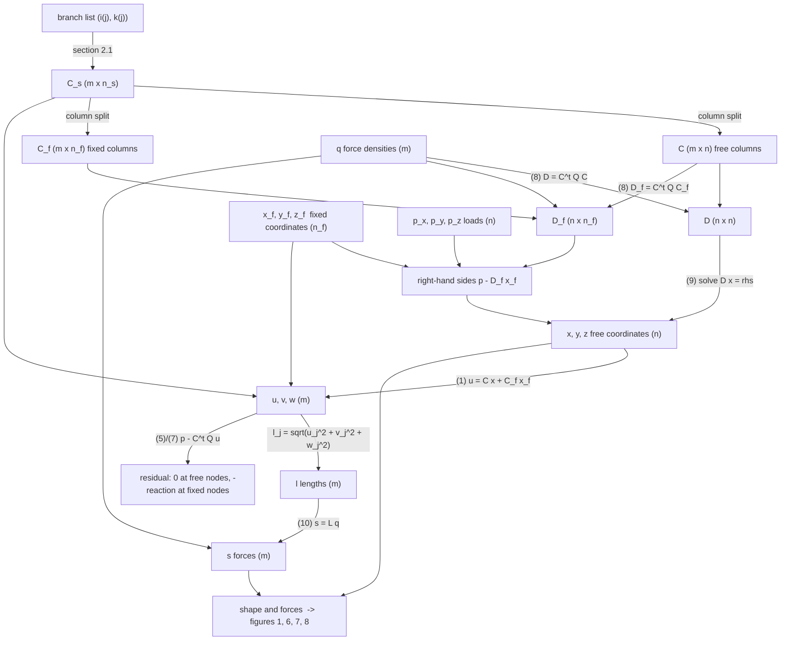
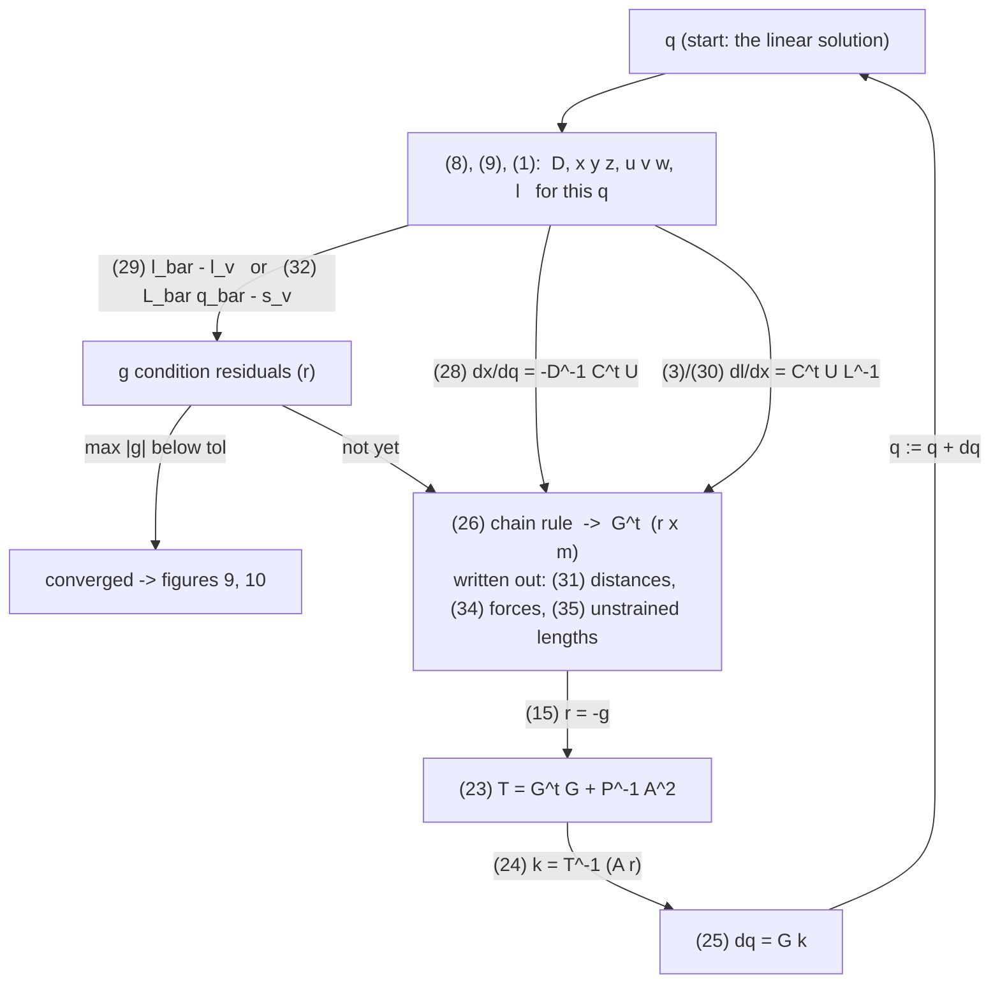

# Force density method with compas_fd

`compas_fd` implements the **force density method (FDM)** of H.-J. Schek (1974):
given the connectivity of a pin-jointed network, the positions of its fixed nodes,
the nodal loads, and one *force density* per branch, the equilibrium coordinates of
all free nodes follow from **one linear system**. A constrained, iterative variant
moves selected anchors along geometric constraints between linear solves.

- Repository: <https://github.com/BlockResearchGroup/compas_fd>
- Documentation: <https://blockresearchgroup.github.io/compas_fd>
- PyPI: `pip install compas_fd` (version `0.5.4` of 2024-11-10 was read and run for this note)
- Used by the Rhino plugin described in [compas_fofin](compas_fofin.md); the same
  force-density parametrisation drives the iterative solver in [compas_dr](compas_dr.md).

## Concept and assumptions

**Force density.** For branch $j$ with axial force $s_j$ and strained length $l_j$,

$$
q_j = \frac{s_j}{l_j}
$$

Dimension: force / length (N/m, kN/m). The same force gives a larger $q$ in a
shorter branch. Schek calls $q$ the "network description parameter": prescribing
$q$ for every branch selects exactly one equilibrium shape.

**Model assumptions (Schek 1974, section 1).**

- Branches are straight axial members (cables or bars) connected by frictionless pins.
- Loads act only at nodes.
- No material law is needed for the linear method; the branches may be elastic or
  inextensible. Material enters only through the optional *unstrained length*
  constraints of the nonlinear extension (section 3.5).
- Nodes are either **free** (unknown coordinates) or **fixed** (prescribed coordinates).
- No geometric restriction is imposed on the shape: the only requirement is
  nodal equilibrium.

**Sign conventions.**

- $q_j \gt 0$ and $s_j \gt 0$: tension. A net with all $q_j \gt 0$ and no isolated free
  node has a positive-definite equation matrix and a unique solution.
- $q_j \lt 0$: compression. `compas_fd` accepts negative values (FormFinder uses them
  for compression-only funiculars), but mixed signs can make the matrix singular
  or indefinite; check the residuals.
- Loads $p$ are external forces on nodes in global $x, y, z$; gravity is a negative $p_z$
  when $z$ points up.
- The **residual** returned by the solver is $r = p - C^{t} Q C x$. At free nodes it is
  zero at convergence. At a fixed node it equals the resultant force the connected
  branches exert on the support, so the **support reaction** is $-r$.

**Units.** The method is unit-agnostic as long as coordinates, loads, and force
densities are consistent (e.g. m, kN, kN/m). Forces returned are $q \cdot l$ in the
load unit; lengths are in the coordinate unit.

## Formulation (Schek 1974), each formula with its NumPy equivalent

Every formula below is followed by the lines of Python that compute it. They are
taken from `examples/form_finding/schek_equations.py`, which runs all of them on the
9-node network of the paper's figure 2 and checks each Jacobian against finite
differences (run the script to see the numbers). Read the formula, then the code:
the code is the formula.

**How the paper's symbols map to arrays.** A lower-case letter is a 1-D array, a
capital letter the matrix of the same name, and a capital letter that is also the
name of a vector ($U$ for $u$, $L$ for $l$, $Q$ for $q$) is the diagonal matrix
`np.diag(u)`. $C^{t}$ is `C.T`. Sizes: $m$ branches, $n$ free nodes, $n_f$ fixed
nodes.

| paper | meaning | code |
|---|---|---|
| $x, y, z$ | coordinates of the free nodes, three arrays of length $n$ | `x, y, z` |
| $x_f, y_f, z_f$ | coordinates of the fixed nodes, length $n_f$ | `x_f, y_f, z_f` |
| $C_s = [C \quad C_f]$ | branch-node matrix $(m, n_s)$ and its free / fixed column blocks | `C_s`, `C = C_s[:, :n]`, `C_f = C_s[:, n:]` |
| $u, v, w$ | coordinate differences along each branch, length $m$ | `u, v, w` |
| $l, s, q$ | branch lengths, forces, force densities, length $m$ | `l, s, q` |
| $U, V, W, L, Q$ | diagonal matrices of the vectors above | `np.diag(u)` etc. |
| $p_x, p_y, p_z$ | load components at the free nodes, length $n$ | `p_x, p_y, p_z` |
| $D, D_f$ | the $(n, n)$ and $(n, n_f)$ system matrices | `D, D_f` |

### Branch-node matrix (section 2.1)

Number the nodes $1 \ldots n_s$ with the $n_f$ fixed nodes last ($n_s = n + n_f$) and
the branches $1 \ldots m$. Branch $j$ runs from node $i(j)$ to node $k(j)$:

$$
c(j, i) =
\begin{cases}
+1 & \text{if } i = i(j) \\
-1 & \text{if } i = k(j) \\
0 & \text{otherwise}
\end{cases}
\qquad
C_s = [C \quad C_f]
$$

```python
def branch_node_matrix(branches, n_nodes):
    """c(j, i) = +1 if i = i(j), -1 if i = k(j), 0 otherwise.   Shape (m, n_s)."""
    C_s = np.zeros((len(branches), n_nodes))
    for j, (i, k) in enumerate(branches):          # branch j goes from node i to node k
        C_s[j, i - 1] = +1.0
        C_s[j, k - 1] = -1.0
    return C_s

def split_free_fixed(C_s, n_free):
    """C_s = [C  C_f]: the first n columns belong to free nodes, the rest to fixed ones."""
    C = C_s[:, :n_free]            # (m, n)
    C_f = C_s[:, n_free:]          # (m, n_f)
    return C, C_f
```

### Equation (1): coordinate differences along the branches

$$
u = C x + C_f x_f, \qquad v = C y + C_f y_f, \qquad w = C z + C_f z_f
$$

Row $j$ of $C$ has a $+1$ at the start node and a $-1$ at the end node of branch $j$,
so $u_j$ is simply $x_{\text{start}} - x_{\text{end}}$. The fixed nodes contribute
through $C_f$.

```python
def eq1_coordinate_differences(C, C_f, x, y, z, x_f, y_f, z_f):
    """u = C x + C_f x_f,  v = C y + C_f y_f,  w = C z + C_f z_f.   Each of shape (m,)."""
    u = C @ x + C_f @ x_f
    v = C @ y + C_f @ y_f
    w = C @ z + C_f @ z_f
    return u, v, w

def branch_lengths(u, v, w):
    """l_j = sqrt(u_j^2 + v_j^2 + w_j^2)."""
    return np.sqrt(u**2 + v**2 + w**2)
```

### Equation (2): equilibrium written with the branch forces

$$
C^{t} U L^{-1} s = p_x, \qquad C^{t} V L^{-1} s = p_y, \qquad C^{t} W L^{-1} s = p_z
$$

$U L^{-1} s$ is the array of $x$-components of the branch forces, $(u_j / l_j)\, s_j$,
because $u_j / l_j$ is the direction cosine of branch $j$. $C^{t}$ sums these
components at every free node with the right signs. "Equals the load" means the
node is in equilibrium.

```python
def eq2_equilibrium(C, u, v, w, l, s, p_x, p_y, p_z):
    """C^t U L^-1 s = p_x  (and y, z).  Returns the three out-of-balance vectors (zero at equilibrium)."""
    U, V, W, L = np.diag(u), np.diag(v), np.diag(w), np.diag(l)
    L_inv = np.linalg.inv(L)                          # 1 / l_j on the diagonal
    out_x = C.T @ U @ L_inv @ s - p_x
    out_y = C.T @ V @ L_inv @ s - p_y
    out_z = C.T @ W @ L_inv @ s - p_z
    return out_x, out_y, out_z
```

This system is **nonlinear** in the coordinates: $u, v, w$ and $l$ all depend on
$x, y, z$, and $l$ contains a square root. The GitBook says the same for a single
node with four cables, $\sum_j F_j (x_j - x_0) / L_j = R_x$.

### Equation (3): the same matrices are Jacobians of the lengths

$$
\frac{\partial l}{\partial x} = C^{t} U L^{-1}, \qquad
\frac{\partial l}{\partial y} = C^{t} V L^{-1}, \qquad
\frac{\partial l}{\partial z} = C^{t} W L^{-1}
$$

(The paper's $(n, m)$ layout; its transpose has one row per branch, $\partial l_j / \partial x$.)

```python
def eq3_length_jacobians(C, u, v, w, l):
    """dl/dx = C^t U L^-1  (and y, z), as written in the paper."""
    L_inv = np.diag(1.0 / l)
    return C.T @ np.diag(u) @ L_inv, C.T @ np.diag(v) @ L_inv, C.T @ np.diag(w) @ L_inv
```

The script checks this against finite differences (agreement to $6 \times 10^{-7}$).

### Equation (4): the force densities

$$
q = L^{-1} s \qquad\text{i.e.}\qquad q_j = \frac{s_j}{l_j}
$$

```python
def eq4_force_densities(l, s):
    """q = L^-1 s,  i.e. q_j = s_j / l_j."""
    return s / l
```

### Equation (5): equilibrium written with the force densities

$$
C^{t} U q = p_x, \qquad C^{t} V q = p_y, \qquad C^{t} W q = p_z
$$

Nothing changed yet: $L^{-1} s$ was replaced by its name $q$.

```python
def eq5_equilibrium_q(C, u, v, w, q, p_x, p_y, p_z):
    """C^t U q = p_x,  C^t V q = p_y,  C^t W q = p_z.   Same as (2) with L^-1 s replaced by q."""
    U, V, W = np.diag(u), np.diag(v), np.diag(w)
    return C.T @ U @ q - p_x, C.T @ V @ q - p_y, C.T @ W @ q - p_z
```

### Equation (6): a diagonal matrix times a vector can be swapped

$$
U q = Q u, \qquad V q = Q v, \qquad W q = Q w
$$

Both sides are the element-wise product $u_j q_j$. This is the whole trick: it moves
the unknown geometry $u$ out of the matrix and into the vector.

```python
def eq6_identity(u, q):
    """U q = Q u : both are the element-wise product u * q."""
    U, Q = np.diag(u), np.diag(q)
    return U @ q, Q @ u
```

### Equation (7): equilibrium in the coordinates, linear

Substitute (6) and then (1) into (5):

$$
C^{t} Q C x + C^{t} Q C_f x_f = p_x, \qquad
C^{t} Q C y + C^{t} Q C_f y_f = p_y, \qquad
C^{t} Q C z + C^{t} Q C_f z_f = p_z
$$

```python
def eq7_equilibrium_xyz(C, C_f, q, x, y, z, x_f, y_f, z_f, p_x, p_y, p_z):
    """C^t Q C x + C^t Q C_f x_f = p_x  (and y, z).   Linear in x, y, z because q is fixed."""
    Q = np.diag(q)
    out_x = C.T @ Q @ C @ x + C.T @ Q @ C_f @ x_f - p_x
    out_y = C.T @ Q @ C @ y + C.T @ Q @ C_f @ y_f - p_y
    out_z = C.T @ Q @ C @ z + C.T @ Q @ C_f @ z_f - p_z
    return out_x, out_y, out_z
```

For the solved geometry, (2), (5) and (7) all return zeros: they are the same
statement written three ways.

### Equation (8): the linear system

$$
D = C^{t} Q C, \qquad D_f = C^{t} Q C_f, \qquad
D x = p_x - D_f x_f, \quad D y = p_y - D_f y_f, \quad D z = p_z - D_f z_f
$$

```python
def eq8_system(C, C_f, q):
    """D = C^t Q C  (n x n),   D_f = C^t Q C_f  (n x n_f).   Then  D x = p_x - D_f x_f  etc."""
    Q = np.diag(q)
    D = C.T @ Q @ C
    D_f = C.T @ Q @ C_f
    return D, D_f
```

Schek's conclusions, in code terms:

1. `D` depends only on the connectivity and on `q`, not on the geometry, so the
   three systems are linear. Its diagonal entry for node $i$ is the sum of the `q`
   of the branches at $i$; the off-diagonal entry $(i, k)$ is `-q[j]` for the branch
   joining $i$ and $k$ (figure 4 below). `D` is positive definite when all `q > 0`
   and every free node is connected to a fixed one.
2. For a given load and fixed points, every `q` gives exactly one solution.
3. The set of shapes you can reach equals the set of vectors `q`.

### Equations (9) and (10): solution and forces

$$
x = D^{-1}(p_x - D_f x_f), \qquad
y = D^{-1}(p_y - D_f y_f), \qquad
z = D^{-1}(p_z - D_f z_f), \qquad
s = L q
$$

```python
def eq9_solve(D, D_f, x_f, y_f, z_f, p_x, p_y, p_z):
    """x = D^-1 (p_x - D_f x_f),  y = D^-1 (p_y - D_f y_f),  z = D^-1 (p_z - D_f z_f)."""
    x = np.linalg.solve(D, p_x - D_f @ x_f)        # solve() instead of inv() @: same result, better numerics
    y = np.linalg.solve(D, p_y - D_f @ y_f)
    z = np.linalg.solve(D, p_z - D_f @ z_f)
    return x, y, z

def eq10_forces(l, q):
    """s = L q,  i.e. s_j = l_j * q_j  with the lengths of the solved geometry."""
    return l * q
```

`compas_fd.fd_numpy` is exactly these two functions with sparse matrices and the
three right-hand sides stacked as columns (`spsolve(Ai, b)` with `b` of shape
$(n, 3)$). Figure 3 of the paper is the loop around them: change anchors or loads
(new right-hand side), change `q` (new `D`), change connectivity (new `C`).

### Section 4: the geometric meaning, equations (36) to (41)

Forget forces and ask for the node positions that minimise the sum of squared
branch lengths, weighted by $P$:

$$
l^{t} P l = u^{t} P u + v^{t} P v + w^{t} P w \to \min
$$

Setting the derivatives with respect to $x, y, z$ to zero, with
$\partial u / \partial x = C$ (38), gives (41):

$$
(C^{t} P C)\, x = -(C^{t} P C_f)\, x_f \qquad \text{(and the same for } y, z)
$$

which is (7) with $Q = P$ and zero load. Hence:

- **Theorem 1.** Every equilibrium state of an *unloaded* net with force densities
  $q_j$ is the net whose weighted sum of squared branch lengths (weights $q_j$) is
  minimal.
- **Theorem 2.** Choosing $q_j = c / l_j$ makes every force $s_j = q_j l_j = c$
  equal: a *minimum way net* (minimal sum of lengths) is a prestressed net with the
  same force in every branch.

```python
def theorem1_weighted_least_squares(C, C_f, q, x_f, y_f, z_f):
    """Minimise  u^t Q u + v^t Q v + w^t Q w  over the free coordinates: the minimiser is the unloaded equilibrium."""
    n = C.shape[1]
    def weighted_sum_of_squared_lengths(free_xyz):
        x, y, z = free_xyz.reshape(3, n)
        u, v, w = eq1_coordinate_differences(C, C_f, x, y, z, x_f, y_f, z_f)
        return u @ np.diag(q) @ u + v @ np.diag(q) @ v + w @ np.diag(q) @ w
    result = minimize(weighted_sum_of_squared_lengths, np.zeros(3 * n), method="BFGS", options={"gtol": 1e-12})
    return result.x.reshape(3, n)

def theorem2_minimum_way_net(l, const=1.0):
    """q_j = const / l_j  makes every branch force s_j = q_j l_j = const."""
    q = const / l
    return q, eq10_forces(l, q)
```

The script finds the minimiser and the unloaded solution of (9) equal to
$7 \times 10^{-8}$.

### Section 3: additional conditions, equations (11) to (25)

The linear method satisfies nothing but equilibrium. To ask for more (prescribed
lengths, prescribed forces), Schek keeps the linear solve and iterates on $q$.

**(11), (12). The conditions.** $r$ functions of the coordinates and the force
densities must vanish; since (9) gives the coordinates from $q$, they are functions
of $q$ alone:

$$
g(x, y, z, q) = 0 \qquad\Longrightarrow\qquad g^{\ast}(q) = g(x(q), y(q), z(q), q) = 0
$$

```python
def eq12_constraint_function(q, C, C_f, x_f, y_f, z_f, p_x, p_y, p_z, condition):
    """g*(q) = g(x(q), y(q), z(q), q):  solve (9) for this q, then evaluate the user's condition g."""
    D, D_f = eq8_system(C, C_f, q)
    x, y, z = eq9_solve(D, D_f, x_f, y_f, z_f, p_x, p_y, p_z)
    return condition(x, y, z, q)
```

**(13) to (16). Linearise around the current $q^{(0)}$.**

$$
g^{\ast}(q^{(0)}) + \frac{\partial g^{\ast}}{\partial q}\, \Delta q = 0,
\qquad
G^{t} := \frac{\partial g^{\ast}}{\partial q}, \qquad r := -g^{\ast}(q^{(0)}),
\qquad
G^{t} \Delta q = r
$$

$G^{t}$ is $(r, m)$: one row per condition, one column per branch. With fewer
conditions than branches the system is underdetermined, so a rule is needed to pick
one $\Delta q$.

```python
def eq13_to_16_linearise(g_star_q0, G_t):
    """g*(q0) + G^t dq = 0  with  G^t = d g* / d q  (14) and  r = -g*(q0)  (15):  the linear system  G^t dq = r  (16)."""
    r = -g_star_q0
    return G_t, r
```

**(17) to (25). Three rules for picking $\Delta q$.** Each is "minimise something
subject to the linear conditions"; the Lagrange multipliers $k$ come from a small
$(r, r)$ system $T k = r$ (22), and $\Delta q = G k$ (25):

| rule | conditions | minimised | $T$ (23) |
|---|---|---|---|
| least squares (16, 17) | $G^{t} \Delta q = r$ | $\Delta q^{t} \Delta q$ | $G^{t} G$ |
| damped (18, 19) | $G^{t} \Delta q = r + a$ | $\Delta q^{t} \Delta q + a^{t} P a$ | $G^{t} G + P^{-1}$ |
| modified damped (20, 21) | $G^{t} \Delta q = A r$ | $\Delta q^{t} \Delta q + (e - a)^{t} P (e - a)$ | $G^{t} G + P^{-1} A^{2}$ |

$A$ is the diagonal matrix of damping factors $a_j$ (between 0 and 1), $e$ a vector
of ones, $P$ a diagonal weight matrix.

```python
def eq17_least_squares_step(G_t, r):
    """Minimise dq^t dq subject to G^t dq = r:   T = G^t G,  k = T^-1 r,  dq = G k."""
    G = G_t.T
    T = G_t @ G
    k = np.linalg.solve(T, r)
    return G @ k

def eq18_19_damped_step(G_t, r, P):
    """Conditions G^t dq = r + a, minimise dq^t dq + a^t P a:   T = G^t G + P^-1."""
    G = G_t.T
    T = G_t @ G + np.linalg.inv(P)
    k = np.linalg.solve(T, r)
    return G @ k

def eq20_21_modified_damped_step(G_t, r, P, a):
    """Conditions G^t dq = A r, minimise dq^t dq + (e - a)^t P (e - a):   T = G^t G + P^-1 A^2,  k = T^-1 (A r)."""
    G = G_t.T
    A = np.diag(a)
    T = G_t @ G + np.linalg.inv(P) @ A @ A
    k = np.linalg.solve(T, A @ r)
    return G @ k

def eq25_update(q0, dq):
    """q0 := q0 + dq, then start again with (13) until g*(q0) is zero within tolerance."""
    return q0 + dq
```

The number of nonlinear equations is $r$, the number of conditions, not the number
of nodes. Schek recommends the modified damped rule: no oscillation, and when the
conditions cannot be met it stops at the closest feasible shape. On the figure 2
network with the four anchor branches prescribed to 1.2 m it converges in 17 steps.

### Equations (26) to (28): how the coordinates react to the force densities

To build $G^{t}$ one needs $\partial x / \partial q$. Inverting $D$ symbolically is
hopeless, so differentiate the equilibrium (5) implicitly: if $q$ and $x$ change
together, equilibrium must still hold,

$$
d(C^{t} U q) = C^{t} U\, dq + C^{t} Q C\, dx = 0
\qquad\Longrightarrow\qquad
\frac{\partial x}{\partial q} = -D^{-1} C^{t} U, \quad
\frac{\partial y}{\partial q} = -D^{-1} C^{t} V, \quad
\frac{\partial z}{\partial q} = -D^{-1} C^{t} W
$$

and the chain rule (26) assembles any condition's Jacobian:

$$
G^{t} =
\frac{\partial g}{\partial x}\frac{\partial x}{\partial q} +
\frac{\partial g}{\partial y}\frac{\partial y}{\partial q} +
\frac{\partial g}{\partial z}\frac{\partial z}{\partial q} +
\frac{\partial g}{\partial q}
$$

```python
def eq27_28_coordinate_jacobians(D, C, u, v, w):
    """dx/dq = -D^-1 C^t U,   dy/dq = -D^-1 C^t V,   dz/dq = -D^-1 C^t W.   Each of shape (n, m)."""
    D_inv = np.linalg.inv(D)
    return -D_inv @ C.T @ np.diag(u), -D_inv @ C.T @ np.diag(v), -D_inv @ C.T @ np.diag(w)

def eq26_chain_rule(dg_dx, dg_dy, dg_dz, dg_dq, dx_dq, dy_dq, dz_dq):
    """G^t = dg/dx dx/dq + dg/dy dy/dq + dg/dz dz/dq + dg/dq.   Shape (r, m)."""
    return dg_dx @ dx_dq + dg_dy @ dy_dq + dg_dz @ dz_dq + dg_dq
```

Finite-difference check of (28): $8 \times 10^{-8}$.

### Equations (29) to (31): prescribed distances (strained lengths)

A bar over a symbol means "the rows of the $r$ constrained branches only":
$\bar C$ is `C[constrained]`, $\bar U$ is `np.diag(u[constrained])`.

$$
g = \bar l - \bar l_v = 0, \qquad
G_d^{t} = -\bar L^{-1}\left(\bar U \bar C D^{-1} C^{t} U + \bar V \bar C D^{-1} C^{t} V + \bar W \bar C D^{-1} C^{t} W\right)
$$

```python
def eq29_distance_conditions(l, constrained, l_v):
    """g = l_bar - l_bar_v = 0 : the constrained branches must have lengths l_v."""
    return l[constrained] - l_v

def eq30_31_distance_jacobian(D, C, u, v, w, l, constrained):
    """G_d^t = -L_bar^-1 (U_bar C_bar D^-1 C^t U + V_bar C_bar D^-1 C^t V + W_bar C_bar D^-1 C^t W).   Shape (r, m)."""
    D_inv = np.linalg.inv(D)
    C_bar = C[constrained]
    L_bar_inv = np.diag(1.0 / l[constrained])
    K = (np.diag(u[constrained]) @ C_bar @ D_inv @ C.T @ np.diag(u)
         + np.diag(v[constrained]) @ C_bar @ D_inv @ C.T @ np.diag(v)
         + np.diag(w[constrained]) @ C_bar @ D_inv @ C.T @ np.diag(w))
    return -L_bar_inv @ K
```

This is (26) with $\partial g / \partial x = \bar C^{t} \bar U \bar L^{-1}$ from (3),
$\partial x / \partial q$ from (28), and $\partial g / \partial q = 0$. Check:
$9 \times 10^{-8}$.

### Equations (32) to (34): prescribed forces

$$
g = \bar L \bar q - \bar s_v = \bar Q \bar l - \bar s_v = 0, \qquad
\frac{\partial g}{\partial q} = \bar L, \qquad
G_f^{t} = \bar L - \bar Q \bar L^{-1}\left(\bar U \bar C D^{-1} C^{t} U + \bar V \bar C D^{-1} C^{t} V + \bar W \bar C D^{-1} C^{t} W\right)
$$

The first term is the direct effect of $q_j$ on $s_j = l_j q_j$; the second is the
change of the length, i.e. $\bar Q$ times the distance Jacobian (31).

```python
def eq32_force_conditions(l, q, constrained, s_v):
    """g = L_bar q_bar - s_bar_v = 0 : the constrained branches must carry forces s_v."""
    return l[constrained] * q[constrained] - s_v

def eq33_34_force_jacobian(D, C, u, v, w, l, q, constrained):
    """G_f^t = L_bar - Q_bar L_bar^-1 (U_bar C_bar D^-1 C^t U + ...).   Shape (r, m)."""
    G_d_t = eq30_31_distance_jacobian(D, C, u, v, w, l, constrained)       # = -L_bar^-1 K
    L_bar = np.zeros((len(constrained), C.shape[0]))                     # L_bar as an (r, m) selector of l_j
    for row, j in enumerate(constrained):
        L_bar[row, j] = l[j]
    return L_bar + np.diag(q[constrained]) @ G_d_t                       # L_bar - Q_bar L_bar^-1 K
```

Check: $2 \times 10^{-7}$.

### Equation (35): prescribed unstrained lengths

For bars with axial stiffness $h_j$ and linear Hooke's law the unstrained length is
$l_{u,j} = h_j l_j / (h_j + s_j)$; prescribing it gives

$$
G_u^{t} = -\bar L_u^{2} \bar H^{-1} - \bar L_u^{2} \bar L^{-3}\left(\bar U \bar C D^{-1} C^{t} U + \bar V \bar C D^{-1} C^{t} V + \bar W \bar C D^{-1} C^{t} W\right)
$$

which tends to $G_d^{t}$ as $h \to \infty$ (an inextensible bar is a distance condition).

```python
def unstrained_length(l, s, h):
    """Hooke's law as the paper writes it: l_u = h l / (h + s), with h the axial stiffness E A."""
    return h * l / (h + s)

def eq35_unstrained_length_jacobian(D, C, u, v, w, l, q, h, constrained):
    """G_u^t = -L_u_bar^2 H_bar^-1 - L_u_bar^2 L_bar^-3 (U_bar C_bar D^-1 C^t U + ...).   Shape (r, m)."""
    s = l * q
    l_u = unstrained_length(l, s, h)
    G_d_t = eq30_31_distance_jacobian(D, C, u, v, w, l, constrained)       # = -L_bar^-1 K
    K = -np.diag(l[constrained]) @ G_d_t
    L_u_bar2 = np.diag(l_u[constrained] ** 2)
    first = np.zeros((len(constrained), C.shape[0]))                     # -L_u_bar^2 H_bar^-1 on the own column
    for row, j in enumerate(constrained):
        first[row, j] = -l_u[j] ** 2 / h[j]
    return first - L_u_bar2 @ np.diag(1.0 / l[constrained] ** 3) @ K
```

Check: $10^{-7}$ against finite differences, and $G_u^{t} \to G_d^{t}$ to
$8 \times 10^{-10}$ for $h = 10^{9}$.

**Mixed conditions (section 3.6).** Stack the class matrices row-wise,
$G = [G_d \mid G_f \mid G_u \mid \ldots]$ (`np.vstack([G_d_t, G_f_t, ...])` for
$G^{t}$). All three share the kernel $C D^{-1} C^{t}$ scaled by the diagonal
coordinate-difference matrices, so they are cheap to build together.

**What `compas_fd` implements of this.** Only the linear method (section 2) and a
*geometric* constraint loop that is not Schek's section 3: anchors are projected onto
lines, planes, circles, curves, or surfaces and moved by a damped fraction of the
tangential residual between linear solves. Prescribed branch lengths or forces
(Schek sections 3.3 to 3.5) are **not** available in `compas_fd` 0.5.4. The iterative
solver in [compas_dr](compas_dr.md) reaches prescribed forces/lengths through its
`fpre`/`lpre` terms instead.

### How the equations chain into a solver

The two flowcharts show the data flow: boxes are arrays, labelled arrows are the
equations that produce them. The first chain is `linear_solver` /
`compas_fd.fd_numpy` and makes figures 1 and 6 to 8; the second wraps it in a loop
and makes figures 9 and 10.





Which input changes make which figure:

| figure | what changes | equations that re-run |
|---|---|---|
| 6.1, 1 | nothing: anchors of fig. 5, border $q = 100$, radial $q = 0.5$, others 1, small load | the whole linear chain once |
| 6.2, 6.3 | apex coordinates $x_f, y_f$ | only the right-hand side and (9), (1), (10); $D$ is unchanged |
| 7.1 to 7.3 | radial $q$ to 1.0, 0.7, 0.3 | (8) onwards: $D$ and $D_f$ are rebuilt |
| 8.1 to 8.3 | border $q$ to 10, 5, 1 | (8) onwards |
| 9.1 to 9.3 | length conditions (29) on all branches not touching the border | the constrained loop; 9.1 is stopped because its conditions cannot be met |
| 10.1 | 112 bars of 1 m (29), loads = bar weights, anchors pulled in | the constrained loop with $r = m = 112$ |
| 10.2 | two anchors raised, inner $q = 1$, border $q = 10$, no load | the linear chain once |
| 10.3 | (29) on the inner branches and (32) on the branches touching the border, mixed $G = [G_d \mid G_f]$ | the constrained loop |

Only four of the numbered equations are executed by the linear solver; the others
are the derivation that earns them. In execution order:

| step | equation | input | output | in `compas_fd.fd_numpy` |
|---|---|---|---|---|
| 1 | section 2.1 | branch list | $C_s$, split into $C$, $C_f$ | `connectivity_matrix`, `C[:, free]`, `C[:, fixed]` |
| 2 | (8) | $C$, $C_f$, $q$ | $D$, $D_f$ | `Ai = Ci.T @ Q @ Ci`, `Af = Ci.T @ Q @ Cf` |
| 3 | (9) | $D$, $D_f$, $x_f$, $p$ | $x, y, z$ | `xyz[free] = spsolve(Ai, p[free] - Af @ xyz[fixed])` |
| 4 | (1) | $C_s$, all coordinates | $u, v, w$, then $l$ | `lengths = normrow(C @ xyz)` |
| 5 | (10) | $l$, $q$ | $s$ | `forces = q * lengths` |
| check | (5) or (7) | everything | residual $p - C^{t} Q u$ | `residuals = p - A @ xyz` |

Equations (2) to (7) never run: (2) states equilibrium with forces, (4) names
$q$, (5), (6) and (7) are the three rewriting steps that turn (2) into the linear
system (8). Equation (3) is a by-product that is reused later in (30).

```python
def linear_solver(branches, n_free, xyz_fixed, q, p):
    """Schek section 2 = compas_fd.fd_numpy.   Executes (8) -> (9) -> (1) -> (10); nothing else."""
    C_s = branch_node_matrix(branches, n_free + len(xyz_fixed))     # section 2.1
    C, C_f = split_free_fixed(C_s, n_free)
    x_f, y_f, z_f = xyz_fixed.T
    D, D_f = eq8_system(C, C_f, q)                                   # (8)   D and D_f from q and topology only
    x, y, z = eq9_solve(D, D_f, x_f, y_f, z_f, *p.T)                 # (9)   one linear solve per axis
    u, v, w = eq1_coordinate_differences(C, C_f, x, y, z, x_f, y_f, z_f)   # (1)   geometry of the result
    l = branch_lengths(u, v, w)
    s = eq10_forces(l, q)                                            # (10)  forces from lengths and q
    return np.vstack([x, y, z]).T, l, s
```

The constrained solver of section 3 wraps the linear solver in a loop. Each pass is
one linear solve plus one small $(r, r)$ solve:

| step | equation | what it does |
|---|---|---|
| a | (8), (9), (1) | geometry for the current $q$ (the linear solver, without (10)) |
| b | (29) or (32) or Hooke | evaluate the conditions $g$ on that geometry; stop if small |
| c | (28) | $\partial x / \partial q$ from the $D^{-1}$ of step a |
| d | (30) or (33) | $\partial g / \partial x$ and $\partial g / \partial q$ for this kind of condition |
| e | (26) | chain rule; written out this is (31), (34) or (35): $G^{t}$ |
| f | (15), (23), (24), (25) | $r = -g$, $T$, $k$, $\Delta q$; then $q := q + \Delta q$ and back to a |

```python
def constrained_solver(branches, n_free, xyz_fixed, q0, p, constrained, l_v, a=0.8, P_scale=1e6, kmax=100, tol=1e-10):
    """Schek section 3 for prescribed lengths l_v on the branches `constrained`."""
    C_s = branch_node_matrix(branches, n_free + len(xyz_fixed))
    C, C_f = split_free_fixed(C_s, n_free)
    x_f, y_f, z_f = xyz_fixed.T
    q = q0.copy()
    P = np.eye(len(constrained)) * P_scale
    for it in range(kmax):
        D, D_f = eq8_system(C, C_f, q)                               # (8)
        x, y, z = eq9_solve(D, D_f, x_f, y_f, z_f, *p.T)             # (9)   geometry for the current q
        u, v, w = eq1_coordinate_differences(C, C_f, x, y, z, x_f, y_f, z_f)   # (1)
        l = branch_lengths(u, v, w)
        g = eq29_distance_conditions(l, constrained, l_v)            # (29)  how far from the prescribed lengths
        if np.abs(g).max() < tol:
            break
        G_t = eq30_31_distance_jacobian(D, C, u, v, w, l, constrained)   # (31)  = (26) with (28) and (30)
        G_t, r = eq13_to_16_linearise(g, G_t)                        # (15)  r = -g
        dq = eq20_21_modified_damped_step(G_t, r, P, np.full(len(constrained), a))   # (23), (24), (25)
        q = eq25_update(q, dq)                                       # q := q + dq, repeat
    xyz, l, s = linear_solver(branches, n_free, xyz_fixed, q, p)     # final geometry for the converged q
    return xyz, l, s, q, it
```

Both functions are in `schek_equations.py` and reproduce the numbers of the
checks above. Where the packages stand in this chain: `compas_fd.fd_numpy` is
`linear_solver`; `compas_fd.fd_constrained_numpy` repeats step a while moving
anchors on geometric constraints, which is a different loop from Schek's
section 3; `compas_dr` keeps (1) and the residual of (5), $p - C^{t} Q u$, and
drives it to zero by pseudo-dynamics instead of solving (9), recomputing $q$
from its `qpre`, `fpre`, `lpre` and stiffness terms every step.

### Schek's worked example (section 5)

Radial net with 67 nodes, nodes 62 to 67 fixed, a small vertical load at every node:

| branches | $q$ | effect |
|---|---|---|
| border (main cables) | 100 | borders nearly straight |
| radial branches to the apex (node 67) | 0.5 | radial branches lengthen relative to the rest |
| all others | 1 | reference value |

Changing the apex position only changes the right-hand side (one matrix
multiplication per variant, figure 6). Raising the apex $q$ to 1.0 / 0.7 / 0.3
(figure 7) or lowering the border $q$ to 10 / 5 / 1 (figure 8) shortens or lengthens
those branch families; with $q = 1$ everywhere the net is also the minimal
squared-length net (Theorem 1). Prescribing 6 m for all radial branches needed
5 damped iterations (figure 9). A hanging grid-shell model of 112 identical bars was
reproduced from anchor coordinates, bar length, and bar weight alone, then turned
into a prestressed net by moving the anchors (figure 10).

## Step by step in NumPy, with the paper's figures

Everything below is produced by two scripts in `examples/form_finding/`:
`schek_1974_walkthrough.py` prints the matrices (NumPy and SciPy only), and
`schek_1974_figures.py` rebuilds the paper's figures as `session_viewer` scenes
(see `examples/form_finding/README.md` for the render pipeline). Figures 2 to 5
are exact redraws of the paper's drawings; figures 1 and 6 to 10 are recomputed
with the method itself. The paper does not print the anchor coordinates or the
load of its example, so those are chosen to match the printed proportions.


*Fig. 1 of the paper, recomputed: two views of the prestressed net of the example
(section 5), rendered with session_viewer.*

### Step 1. Graph and branch-node matrix (fig. 2)


*Fig. 2, redrawn: 5 free nodes (1 to 5), 4 fixed nodes (6 to 9), 12 branches with
their numbers in circles; branch-node matrix $C_s = [C \quad  C_f]$.*

Branch $j$ is an ordered pair $(i(j), k(j))$; node $i(j)$ gets $+1$ and node $k(j)$
gets $-1$ in row $j$:

```python
import numpy as np

BRANCHES = [(1, 6), (2, 7), (3, 8), (4, 9),          # anchor branches 1-4
            (1, 4), (1, 2), (2, 3), (3, 4),          # ring 5-8
            (4, 5), (1, 5), (2, 5), (3, 5)]          # spokes to the centre 9-12
N_FREE, N_FIXED = 5, 4

def branch_node_matrix(branches, n_nodes):
    C = np.zeros((len(branches), n_nodes))
    for j, (i, k) in enumerate(branches):
        C[j, i - 1] = +1.0
        C[j, k - 1] = -1.0
    return C

C_s = branch_node_matrix(BRANCHES, N_FREE + N_FIXED)
free, fixed = list(range(N_FREE)), list(range(N_FREE, N_FREE + N_FIXED))
C, C_f = C_s[:, free], C_s[:, fixed]        # column split: free | fixed
```

The printed matrix is the one in the paper's figure 2 (a dot is a zero):

```text
C_s = [C  C_f]   (figure 2 of the paper)  shape (12, 9)
           1     2     3     4     5     6     7     8     9
   1       1     .     .     .     .    -1     .     .     .
   2       .     1     .     .     .     .    -1     .     .
   3       .     .     1     .     .     .     .    -1     .
   4       .     .     .     1     .     .     .     .    -1
   5       1     .     .    -1     .     .     .     .     .
   6       1    -1     .     .     .     .     .     .     .
   7       .     1    -1     .     .     .     .     .     .
   8       .     .     1    -1     .     .     .     .     .
   9       .     .     .     1    -1     .     .     .     .
  10       1     .     .     .    -1     .     .     .     .
  11       .     1     .     .    -1     .     .     .     .
  12       .     .     1     .    -1     .     .     .     .
```

`compas.matrices.connectivity_matrix(edges, "csr")` builds the same matrix as a
sparse CSR matrix with 0-based edges; `compas_fd` slices it into `Ci = C[:, free]`
and `Cf = C[:, fixed]`.

### Step 2. Coordinate differences, equation (1)

The initial geometry is a flat net with the four anchors alternately lifted (a small
hypar). Multiplying the coordinates by $C_s$ gives the per-branch differences
$u, v, w$ as three columns:

```python
xyz0 = np.array([[-1, 0, 0], [0, -1, 0], [1, 0, 0], [0, 1, 0], [0, 0, 0],      # free 1-5
                 [-2, 0, 0], [0, -2, 1], [2, 0, 0], [0, 2, 1]], dtype=float)   # fixed 6-9
uvw = C_s @ xyz0                 # eq. (1): u = C x + C_f x_f, same for v, w
l0 = np.linalg.norm(uvw, axis=1) # branch lengths
```

```text
u, v, w = C_s @ xyz0   (eq. 1, columns = u, v, w)  shape (12, 3)
           u     v     w
   1    1.00     .     .
   2       .  1.00 -1.00
   3   -1.00     .     .
   4       . -1.00 -1.00
   5   -1.00 -1.00     .
   6   -1.00  1.00     .
   7   -1.00 -1.00     .
   8    1.00 -1.00     .
   9       .  1.00     .
  10   -1.00     .     .
  11       . -1.00     .
  12    1.00     .     .

initial lengths l0: [1.    1.414 1.    1.414 1.414 1.414 1.414 1.414 1.    1.    1.    1.   ]
```

### Step 3. Force densities and the matrices Q, D, D_f, equations (4), (7), (8)

Choose one force density per branch. Here the four anchor branches get $q = 2$ and the
rest $q = 1$; a small downward load acts on every free node.

```python
q = np.ones(len(BRANCHES)); q[:4] = 2.0
p = np.zeros((9, 3)); p[free, 2] = -0.5

Q   = np.diag(q)
D   = C.T @ Q @ C          # (5 x 5)  eq. (8) left-hand side: "generalised Gaussian transformation"
D_f = C.T @ Q @ C_f        # (5 x 4)  coupling to the fixed nodes
rhs = p[free] - D_f @ xyz0[fixed]      # right-hand side of (8), one column per axis
```

$D$ has the structure of the paper's figure 4: the diagonal entry of node $i$ is the
sum of the $q$ of the branches meeting at $i$, the off-diagonal entry $(i, k)$ is
$-q_j$ for the branch joining $i$ and $k$, and it is zero where no branch exists.


*Fig. 4, redrawn: the symbolic structure of $D$ for the graph of fig. 2.*

The script prints the same structure symbolically and then with the chosen numbers:

```text
D with symbolic q_j (figure 4):
       q1+q5+q6+q10             -q6               .             -q5            -q10
                -q6    q2+q6+q7+q11             -q7               .            -q11
                  .             -q7    q3+q7+q8+q12             -q8            -q12
                -q5               .             -q8     q4+q5+q8+q9             -q9
               -q10            -q11            -q12             -q9  q9+q10+q11+q12

D = C^t Q C   (compare figure 4: diagonal = sum of q at node, off-diagonal = -q_j)  shape (5, 5)
           1     2     3     4     5
   1     5.0  -1.0     .  -1.0  -1.0
   2    -1.0   5.0  -1.0     .  -1.0
   3       .  -1.0   5.0  -1.0  -1.0
   4    -1.0     .  -1.0   5.0  -1.0
   5    -1.0  -1.0  -1.0  -1.0   4.0

D_f = C^t Q C_f  shape (5, 4)
           6     7     8     9
   1    -2.0     .     .     .
   2       .  -2.0     .     .
   3       .     .  -2.0     .
   4       .     .     .  -2.0
   5       .     .     .     .

right-hand side  p_free - D_f @ xyz_fixed   (eq. 8)  shape (5, 3)
           x     y     z
   1   -4.00     . -0.50
   2       . -4.00  1.50
   3    4.00     . -0.50
   4       .  4.00  1.50
   5       .     . -0.50
```

### Step 4. Solve, lengths, forces, residuals, equations (9) and (10)

```python
xyz = xyz0.copy()
xyz[free] = np.linalg.solve(D, rhs)        # eq. (9), three right-hand sides at once
uvw = C_s @ xyz
lengths = np.linalg.norm(uvw, axis=1)
forces = q * lengths                        # eq. (10)  s = L q
residuals = p - C_s.T @ Q @ uvw             # zero at free nodes; minus the reaction at supports
```

```text
xyz (eq. 9; rows 6-9 are the fixed input)  shape (9, 3)
           x     y     z
   1   -0.80     .  0.04
   2       . -0.80  0.33
   3    0.80     .  0.04
   4       .  0.80  0.33
   5       .     .  0.06
   6   -2.00     .     .
   7       . -2.00  1.00
   8    2.00     .     .
   9       .  2.00  1.00

lengths l : [1.201 1.374 1.201 1.374 1.167 1.167 1.167 1.167 0.844 0.8   0.844 0.8  ]
forces  s = q l (eq. 10): [2.402 2.748 2.402 2.748 1.167 1.167 1.167 1.167 0.844 0.8   0.844 0.8  ]

residuals p - C^t Q u (free rows ~ 0, fixed rows = -reaction)  shape (9, 3)
           x     y     z
   1       .     .     .
   2       .     .     .
   3       .     .     .
   4       .     .     .
   5       .     .     .
   6    2.40     .  0.09
   7       .  2.40 -1.34
   8   -2.40     .  0.09
   9       . -2.40 -1.34
```

The free rows of the residual are zero to machine precision; the fixed rows are the
forces the branches apply to the anchors. The run cross-checks itself against
`compas_fd.fd_numpy`:

```text
compas_fd.fd_numpy agrees with the hand-rolled solve to 1.1e-16 (coordinates) and 4.4e-16 (forces)
```

`fd_numpy` differs from the lines above only in using sparse matrices and `spsolve`.

### Step 5. The paper's workflow (fig. 3) and example (figs. 5 to 8)


*Fig. 3, redrawn: the loop of the linear method. A change of anchors or loads only
changes the right-hand side of (8); a change of $q$ rebuilds $D$; a change of
connectivity rebuilds $C$.*


*Fig. 5, redrawn from the printed figure: 67 nodes and 110 branches. Nodes 62 to 66
are the border corners and 67 the apex; all six are fixed. The 20-node inner ring
alternates between a branch to the apex (10 radial branches) and a branch to the
10-node middle ring.*

With $q = 100$ on the border, $q = 0.5$ on the radial branches and $q = 1$
elsewhere, plus a small vertical load on every node, one linear solve gives the net
of figure 6.1. Figures 6.2 and 6.3 move the apex in plan, which only changes the
right-hand side of (8):


*Fig. 6, recomputed: apex at the position of fig. 5, then moved by (6, 2) m and
(12, 4) m in plan. Top: perspective; bottom: plan, as in the paper.*

Raising the radial force density to 1.0, 0.7 and 0.3 shortens or lengthens the
radial branches relative to the rest (fig. 7); lowering the border force density to
10, 5 and 1 lets the border sag inward (fig. 8). With $q = 1$ everywhere, fig. 8.3
is also the net with the minimal sum of squared branch lengths (Theorem 1).


*Fig. 7, recomputed: radial branches with $q = 1.0$, $0.7$, $0.3$.*


*Fig. 8, recomputed: border branches with $q = 10$, $5$, $1$.*

### Step 6. Constraints by damped least squares (section 3, figs. 9 and 10)

Prescribing lengths (or forces) makes the problem nonlinear in $q$. The Jacobian of
the lengths with respect to the force densities follows from the implicit
differentiation of equilibrium, equations (28) and (31); in NumPy, for the first
$r$ branches:

```python
Dinv = np.linalg.inv(D)
CDC = C @ Dinv @ C.T                                   # the kernel  C D^-1 C^t
rows = []
for j in constrained:                                  # dl_j / dq, eq. (31)
    rows.append(-(1.0 / lengths[j]) * sum(uvw[j, a] * CDC[j, :] * uvw[:, a] for a in range(3)))
Gt = np.array(rows)                                    # (r x m)
g = lengths[constrained] - l_v                         # eq. (29)
```

One "modified damped" step, equations (20) to (25), with damping factors $a_j$ and
weights $P$:

```python
G = Gt.T
A = np.diag(a)                                         # damping factors, e.g. 0.8
T = Gt @ G + Pinv @ A @ A                              # eq. (23), third case
k = np.linalg.solve(T, A @ (-g))                       # eqs. (20), (24)
q = q + G @ k                                          # eq. (25); then rebuild D and repeat
```

On the fig. 2 network with the four anchor branches prescribed to 1.2 m:

```text
prescribed anchor-branch length 1.2: reached in 14 damped iterations; lengths [1.2 1.2 1.2 1.2] q [1.893 2.352 1.893 2.352]
G^t for the length constraints (eq. 31, last iteration)  shape (4, 12)
           1     2     3     4     5     6     7     8     9    10    11    12
  g1   -0.32  0.00  0.07  0.00  0.16  0.16  0.02  0.02  0.00  0.11  0.00  0.06
  g2    0.00 -0.30  0.00  0.03  0.02  0.17  0.17  0.02  0.04  0.00  0.14  0.00
  g3    0.07  0.00 -0.32  0.00  0.02  0.02  0.16  0.16  0.00  0.06  0.00  0.11
  g4    0.00  0.03  0.00 -0.30  0.17  0.02  0.02  0.17  0.14  0.00  0.04  0.00
```

The analytic Jacobian matches finite differences to $4 \times 10^{-7}$ (checked in
the script). For the paper's example, prescribing 6 m for the radial branches together
with over-long ring lengths cannot be met by a tension net and the damped sequence is
stopped (fig. 9.1); shortening the ring lengths makes it attainable (fig. 9.2); a
third uniform prescription gives fig. 9.3:


*Fig. 9, recomputed: additional distance conditions on all branches not connected
with the border.*

Figure 10 is the grid-shell model of 112 identical bars (an 8 by 8 node grid). The
hanging shape (10.1) needs only the anchor coordinates, the bar length and the bar
weight: all 112 bars carry a length condition and the loads are the bar weights.
Moving the anchors (two corners raised) and dropping the load gives a prestressed net
with inner $q = 1$ and border $q = 10$ (10.2). Asking for an equidistant inner net and
a constant force in the branches that connect to the border (mixed conditions,
$G = [G_d  \mid  G_f]$) gives 10.3:


*Fig. 10, recomputed: hanging and prestressed net with the same structure.*

The constraint iteration in `schek_1974_figures.py` keeps Schek's matrix
$T = G^{t} G + P^{-1} A^{2}$ but adapts $P^{-1}$ with the Levenberg-Marquardt
rule (halve it after a step that reduces the residual, multiply by four otherwise)
and never lets a force density change sign; without that, 112 simultaneous length
conditions overshoot.

## Implementation in compas_fd 0.5.4

### Linear solver

```python
from compas_fd.solvers import fd_numpy

result = fd_numpy(
    vertices=vertices,          # (n_s, 3) coordinates of ALL nodes, free and fixed
    fixed=fixed,                # indices of fixed nodes
    edges=edges,                # list of (i, k) index pairs; i -> +1, k -> -1 in C
    forcedensities=q,           # one float per edge
    loads=loads,                # (n_s, 3) nodal loads, optional (defaults to zero)
)
result.vertices    # (n_s, 3) equilibrium coordinates; fixed rows unchanged
result.residuals   # (n_s, 3) p - C^t Q C x  (zero at free nodes; -reaction at supports)
result.forces      # (m, 1)   q * l
result.lengths     # (m, 1)   strained lengths
```

Internally (`solvers/fd_numerical_data.py`, `solvers/fd_numpy.py`):

| symbol in Schek | name in code | construction |
|---|---|---|
| $C_s$ | `C` | `connectivity_matrix(edges, "csr")` |
| $C$ (free columns) | `Ci` | `C[:, free]` |
| $C_f$ | `Cf` | `C[:, fixed]` |
| $Q$ | `Q` | `diags([q.flatten()], [0])` |
| $D$ | `Ai` | `Ci.T @ Q @ Ci` |
| $D_f$ | `Af` | `Ci.T @ Q @ Cf` |
| full $C_s^{t} Q C_s$ | `A` | `C.T @ Q @ C` (used only for residuals) |
| right-hand side of (8) | `b` | `p[free] - Af @ xyz[fixed]` |
| (9) | — | `xyz[free] = spsolve(Ai, b)` |
| $l$ | `lengths` | `normrow(C @ xyz)` |
| (10) | `forces` | `q * lengths` |
| residual | `residuals` | `p - A @ xyz` |

The compas-FoFin GitBook shows the same lines verbatim as the "matrix formulation".
Node ordering is free: the code selects columns by index, so fixed nodes need not
be last as Schek advises. Vertex and edge ordering of the outputs equals the input
ordering. `Result` is a `NamedTuple`; `vertices` is a new array built from the input
list, not the input list itself.

### Constrained solver

```python
from compas.geometry import Line
from compas_fd.constraints import Constraint
from compas_fd.solvers import fd_constrained_numpy

constraints = [None] * len(vertices)
constraints[k] = Constraint(Line([0, 0, 0], [1, 0, 0]))   # vertex k may slide on this line

result = fd_constrained_numpy(
    vertices=vertices, fixed=fixed, edges=edges, forcedensities=q, loads=loads,
    constraints=constraints,   # list aligned with vertices; None = unconstrained
    kmax=100, tol_res=1e-3, tol_disp=1e-3, damping=0.1,
    selfweight=None,           # optional callable xyz -> (n_s, 1) weights, subtracted from p_z
)
```

Each iteration: solve the linear system with the constrained vertices treated as
fixed; compute residuals; for every constrained vertex set `location` and
`residual` on its constraint, call `update(damping)`, which moves the vertex by
`damping × tangent` (the residual component along the constraint) and re-projects
it onto the geometry; collect the tangential residuals. Convergence requires the
largest tangential residual below `tol_res`. Constrained vertices must therefore
be listed in `fixed`; a constraint on a free vertex is ignored by the linear solve.

Constraint geometries are registered on `Constraint(geometry)`: `Vector`,
`Frame`, `Line`, `Plane`, `Circle`, `NurbsCurve`, `NurbsSurface`
(`constraints/__init__.py`). Each subclass defines `project`, `compute_tangent`,
`compute_normal`, `update`, `compute_param`.

`compas_fd.loads.SelfweightCalculator(mesh, density, thickness_attr_name="t")`
returns a callable that multiplies each vertex's tributary area (a quarter of each
adjacent face, from the current coordinates) by thickness × density.

### Caveats found while reading the source

- In `fd_constrained_numpy`, `xyz_prev = numdata.xyz` binds the same array that
  the linear solve then overwrites in place, so the displacement test
  `_is_converged_disp` compares the array with itself and is always true; only
  the tangential-residual test actually stops the loop (0.5.4).
- With `constraints` all `None`, the constrained solver returns the linear
  result after one iteration.
- `fd_numpy` has no input validation: an edge index out of range raises inside
  `connectivity_matrix`, mismatched lengths of `forcedensities` and `edges` raise in
  `diags`/`dot`, and a free node not connected to any fixed node by a positive-$q$
  path makes `Ai` singular (`spsolve` warns and returns `nan`/`inf`).
- `requirements.txt` lists only `compas`; `numpy` and `scipy` arrive through
  `compas`. Tested here with compas 2.15.1, numpy 2.4.6, scipy 1.17.1.

## Verification

**Benchmark from the chapter README.** Four fixed nodes at $(\pm 1, \pm 1, 0)$, one
free node at the origin connected to all four, $q = 1$ N/m on every edge, load
$(0, 0, -1)$ N on the free node. Vertical equilibrium gives
$4 \cdot q \cdot (0 - z) = 1$, so $z = -0.25$ m independent of the cable lengths
(that is the whole point of equation 8).

Run with `compas_fd` 0.5.4 (`fd_numpy`):

| quantity | value |
|---|---|
| free node | $(0, 0, -0.25)$; error below $10^{-12}$ m |
| residual at free node | $(0, 0, 0)$ |
| edge length | 1.436140662 m $= \sqrt{1 + 1 + 0.0625}$ |
| edge force | 1.436140662 N $= q\ l$ |
| residual at support $(-1, -1, 0)$ | $(1, 1, -0.25)$ N, the force the cable exerts on the support |

The support residuals sum to $(0, 0, -1)$, i.e. the applied load, as they must.

**Structure of D (Schek figure 4).** Building $C_s$ for the 9-node, 12-branch graph
of figure 2 and setting $q_j = j$ gives
$D_{11} = q_1 + q_5 + q_6 + q_{10} = 22$,
$D_{33} = q_3 + q_7 + q_8 + q_{12} = 30$,
$D_{55} = q_9 + q_{10} + q_{11} + q_{12} = 42$
and off-diagonals $-q_j$ exactly as printed in the paper. (Branch 5 joins nodes 1
and 4; the scanned figure is ambiguous there, but figure 4 fixes it.)

**Theorem 1.** For random anchors and random $q \in [0.5, 3]$ on that graph, the
unloaded FDM solution and a BFGS minimiser of $\sum_j q_j l_j^{2}$ agree to
$3 \times 10^{-7}$.

**Jacobian (31) and damped iteration (20 to 25).** Implemented literally for
$r = 4$ prescribed strained lengths on the same graph: the analytic $G_d^{t}$ matches
finite differences to $4 \times 10^{-7}$, and the modified damped scheme with
$a_j = 0.8$ and $P^{-1} = 10^{-6} I$ reaches the prescribed lengths to $10^{-12}$
in 19 iterations while the free-node residual stays at machine precision. These
checks are part of `examples/form_finding/schek_1974_walkthrough.py`.

## References and provenance

- Schek, H.-J. (1974). *The force density method for form finding and computation
  of general networks.* Computer Methods in Applied Mechanics and Engineering 3,
  115–134. <https://doi.org/10.1016/0045-7825(74)90045-0>. Read in full from the
  publisher PDF (20 pages; OCR text checked against page images for every equation
  cited above). Received 26 June 1973; work done within SFB 64, Stuttgart, for the
  Munich Olympic roofs (references 16 and 17 of the paper).
- Block Research Group. *Force Densities Method*, compas-FoFin GitBook,
  <https://blockresearchgroup.gitbook.io/compas-fofin/theoretical-background/force-densities-method>
  (read 2026-10-15). Gives the single-node motivation, the rope analogy for $q$,
  and the NumPy/SciPy snippet reproduced above. It cites Schek (1974);
  Veenendaal & Block (2012), *An overview and comparison of structural form finding
  methods for general networks*, Int. J. Solids Struct. 49, 3741–3753,
  <https://doi.org/10.1016/j.ijsolstr.2012.08.008>; and Adriaenssens, Block,
  Veenendaal & Williams (eds., 2014), *Shell Structures for Architecture: Form
  Finding and Optimization*, Routledge.
- Source read: `BlockResearchGroup/compas_fd` at commit `7ee3c5a` (0.5.4, 2024-11-10):
  `solvers/fd_numpy.py`, `solvers/fd_constrained_numpy.py`,
  `solvers/fd_numerical_data.py`, `solvers/result.py`, `constraints/*.py`,
  `loads/selfweight.py`. MIT licence.
- Verification status: benchmark and the four numerical checks above were run on
  2026-10-15 with compas_fd 0.5.4 in a throw-away virtual environment; no adapter,
  example, or test has been added to this repository yet (see chapter README).

[Chapter README](README.md) · [compas_dr](compas_dr.md) · [compas_fofin](compas_fofin.md)
