# Force density method with compas_fd

This tutorial builds the **force density method (FDM)** from scratch, following
H.-J. Schek (1974). Start with [Build the force density method step by step](#build-the-force-density-method-step-by-step):
create the network data, construct connectivity, write equilibrium, introduce
force densities, solve the free coordinates, and recover branch forces and reactions.
At D.2 you have a reusable linear solver. Later steps add length and force conditions.

The assumptions below serve as a reference while you work through the steps.
The final sections compare our implementation with `compas_fd`, whose linear
solver computes the same free-node equilibrium coordinates. Its constrained solver
moves selected anchors along geometric constraints; it differs from the tutorial's
iteration on force densities for prescribed branch lengths or forces.

- Repository: <https://github.com/BlockResearchGroup/compas_fd>
- Documentation: <https://blockresearchgroup.github.io/compas_fd>
- PyPI: `pip install compas_fd` (version `0.5.4` of 2024-11-10 was read and run for this note)
- Used by the Rhino plugin described in [compas_fofin](compas_fofin.md); the same
  force-density parametrisation drives the iterative solver in [compas_dr](compas_dr.md).

## Concept and assumptions

**Force density.** For branch $j$ with axial force $s_j$ and strained length $l_j$,

$$
q_j = \frac{s_j}{l_j}
$$

Dimension: force / length (N/m, kN/m). The same force gives a larger $q$ in a
shorter branch. Schek calls $q$ the "network description parameter": prescribing
$q$ for every branch selects an equilibrium shape when the resulting free-node
system is nonsingular.

**Model assumptions (Schek 1974, section 1).**

- Branches are straight axial members (cables or bars) connected by frictionless pins.
- Loads act only at nodes.
- No material law is needed for the linear method; the branches may be elastic or
  inextensible. Material enters only through the optional *unstrained length*
  constraints of the nonlinear extension (section 3.5).
- Nodes are either **free** (unknown coordinates) or **fixed** (prescribed coordinates).
- No geometric restriction is imposed on the shape: the only requirement is
  nodal equilibrium.

**Sign conventions.**

- $q_j \gt 0$ and $s_j \gt 0$: tension. A net with all $q_j \gt 0$ has a
  positive-definite free-node matrix and a unique solution if every connected
  component containing free nodes also contains at least one fixed node.
- $q_j \lt 0$: compression. `compas_fd` accepts negative values (FormFinder uses them
  for compression-only funiculars), but mixed signs can make the matrix singular
  or indefinite; check the residuals.
- Loads $p$ are external forces on nodes in global $x, y, z$; gravity is a negative $p_z$
  when $z$ points up.
- The **residual** returned by the solver is $r = p - C^{t} Q C x$. At free nodes it is
  zero at convergence. At a fixed node it includes the applied load and the resultant
  branch force; the **support reaction** acting on the network is $-r$. With
  zero applied loads at supports, $r$ is the force the cables exert on the support.

**Units.** The method is unit-agnostic as long as coordinates, loads, and force
densities are consistent (e.g. m, kN, kN/m). Forces returned are $q \cdot l$ in the
load unit; lengths are in the coordinate unit.

<!-- schek-app:start -->

## Build the force density method step by step

Start with an empty Python file or notebook. Follow the subsections in order:
each adds data or a calculation that the following steps need. The complete
program is also available in `examples/form_finding/schek_app.py`.

Read each explanation, then append its code to the same Python file or notebook.
A.4 is a visual reference: its operations are implemented in the solver steps
that follow. The runnable tutorial contains the implementation, not repeated
demo calculations or assertion blocks. Numerical verification is separate.

The implementation uses NumPy. A Python list of node pairs stores topology;
NumPy arrays store vectors and matrices. Every step identifies what it creates.
`print` calls only inspect values. Displayed output is rounded; calculations
retain full floating-point precision. No package solver is needed for this derivation.

| Milestone | What you can do |
|---|---|
| A.1–A.4 | Represent a network and understand its matrix operations. |
| B.1–B.3 | Compute branch geometry and test nodal equilibrium. |
| C.1–C.4 | Derive and execute the linear force density solve. |
| D.1–D.2 | Reuse a complete linear solver with different supports and force densities. |
| E.1 | Interpret the geometric effect of force densities. |
| F.1–F.5 | Extend the solver to prescribed lengths and forces. |
| G.1–G.5 | Apply the same solvers to larger reconstructed examples. |

**The linear force density method is complete at D.2.** Part F is a nonlinear
extension, not a prerequisite for using the linear method. Package API details
follow the tutorial for comparison after implementing the method yourself.

This tutorial is generated from the program by `build_note.py`; it executes
each implementation block before updating this Markdown.

Contents

- **Part A. The network as data**
  - [A.1 How the paper writes vectors and matrices (section 1.4)](#a1-how-the-paper-writes-vectors-and-matrices-section-14)
  - [A.2 Numbering the nodes and branches (section 2.1)](#a2-numbering-the-nodes-and-branches-section-21)
  - [A.3 The branch-node matrix C_s and its two column blocks (section 2.1)](#a3-the-branch-node-matrix-c_s-and-its-two-column-blocks-section-21)
  - [A.4 Reading matrices: the five operations the paper uses](#a4-reading-matrices-the-five-operations-the-paper-uses)
- **Part B. Equilibrium, the nonlinear form**
  - [B.1 The data: anchors and loads (section 2.2)](#b1-the-data-anchors-and-loads-section-22)
  - [B.2 Coordinate differences and lengths, equation (1)](#b2-coordinate-differences-and-lengths-equation-1)
  - [B.3 Equilibrium with the unknown forces, equation (2)](#b3-equilibrium-with-the-unknown-forces-equation-2)
- **Part C. The force density trick: a linear system**
  - [C.1 The force density, equations (4) to (6)](#c1-the-force-density-equations-4-to-6)
  - [C.2 The matrices D and D_f, equations (7) and (8)](#c2-the-matrices-d-and-d_f-equations-7-and-8)
  - [C.3 Solving for the free coordinates, equation (9)](#c3-solving-for-the-free-coordinates-equation-9)
  - [C.4 Lengths, forces and the equilibrium check, equation (10)](#c4-lengths-forces-and-the-equilibrium-check-equation-10)
- **Part D. The form-finding loop**
  - [D.1 The form-finding loop as one function (figure 3)](#d1-the-form-finding-loop-as-one-function-figure-3)
  - [D.2 Using the loop: move the anchors, change the force densities](#d2-using-the-loop-move-the-anchors-change-the-force-densities)
- **Part E. What the force densities mean**
  - [E.1 What the force densities mean geometrically (section 4)](#e1-what-the-force-densities-mean-geometrically-section-4)
- **Part F. Additional conditions**
  - [F.1 Additional conditions and their linearisation (section 3.1)](#f1-additional-conditions-and-their-linearisation-section-31)
  - [F.2 Three ways to pick the step, equations (17) to (25)](#f2-three-ways-to-pick-the-step-equations-17-to-25)
  - [F.3 How the coordinates react to the force densities (section 3.2)](#f3-how-the-coordinates-react-to-the-force-densities-section-32)
  - [F.4 Distance, force and unstrained-length conditions (sections 3.3 to 3.6)](#f4-distance-force-and-unstrained-length-conditions-sections-33-to-36)
  - [F.5 The constrained loop assembled](#f5-the-constrained-loop-assembled)
- **Part G. The paper's examples, computed and drawn**
  - [G.1 The network of figure 5 (section 5)](#g1-the-network-of-figure-5-section-5)
  - [G.2 Figure 6: different fixed points](#g2-figure-6-different-fixed-points)
  - [G.3 Figures 7 and 8: changing the force densities](#g3-figures-7-and-8-changing-the-force-densities)
  - [G.4 Figure 9: additional distance conditions](#g4-figure-9-additional-distance-conditions)
  - [G.5 Figure 10: the grid-shell model of 112 identical bars](#g5-figure-10-the-grid-shell-model-of-112-identical-bars)

## Part A. The network as data

### A.1 How the paper writes vectors and matrices (section 1.4)

**Build this step.** Start a new Python file or notebook. Import NumPy, create a vector, and turn it into a diagonal matrix. This establishes the notation used by the later equations.

The paper writes a vector as a lower-case letter and the diagonal matrix built from
it as the same capital letter: for the vector $u$ the matrix $U$ has $u$ on its
diagonal. A general matrix is a capital letter, $C^{t}$ is the transpose. In the
program a vector is a 1-D NumPy array, the diagonal matrix is `np.diag(u)`, the
transpose is `C.T`, and `@` is the matrix product.

Use `np.array(...)` to create the vector and `np.diag(...)` to construct its
diagonal matrix directly. Console formatting is optional and does not
affect the calculation. `FloatMatrix` and `FloatVector` describe two-dimensional and one-dimensional NumPy arrays of
64-bit floats; it does not create another array class.

**Add to your program:**

```python
import numpy as np
from typing import TypeAlias

FloatMatrix: TypeAlias = np.ndarray[tuple[int, int], np.dtype[np.float64]]
FloatVector: TypeAlias = np.ndarray[tuple[int], np.dtype[np.float64]]

u_example = np.array([2.0, -1.0, 3.0])
U_example = np.diag(u_example)
```

### A.2 Numbering the nodes and branches (section 2.1)

**Build this step.** Append the branch list and the free/fixed node counts. Keep this node order throughout the example: free nodes first, supports last. We have topology now, but no coordinates or forces yet.

Number the nodes $1 \ldots n_s$ and the branches $1 \ldots m$ in any order, but put
the nodes that will be fixed at the end: $n$ free nodes first, then $n_f$ fixed ones,
$n_s = n + n_f$. For every branch $j$ record its two end nodes $i(j)$ and $k(j)$;
the order of the pair fixes the direction of the branch.

**What data are we creating?** `branches` is a plain Python `list`, and each
`(i, k)` inside it is a Python `tuple` of two integer node labels. It is an edge
list, not a NumPy array or a connectivity matrix. `branches[0]` is `(1, 6)`:
branch 1 connects node 1 to node 6. Its position in the list defines its branch
number; the tuple entries are node numbers, not coordinates. Python indexes the
list from zero, while the node labels in this example start at one.

`n: int = 5
n_f: int = 4` assigns two Python integers: five free nodes and four fixed nodes.
`m: int = len(branches)` counts the tuples, giving twelve branches. None of these
lines creates geometry or computes forces. A.3 turns this edge list into the
NumPy connectivity array.

The example is the network
of the paper's figure 2: nodes 1 to 5 free, 6 to 9 fixed, 12 branches.

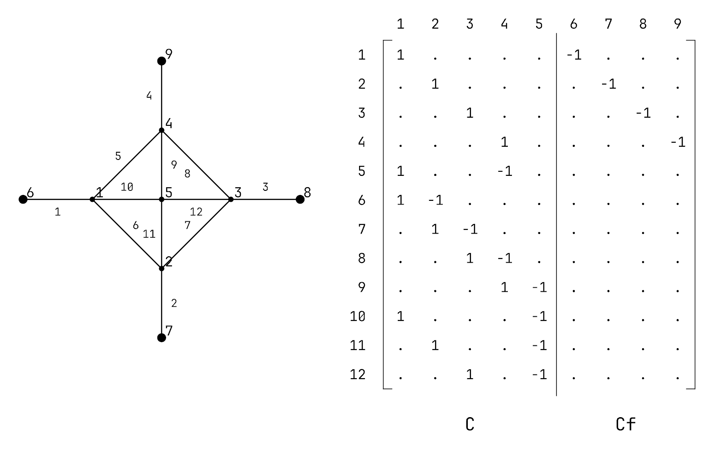

*Fig. 2, redrawn: the graph and its branch-node matrix.*

**Add to your program:**

```python
branches: list[tuple[int, int]] = [(1, 6), (2, 7), (3, 8), (4, 9),      # 1-4: one branch from each free corner to its anchor
            (1, 4), (1, 2), (2, 3), (3, 4),      # 5-8: the ring
            (4, 5), (1, 5), (2, 5), (3, 5)]      # 9-12: four spokes to the centre node 5
n, n_f = 5, 4                                    # free nodes 1..5, fixed nodes 6..9
m = len(branches)
```

### A.3 The branch-node matrix C_s and its two column blocks (section 2.1)

**Build this step.** Convert the branch list into an array that can operate on coordinates. Add one row per branch, then split the columns into free and fixed nodes. Keep all three arrays for subsequent steps.

The branch-node matrix $C_s$ has one row per branch and one column per node:

$$
c(j, i) =
\begin{cases}
+1 & \text{if } i = i(j) \\
-1 & \text{if } i = k(j) \\
0 & \text{otherwise}
\end{cases}
$$

**What do +1, −1 and 0 mean?** Each entry describes how a node belongs to
one branch:

- **+1:** the node is the branch's starting endpoint, $i(j)$.
- **−1:** the node is the branch's ending endpoint, $k(j)$.
- **0:** the node is not an endpoint of this branch.

For branch 1, `(1, 6)`, node 1 is the chosen start and node 6 is the chosen end.
Its row in $C_s$ is:

| Node label | 1 | 2 | 3 | 4 | 5 | 6 | 7 | 8 | 9 |
|---|---|---|---|---|---|---|---|---|---|
| Branch 1 | +1 | 0 | 0 | 0 | 0 | −1 | 0 | 0 | 0 |

**Why use these numbers?** Multiplying this row by the vector of all nine
$x$-coordinates selects the two endpoints and subtracts their coordinates:

$$
(+1)x_1 + 0x_2 + 0x_3 + 0x_4 + 0x_5 + (-1)x_6 + 0x_7 + 0x_8 + 0x_9
= x_1 - x_6.
$$

The same row gives $y_1 - y_6$ and $z_1 - z_6$ for the other coordinate vectors.
Thus the matrix turns node coordinates into branch coordinate differences.
With Schek's signs, these differences point from the chosen end toward the
chosen start: start coordinates minus end coordinates.

The orientation is arbitrary: writing `(6, 1)` instead would reverse both signs
and the resulting coordinate differences. The physical connection stays the
same. These signs do **not** indicate tension or compression, or whether a node
is free or fixed. Force density determines tension or compression later.

Because the fixed nodes were numbered last, the matrix splits into two column
blocks, $C_s = [C \quad C_f]$: $C$ ($m \times n$) holds the free nodes and $C_f$
($m \times n_f$) the fixed ones.

**What changes from A.2?** `np.zeros((m, n + n_f))` creates a two-dimensional
NumPy `ndarray` of floating-point zeros, with shape `(12, 9)`. This is our
mathematical matrix; we use ordinary NumPy arrays, not the `np.matrix` class.
Rows represent branches in list order. Columns represent node labels 1 to 9.
The branch list itself remains a Python list.

For `branches[0] == (1, 6)`, put `+1` in array entry `[0, 0]` and `-1` in
`[0, 5]`. The first row becomes `[1, 0, 0, 0, 0, -1, 0, 0, 0]`. We subtract
one from each node label to obtain its zero-based array column index. This row
will later compute the coordinate difference `x_1 - x_6`.

Figure 2 shows the nonzero entries, and the
icon below shows the split. The arrays store zeros as numeric zeros.

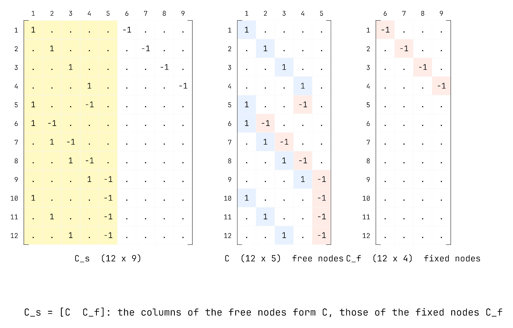

**Add to your program:**

```python
C_s: FloatMatrix = np.zeros((m, n + n_f))
for j, (i, k) in enumerate(branches):
    C_s[j, i - 1] = +1.0                          # node i(j): +1   (Python indices start at 0)
    C_s[j, k - 1] = -1.0                          # node k(j): -1
C: FloatMatrix = C_s[:, :n]                                    # (m, n)   free columns
C_f: FloatMatrix = C_s[:, n:]                                  # (m, n_f) fixed columns

print("C_s shape:", C_s.shape)
print(C_s)
```

**Reading the code.**

- `C_s = np.zeros((m, n + n_f))`: an empty table of 12 rows (branches) and 9 columns (nodes), all zeros.
- `for j, (i, k) in enumerate(branches)`: `j` counts the branches from 0, `i` and `k` are the two end nodes of branch `j` as the paper numbers them (from 1).
- `C_s[j, i - 1] = +1.0` and `C_s[j, k - 1] = -1.0`: row `j` gets a $+1$ in the column of the start node and a $-1$ in the column of the end node. The `- 1` converts the paper's numbering (from 1) to Python's (from 0).
- `C = C_s[:, :n]`: all rows (`:`), the first `n` columns, the free nodes. `C_f = C_s[:, n:]`: the remaining columns, the fixed nodes. Nothing is copied or recomputed, the one table is only read in two parts.
- The final two `print` calls are optional: they inspect the array without changing it. Row `j` corresponds to paper branch `j + 1`; column `i` to paper node `i + 1`.

Example output:

```text
C_s shape: (12, 9)
[[ 1.  0.  0.  0.  0. -1.  0.  0.  0.]
 [ 0.  1.  0.  0.  0.  0. -1.  0.  0.]
 [ 0.  0.  1.  0.  0.  0.  0. -1.  0.]
 [ 0.  0.  0.  1.  0.  0.  0.  0. -1.]
 [ 1.  0.  0. -1.  0.  0.  0.  0.  0.]
 [ 1. -1.  0.  0.  0.  0.  0.  0.  0.]
 [ 0.  1. -1.  0.  0.  0.  0.  0.  0.]
 [ 0.  0.  1. -1.  0.  0.  0.  0.  0.]
 [ 0.  0.  0.  1. -1.  0.  0.  0.  0.]
 [ 1.  0.  0.  0. -1.  0.  0.  0.  0.]
 [ 0.  1.  0.  0. -1.  0.  0.  0.  0.]
 [ 0.  0.  1.  0. -1.  0.  0.  0.  0.]]
```

### A.4 Reading matrices: the five operations the paper uses

**Read the diagrams.** These operations are used in the solver below. Continue to B.1 to add the support coordinates and loads.

Five matrix operations prepare us for the equilibrium solve.

1. **A matrix is a table.** $C_s$ has one row per branch and one column per node;
   the entry in row $j$, column $i$ says how node $i$ enters branch $j$ ($+1$ start,
   $-1$ end, $0$ not at all).
2. **Matrix times vector: multiply. Add.**

   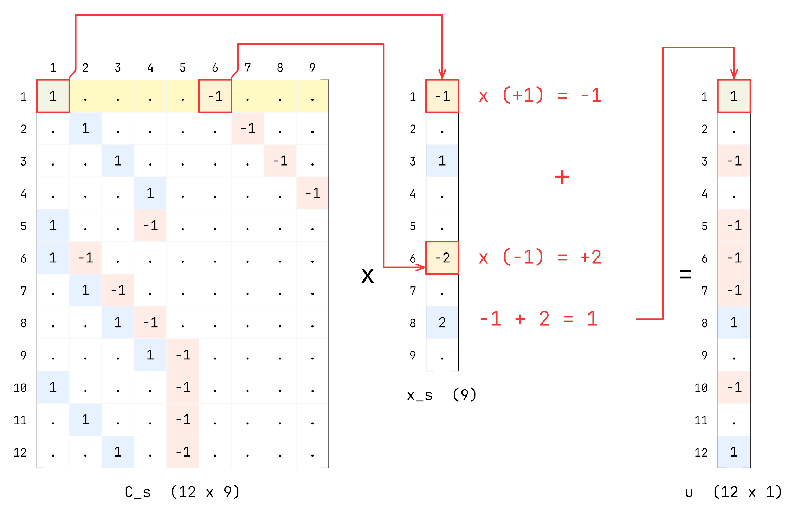

   Follow red arrows. Multiply the matching numbers. Add: $-1+2=1$.
   Dots mean zero: they add nothing.

   **One row → one sum. Twelve rows → twelve sums in one column.**

   $x_s$ contains all nine node coordinates. The result contains
   twelve branch differences. In NumPy their shapes are `(9,)` and `(12,)`;
   the diagram draws them as columns.

3. **Transpose times vector = add up at the nodes.** $C^{t}$ swaps rows and
   columns, so $C^{t} f$ has one number per *node*: the sum of the branch values $f_j$
   of the branches at that node, with $+$ for branches that start there and $-$ for
   branches that end there. This is how the paper sums forces at a node.

   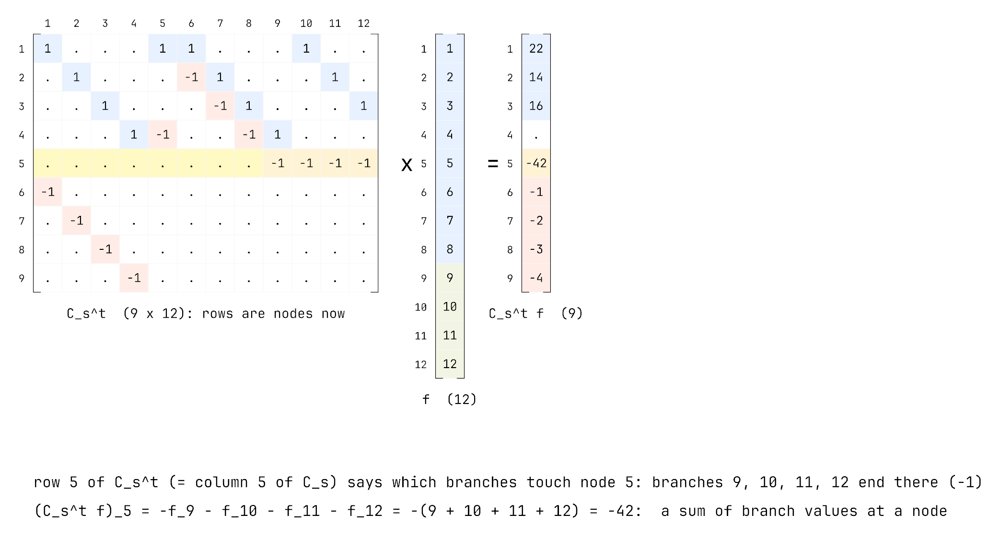
4. **Diagonal matrix times vector = scale each entry.** $Q u$ with $Q = $ `np.diag(q)`
   is just $q_j u_j$ for every branch, which is why $U q = Q u$ (equation 6).

   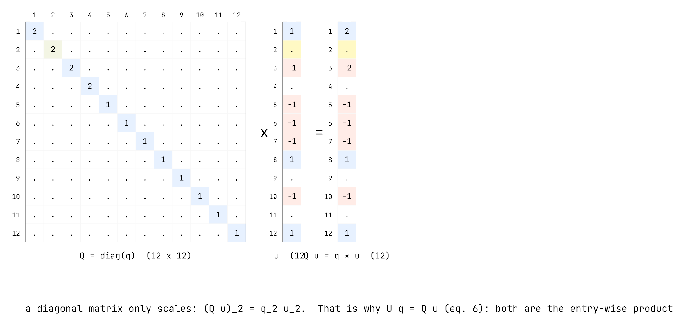
5. **Solving $D x = b$** means finding the $x$ that makes $D x$ equal to $b$;
   `np.linalg.solve` does it without forming $D^{-1}$. Check: $D x$ reproduces $b$.

   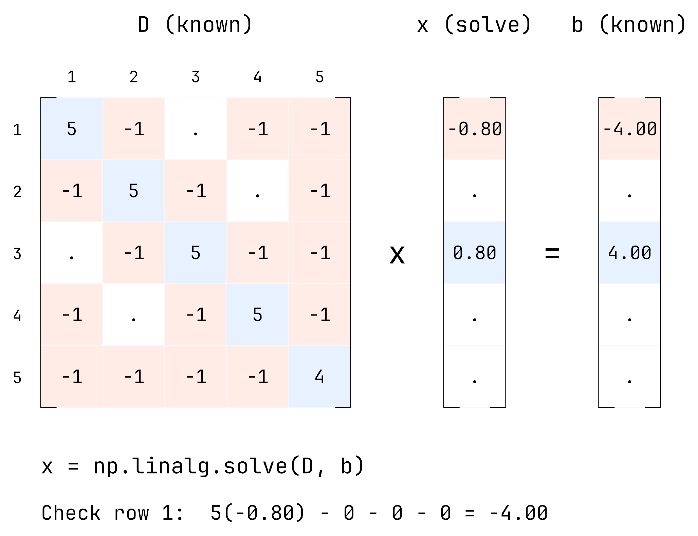

The product $D = C^{t} Q C$ that the paper builds in section 2.2 combines
operations 3 and 4. Part C assembles it from connectivity and force densities.

## Part B. Equilibrium, the nonlinear form

### B.1 The data: anchors and loads (section 2.2)

**Build this step.** Add the prescribed support coordinates and the external loads on the five free nodes. Use metres, kilonewtons, and an upward positive z-axis throughout this example. Free coordinates will be solved later.

The nodes are points $P_i = (x_i, y_i, z_i)$. The free coordinates form the
$n$-vectors $x, y, z$ (the unknowns); the fixed coordinates form the $n_f$-vectors
$x_f, y_f, z_f$ (given). Every free node carries a load with components
$p_x, p_y, p_z$ (given). Every branch has a length $l_j$ and a force $s_j$ (unknown).

**Chosen example inputs—not values reported by Schek.** Figure 2 supplies the
connectivity. We choose the support coordinates below to make a runnable example:

| Fixed node | x (m) | y (m) | z (m) |
|---|---|---|---|
| 6 | -2 | 0 | 0 |
| 7 | 0 | 2 | 1 |
| 8 | 2 | 0 | 0 |
| 9 | 0 | -2 | 1 |

**Types and shapes:** these are arrays, not single numbers.

| Variables | Python type | Shape | One entry means |
|---|---|---|---|
| `x_f`, `y_f`, `z_f` | `FloatVector` (`np.ndarray` of float64) | `(4,)` | One coordinate of a fixed node, ordered 6, 7, 8, 9 |
| `p_x`, `p_y`, `p_z` | `FloatVector` | `(5,)` | One load component at a free node, ordered 1, 2, 3, 4, 5 |
| `x`, `y`, `z` | `FloatVector` | `(5,)` | One coordinate of a free node; computed by the solve in C.3 |

For example, `x_f` is `[-2, 0, 2, 0]`; `x_f[0]` is the single number `-2`,
the x-coordinate of node 6. `x` is not defined yet: B.2 declares function arguments
for these arrays, and C.3 later solves for their values.

We also choose a downward load of 0.5 kN on every free node. The 2 m offsets,
1 m heights, and 0.5 kN loads are example parameters, not inferred measurements.
Change them to define a different problem; the solver then finds its equilibrium.

**Add to your program:**

```python
x_f: FloatVector = np.array([-2.0, 0.0, 2.0, 0.0], dtype=np.float64)             # anchors 6, 7, 8, 9
y_f: FloatVector = np.array([0.0, 2.0, 0.0, -2.0], dtype=np.float64)
z_f: FloatVector = np.array([0.0, 1.0, 0.0, 1.0], dtype=np.float64)             # two anchors lifted by 1 m
p_x: FloatVector = np.zeros(n, dtype=np.float64)
p_y: FloatVector = np.zeros(n, dtype=np.float64)
p_z: FloatVector = np.full(n, -0.5, dtype=np.float64)                            # 0.5 kN downward at every free node
```

### B.2 Coordinate differences and lengths, equation (1)

**Build this step.** Given node positions, measure each branch. This function does
not find or move the nodes. The linear solve in C.3 finds equilibrium positions;
this function then measures the branches between them.

| Output array | Meaning of one entry |
|---|---|
| `u` | Start x minus end x |
| `v` | Start y minus end y |
| `w` | Start z minus end z |
| `l` | Distance between the endpoints |

Multiplying the coordinates by the branch-node matrix gives, for every branch, the
difference of the coordinates of its two end nodes (1), operation 2 of A.4:

$$
u = C x + C_f x_f, \qquad v = C y + C_f y_f, \qquad w = C z + C_f z_f
$$

Split the same endpoint subtraction into free-node and fixed-node contributions:

| Branch | `C @ x` | `C_f @ x_f` | Add |
|---|---|---|---|
| `(1, 6)` | $x_1$ | $-x_6$ | $x_1-x_6$ |
| `(1, 2)` | $x_1-x_2$ | $0$ | $x_1-x_2$ |

`x` stores the five free-node coordinates. `x_f` stores the four fixed-node
coordinates; its first entry is $x_6$. Both products return one value per branch.
The `+` adds corresponding entries.

| Multiplication | Shapes | Result |
|---|---|---|
| `C @ x` | `(12, 5) @ (5,)` | 12 free-node contributions |
| `C_f @ x_f` | `(12, 4) @ (4,)` | 12 fixed-node contributions |
| Add | `(12,) + (12,)` | `u`: 12 branch differences |

The same shapes apply to `y`/`y_f` and `z`/`z_f`. All four outputs `u`, `v`, `w`,
and `l` are arrays of length 12. One entry, such as `u[0]`, is a scalar.

**Add to your program:**

```python
def coordinate_differences(
    C: FloatMatrix,
    x: FloatVector,
    y: FloatVector,
    z: FloatVector,
    C_f: FloatMatrix,
    x_f: FloatVector,
    y_f: FloatVector,
    z_f: FloatVector,
) -> tuple[FloatVector, FloatVector, FloatVector, FloatVector]:
    """Given positions: matrices (m,n)/(m,n_f) times vectors (n,)/(n_f,) -> (m,)."""
    u = C @ x + C_f @ x_f
    v = C @ y + C_f @ y_f
    w = C @ z + C_f @ z_f
    l = np.sqrt(u**2 + v**2 + w**2)
    return u, v, w, l
```

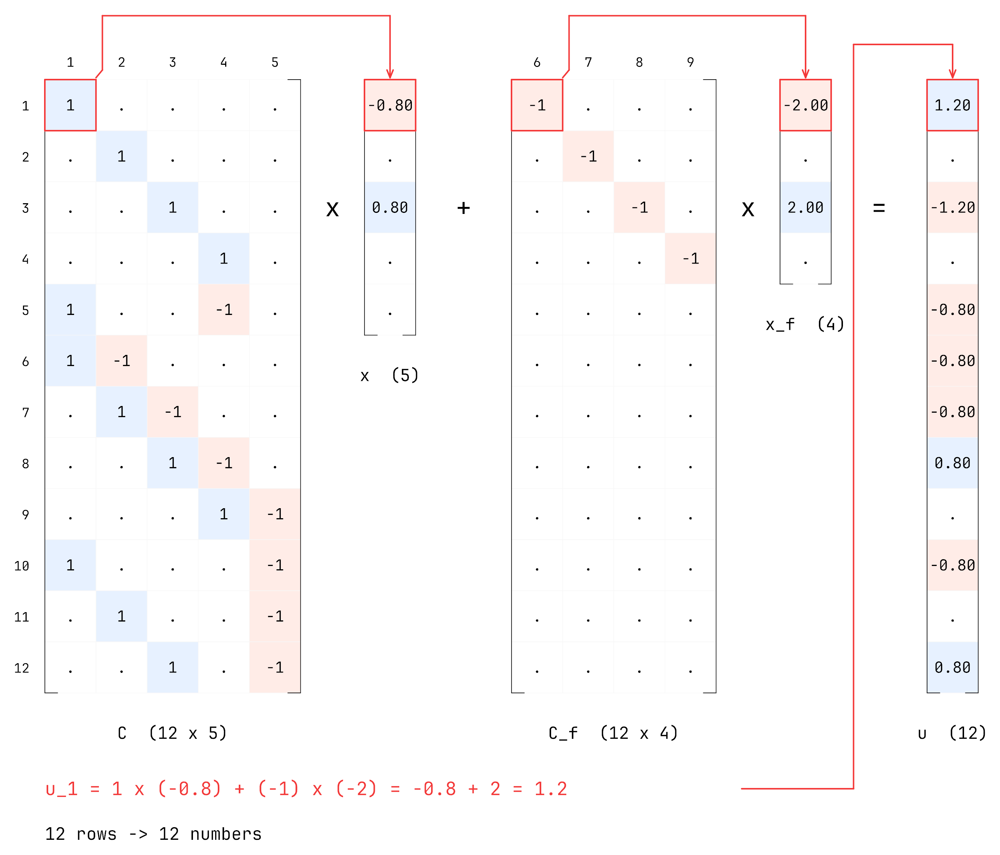

**One row → one answer. Twelve rows → twelve answers.**
For branch `(1, 6)`: $u_1=x_1+2$, $v_1=y_1$, $w_1=z_1$.
`x`, `y`, `z` are still unknown here. The loads enter the later solve.

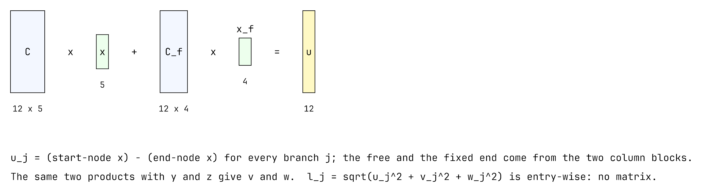

**Reading the code.**

- `u = C @ x + C_f @ x_f`: a $(12 \times 5)$ matrix times 5 free coordinates gives 12 numbers; a $(12 \times 4)$ matrix times 4 fixed coordinates gives 12 numbers; added entry by entry they are the 12 differences $u_j$. For branch 1 (from node 1 to node 6) that is $x_1 - x_6$: the $+1$ sits in `C`, the $-1$ in `C_f`.
- The lines for `v` and `w` are the same product with the $y$ and $z$ coordinates.
- `l`: the 12 branch lengths.

### B.3 Equilibrium with the unknown forces, equation (2)

**Build this step.** Use branch forces and direction components to assemble the force imbalance at every free node. Evaluate it on a guessed shape. A nonzero error shows why a geometry-and-force solve is still required.

Dividing $u_j$ by the length gives the direction cosine of branch $j$; multiplying
by the force $s_j$ gives the $x$ component of that force. Summing these components
at every free node (operation 3 of A.4, the transpose) must give the load. This is
the equilibrium (2):

$$
C^{t} U L^{-1} s = p_x, \qquad C^{t} V L^{-1} s = p_y, \qquad C^{t} W L^{-1} s = p_z
$$

It is **nonlinear** in the coordinates: $u, v, w$ and $l$ all depend on them and $l$
holds a square root. The function below evaluates it for any trial geometry; for a
flat guess with 1 kN in every branch it is far from satisfied.

**Add to your program:**

```python
def equilibrium_error(x, y, z, s):
    """Eq. (2): C^t U L^-1 s - p for the three axes.  All zeros means the net is in equilibrium."""
    u, v, w, l = coordinate_differences(C, x, y, z, C_f, x_f, y_f, z_f)
    L_inv = np.diag(1.0 / l)
    return (C.T @ np.diag(u) @ L_inv @ s - p_x,
            C.T @ np.diag(v) @ L_inv @ s - p_y,
            C.T @ np.diag(w) @ L_inv @ s - p_z)


x_guess = np.array([-1.0, 0.0, 1.0, 0.0, 0.0])    # a flat guess for the free nodes
y_guess = np.array([0.0, -1.0, 0.0, 1.0, 0.0])
z_guess = np.zeros(n)
s_guess = np.ones(m)                              # 1 kN in every branch
ex, ey, ez = equilibrium_error(x_guess, y_guess, z_guess, s_guess)
print("out of balance at the free nodes for the flat guess, z direction:", ez)
```

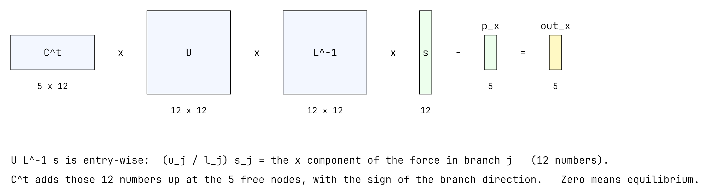

**Reading the code.**

- `L_inv = np.diag(1.0 / l)`: the paper's $L^{-1}$. The inverse of a diagonal matrix is the diagonal matrix of the reciprocals, and `1.0 / l` divides entry by entry.
- `C.T @ np.diag(u) @ L_inv @ s - p_x`, read from the right: `L_inv @ s` is $s_j / l_j$ for every branch; `np.diag(u) @ ...` multiplies each by $u_j$, giving the $x$ component of the force in branch $j$; `C.T @ ...` adds those components up at every free node with the sign of the branch direction (operation 3 of A.4); `- p_x` compares the sum with the load. Zero at a node means that node is in equilibrium.
- The three return values are the three axes.
- The printout: with the free nodes in a horizontal plane and 1 kN in every branch, the vertical load is unbalanced. Nodes 1, 3 and 5 have error $+0.5$; the inclined anchor branches at nodes 2 and 4 already carry a vertical force component.

Example output:

```text
out of balance at the free nodes for the flat guess, z direction: [0.5   0.184 0.5   0.184 0.5  ]
```

## Part C. The force density trick: a linear system

### C.1 The force density, equations (4) to (6)

**The scope of Part C:** Solve for the unknown coordinates $(x, y, z)$ of the 5 free nodes in static equilibrium.
In Part B, equilibrium was nonlinear because branch length $l_j = \sqrt{\Delta x^2 + \Delta y^2 + \Delta z^2}$ put coordinates under square roots. We fix this by defining the **force density** $q_j = s_j / l_j$ (force per unit length). Because $s_j = q_j \cdot l_j$, the length $l_j$ in direction cosines cancels out: $s_j (u_j / l_j) = q_j u_j$, turning equilibrium into a standard linear system.

**Add to your program:**

```python
q = np.array([2, 2, 2, 2, 1, 1, 1, 1, 1, 1, 1, 1], dtype=float)   # one force density per branch: the design input
```

**Matrix-by-matrix breakdown:**

- `q`: 1-D vector of shape `(12,)` (one value per branch).
  - Branches 1–4 (corner cables connected to anchors): $q = 2.0\text{ kN/m}$.
  - Branches 5–12 (inner ring and center spokes): $q = 1.0\text{ kN/m}$.
- `Q = np.diag(q)`: 2-D diagonal matrix of shape `(12, 12)` with `q` on the diagonal and zeros elsewhere.
- **The swap ($U q = Q u$):** The equilibrium equation on axis $x$ is $C^t U q = p_x$. Because multiplying a diagonal matrix by a vector is element-wise multiplication ($u_j q_j = q_j u_j$), we can swap the factors to $C^t Q u = p_x$. The design parameter $Q$ is now inside the matrix, and the unknown geometry $u$ is outside.

### C.2 The matrices D and D_f, equations (7) and (8)

Substitute branch coordinate differences $u = C x + C_f x_f$ into equilibrium $C^t Q u = p_x$.
This expands to $(C^t Q C) x + (C^t Q C_f) x_f = p_x$.
Defining $D = C^t Q C$ and $D_f = C^t Q C_f$ gives the linear system $D x = p_x - D_f x_f$.

**Add to your program:**

```python
Q = np.diag(q)
D = C.T @ Q @ C                                   # (n, n)   eq. (8)
D_f = C.T @ Q @ C_f                               # (n, n_f)

rhs = np.c_[p_x - D_f @ x_f, p_y - D_f @ y_f, p_z - D_f @ z_f]
print("D:", D, sep="\n")
print("D_f:", D_f, sep="\n")
print("right-hand sides (columns x, y, z):", rhs, sep="\n")
```

**Matrix-by-matrix breakdown:**

1. **Matrix $Q$ (shape `(12, 12)`):**
   Diagonal matrix scaling each branch by its force density $q_j$.

2. **Matrix $D = C^t Q C$ (shape `(5, 5)`):**
   Multiplies $C^t$ `(5, 12)` $\times$ $Q$ `(12, 12)` $\times$ $C$ `(12, 5)`.
   - **Rows:** 5 free nodes (nodes 1 to 5).
   - **Columns:** 5 free nodes (nodes 1 to 5).
   - **Diagonal entry $D[i, i]$:** Sum of $q$ on all branches touching node $i+1$.
     - Node 1 touches branch 1 ($q=2$), branch 5 ($q=1$), branch 6 ($q=1$), spoke 10 ($q=1$) $\implies 2 + 1 + 1 + 1 = 5.0$.
     - Node 5 (center) touches 4 spokes (branches 9, 10, 11, 12, each $q=1$) $\implies 1 + 1 + 1 + 1 = 4.0$.
   - **Off-diagonal entry $D[i, k]$:** $-q$ of the branch joining free nodes $i+1$ and $k+1$, or $0$ if not connected.
     - Node 1 connects to Node 2 via branch 6 ($q=1$) $\implies D[0, 1] = -1.0$.
     - Node 1 does not connect to Node 3 $\implies D[0, 2] = 0.0$.

   ```text
   D (5x5):
   [[ 5. -1.  0. -1. -1.]
    [-1.  5. -1.  0. -1.]
    [ 0. -1.  5. -1. -1.]
    [-1.  0. -1.  5. -1.]
    [-1. -1. -1. -1.  4.]]
   ```

3. **Matrix $D_f = C^t Q C_f$ (shape `(5, 4)`):**
   Multiplies $C^t$ `(5, 12)` $\times$ $Q$ `(12, 12)` $\times$ $C_f$ `(12, 4)`.
   - **Rows:** 5 free nodes (nodes 1 to 5).
   - **Columns:** 4 fixed anchors (nodes 6, 7, 8, 9).
   - **Entry $D_f[i, k]$:** $-q$ if free node $i+1$ connects to anchor $6+k$, else $0$.
     - Nodes 1, 2, 3, 4 connect to anchors 6, 7, 8, 9 with $q=2 \implies -2.0$.
     - Node 5 has no anchor branches $\implies$ its row is all zeros.

   ```text
   D_f (5x4):
   [[-2.  0.  0.  0.]
    [ 0. -2.  0.  0.]
    [ 0.  0. -2.  0.]
    [ 0.  0.  0. -2.]
    [ 0.  0.  0.  0.]]
   ```

4. **Right-Hand Side $rhs = p - D_f x_f$ (shape `(5,)` per axis, stacked to `(5, 3)`):**
   - $p$: applied external loads at the 5 free nodes.
   - $-D_f x_f$: pulling forces from the fixed anchors transferred to the free nodes.
   Since anchors are stationary, their pull is known and moves to the right-hand side.

Example output:

```text
D:
[[ 5. -1.  0. -1. -1.]
 [-1.  5. -1.  0. -1.]
 [ 0. -1.  5. -1. -1.]
 [-1.  0. -1.  5. -1.]
 [-1. -1. -1. -1.  4.]]
D_f:
[[-2.  0.  0.  0.]
 [ 0. -2.  0.  0.]
 [ 0.  0. -2.  0.]
 [ 0.  0.  0. -2.]
 [ 0.  0.  0.  0.]]
right-hand sides (columns x, y, z):
[[-4.   0.  -0.5]
 [ 0.   4.   1.5]
 [ 4.   0.  -0.5]
 [ 0.  -4.   1.5]
 [ 0.   0.  -0.5]]
```

### C.3 Solving for the free coordinates, equation (9)

Solve $D x = p_x - D_f x_f$, $D y = p_y - D_f y_f$, and $D z = p_z - D_f z_f$ for the free coordinates.
Because $D$ is symmetric positive definite when all $q_j > 0$ and anchored, the solution exists and is unique.

**Add to your program:**

```python
x: FloatVector = np.linalg.solve(D, p_x - D_f @ x_f)            # eq. (9)
y: FloatVector = np.linalg.solve(D, p_y - D_f @ y_f)
z: FloatVector = np.linalg.solve(D, p_z - D_f @ z_f)
```

**Matrix-by-matrix breakdown:**

- `np.linalg.solve(D, rhs)`: solves the linear system $D x = b$ directly in $O(n^3)$ operations without inverting $D$.
- Notice matrix $D$ (`5x5`) is **identical** for all three axes ($x, y, z$); only the right-hand side vector `(5,)` changes per axis.
- Output vectors `x`, `y`, `z`: each is a 1-D array of shape `(5,)` containing the exact equilibrium coordinates of nodes 1 to 5:
  - Node 1: `[-0.800,  0.000,  0.045]`
  - Node 2: `[ 0.000,  0.800,  0.330]` (pulled upward by lifted anchor 7 at $z = 1.0$)
  - Node 3: `[ 0.800,  0.000,  0.045]`
  - Node 4: `[ 0.000, -0.800,  0.330]` (pulled upward by lifted anchor 9 at $z = 1.0$)
  - Node 5: `[ 0.000,  0.000,  0.062]` (saddle center)
- The entire equilibrium geometry is found in a single direct solve—no iterative guessing.

### C.4 Lengths, forces and the equilibrium check, equation (10)

Measure branch lengths on the solved coordinates, recover axial forces $s = q \cdot l$, and check equilibrium residuals using the nonlinear equation from B.3.

**Add to your program:**

```python
u, v, w, l = coordinate_differences(C, x, y, z, C_f, x_f, y_f, z_f)      # eq. (1) on the solution
s = l * q                                         # eq. (10)

xyz_free = np.c_[x, y, z]
print("free node coordinates (columns x, y, z):", xyz_free, sep="\n")
print("lengths l:", l)
print("forces  s:", s)
print("equilibrium error (2) on the solution:", max(np.abs(e).max() for e in equilibrium_error(x, y, z, s)))
```

**Matrix-by-matrix breakdown:**

- `coordinate_differences(...)`:
  - `u, v, w`: 1-D vectors of shape `(12,)` holding coordinate differences ($\Delta x, \Delta y, \Delta z$) for each branch.
  - `l`: 1-D vector of shape `(12,)` holding branch lengths $l_j = \sqrt{u_j^2 + v_j^2 + w_j^2}$.
- `s = l * q`: 1-D vector of shape `(12,)` holding axial forces in kN.
  - Anchor branches (1–4): $s \approx 2.40\text{ kN}$ to $2.75\text{ kN}$.
  - Ring branches (5–8): $s \approx 1.17\text{ kN}$.
  - Center spokes (9–12): $s \approx 0.80\text{ kN}$ to $0.84\text{ kN}$.
- `equilibrium_error(x, y, z, s)`:
  - Evaluates nonlinear equilibrium equation (2): $C^t U L^{-1} s - p$.
  - Maximum residual error across all nodes is $\approx 4 \times 10^{-16}\text{ kN}$ (machine zero).
  - Passing this check confirms that the linear force density solve produced an exact physical equilibrium.

Example output:

```text
free node coordinates (columns x, y, z):
[[-0.8    0.     0.045]
 [-0.     0.8    0.33 ]
 [ 0.8   -0.     0.045]
 [-0.    -0.8    0.33 ]
 [ 0.    -0.     0.062]]
lengths l: [1.201 1.374 1.201 1.374 1.167 1.167 1.167 1.167 0.844 0.8   0.844 0.8  ]
forces  s: [2.402 2.748 2.402 2.748 1.167 1.167 1.167 1.167 0.844 0.8   0.844 0.8  ]
equilibrium error (2) on the solution: 4.440892098500626e-16
```

## Part D. The form-finding loop

### D.1 The form-finding loop as one function (figure 3)

**Build this step.** Refactor the working A–C calculations into one function. Build connectivity from its arguments, solve the free coordinates, then return coordinates, lengths, forces, and support reactions. The function must not rely on the earlier example's global connectivity or loads.

Figure 3 of the paper is the workflow: build $C$, build $D$ and the right-hand
sides, solve, compute lengths and forces, look at the shape, then change the fixed
points or the load (only the right-hand side changes), the force densities ($D$ is
rebuilt), or the connectivity ($C$ is rebuilt), and solve again. The whole linear
method is this function.

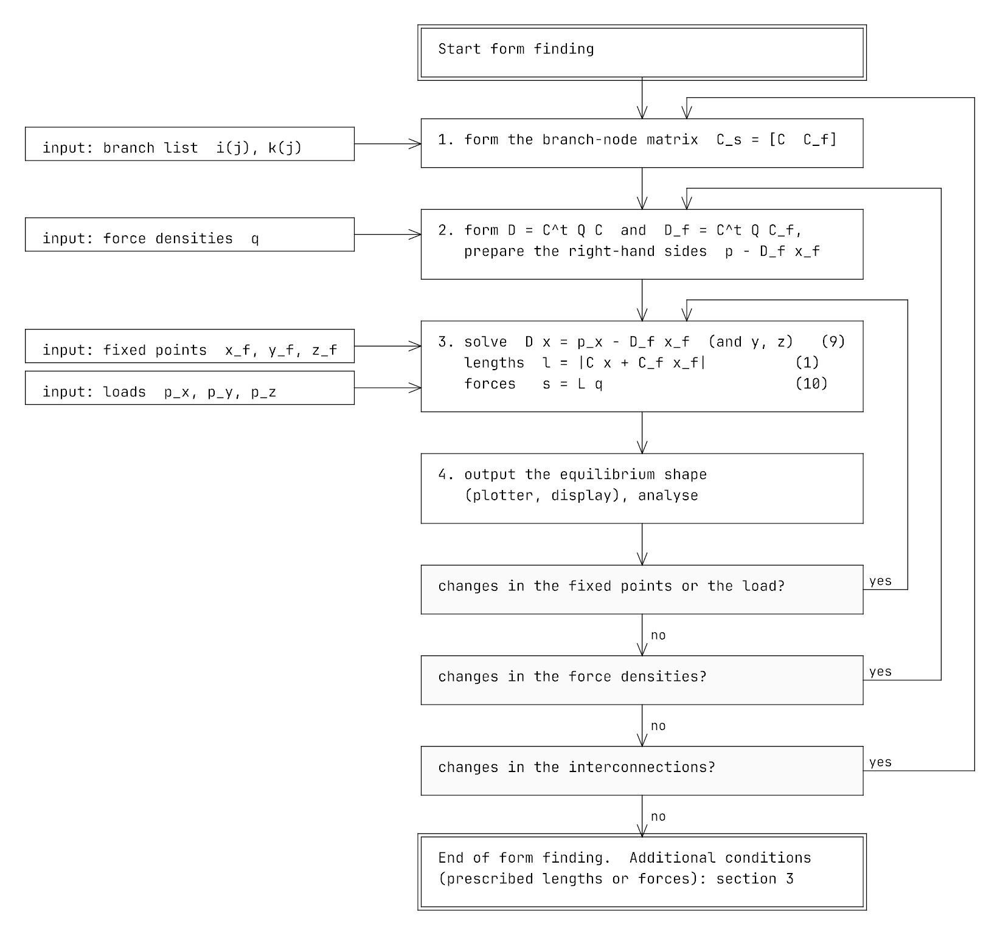

*Fig. 3, redrawn: the diagram of the form finding.*

**Add to your program:**

```python
def form_finding(branches, n_free, xyz_fixed, q, p):
    """Schek section 2 as one call.  xyz_fixed: (n_f, 3); p: (n_free, 3) loads; q: (m,)."""
    n_s = n_free + len(xyz_fixed)
    C_s = np.zeros((len(branches), n_s))
    for j, (i, k) in enumerate(branches):
        C_s[j, i - 1], C_s[j, k - 1] = 1.0, -1.0                      # section 2.1
    C, C_f = C_s[:, :n_free], C_s[:, n_free:]
    D, D_f = C.T @ np.diag(q) @ C, C.T @ np.diag(q) @ C_f                    # eq. (8)
    xyz = np.vstack([np.linalg.solve(D, p[:, a] - D_f @ xyz_fixed[:, a]) for a in range(3)]).T   # eq. (9)
    uvw = C @ xyz + C_f @ xyz_fixed                                    # eq. (1), three columns
    l = np.linalg.norm(uvw, axis=1)
    s = l * q                                                          # eq. (10)
    reactions = C_f.T @ np.diag(q) @ uvw                               # eq. (5) at the fixed nodes
    return xyz, l, s, reactions
```

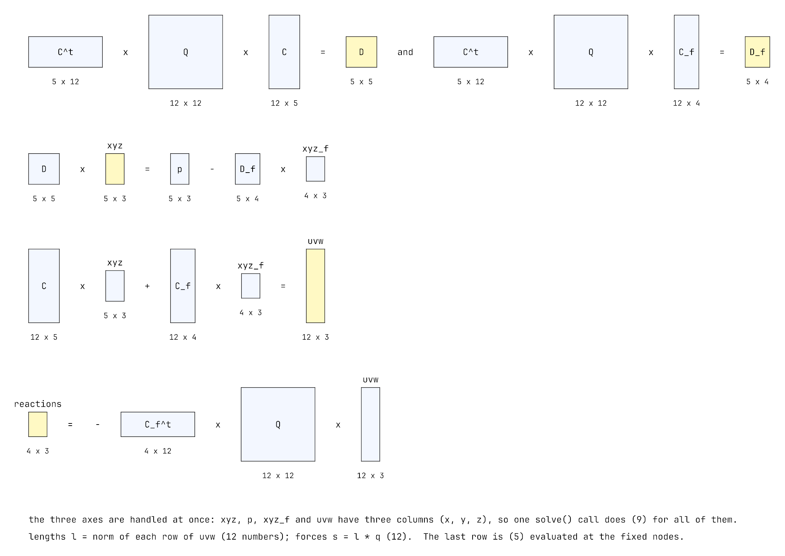

**Reading the code.** Everything from A.3 to C.4 again, compressed into one function and handling the three axes at once.

- The first four lines build `C_s`, `C`, `C_f` from any branch list (A.3).
- `D, D_f = C.T @ np.diag(q) @ C, C.T @ np.diag(q) @ C_f`: equation (8).
- `np.vstack([np.linalg.solve(D, p[:, a] - D_f @ xyz_fixed[:, a]) for a in range(3)]).T`: solves (9) three times, `a = 0, 1, 2` picking the $x$, $y$, $z$ column of the loads and of the anchors, stacks the three solutions as rows and transposes, so `xyz` is a $(5 \times 3)$ table with one row per free node.
- `uvw = C @ xyz + C_f @ xyz_fixed`: equation (1) for all three axes at once; a matrix times a 3-column table is three matrix-vector products side by side, giving $(12 \times 3)$.
- `np.linalg.norm(uvw, axis=1)`: the length of each row, i.e. $\sqrt{u_j^2 + v_j^2 + w_j^2}$ for every branch.
- `s = l * q`: equation (10).
- `reactions = C_f.T @ np.diag(q) @ uvw`: the support forces acting on the net, with zero applied loads at the fixed nodes in this function. The cables exert the opposite forces on the supports. Thus `reactions.sum(axis=0) + p.sum(axis=0)` is zero at equilibrium.

### D.2 Using the loop: move the anchors, change the force densities

**Build this step.** Call the function with the original data, then change one input at a time. First lift all supports; then increase only the anchor-branch force densities. You now have a reusable linear force density method. The nonlinear conditions in part F extend this linear solver.

Two of the three loops of figure 3. Moving the fixed points changes only the
right-hand side $p - D_f x_f$, so the same $D$ serves again; changing the force
densities rebuilds $D$. (Changing the connectivity rebuilds $C_s$ and everything
after it.)

**Add to your program:**

```python
xyz_fixed = np.c_[x_f, y_f, z_f]
p = np.c_[p_x, p_y, p_z]
xyz1, l1, s1, R1 = form_finding(branches, n, xyz_fixed, q, p)
print("same solution from the function:", np.allclose(xyz1[:, 2], z))
print("reactions at the anchors (sum of z components balances the total load):", R1[:, 2], R1[:, 2].sum())

# a change of fixed points: only the right-hand side changes
xyz2, *_ = form_finding(branches, n, xyz_fixed + np.array([0, 0, 1.0]), q, p)
# a change of force densities: D is rebuilt
xyz3, *_ = form_finding(branches, n, xyz_fixed, np.where(np.arange(m) < 4, 10.0, 1.0), p)
print("centre node height: base %.3f | anchors lifted by 1 m %.3f | anchor branches q = 10: %.3f" % (xyz1[4, 2], xyz2[4, 2], xyz3[4, 2]))
```

**Reading the code.** `xyz_fixed + np.array([0, 0, 1.0])` adds the 3-vector to every row of the $(4 \times 3)$ anchor table (NumPy "broadcasting"), lifting all anchors by 1 m. `np.where(np.arange(m) < 4, 10.0, 1.0)` builds a new `q` with 10 on branches 1 to 4 and 1 elsewhere. The printout: lifting the anchors by 1 m lifts the centre node by exactly 1 m (the right-hand side moved, the shape did not change), while a higher force density in the anchor branches pulls the centre up. Force density is a prescribed force-to-length ratio, not a material stiffness.

Example output:

```text
same solution from the function: True
reactions at the anchors (sum of z components balances the total load): [-0.089  1.339 -0.089  1.339] 2.5000000000000004
centre node height: base 0.062 | anchors lifted by 1 m 1.063 | anchor branches q = 10: 0.313
```

**Milestone reached:** you have implemented the linear force density method.
Parts E–G explain and extend this solver; the basic method needs no
additional iteration.

## Part E. What the force densities mean

### E.1 What the force densities mean geometrically (section 4)

**Build this step.** Use the solver with zero applied loads to investigate what q controls geometrically. Check the gradient of the weighted sum of squared lengths. The equal-force calculation below verifies s = q l algebraically; it does not by itself solve a new equilibrium for changed q.

Forget forces for a moment and ask for the node positions that make the weighted
sum of squared branch lengths smallest, with weights $P$ (40):

$$
u^{t} P u + v^{t} P v + w^{t} P w \to \min
$$

Setting the derivative with respect to $x$ to zero, with $\partial u / \partial x = C$
(38), gives $(C^{t} P C) x = -(C^{t} P C_f) x_f$ (41): exactly (8) with $Q = P$ and
no load. **Theorem 1:** an unloaded net with force densities $q$ is the net whose
sum of squared branch lengths weighted by $q$ is minimal. **Theorem 2:** choosing
$q_j = c / l_j$ makes every force $s_j = q_j l_j = c$ equal, so a *minimum way net*
(minimal sum of lengths) is a prestressed net with the same force everywhere.
The check below evaluates the gradient of (40) at the unloaded solution of (8).

**Add to your program:**

```python
xyz0, l0, s0, _ = form_finding(branches, n, xyz_fixed, q, np.zeros((n, 3)))      # no load
uvw0 = C @ xyz0 + C_f @ xyz_fixed
gradient = 2 * C.T @ np.diag(q) @ uvw0                                              # d/dx of u^t Q u, per axis
print("Theorem 1: gradient of the weighted squared lengths at the unloaded equilibrium:", np.abs(gradient).max())
q_const = 1.0 / l0                                                               # Theorem 2
print("Theorem 2: forces with q = 1 / l:", l0 * q_const)
```

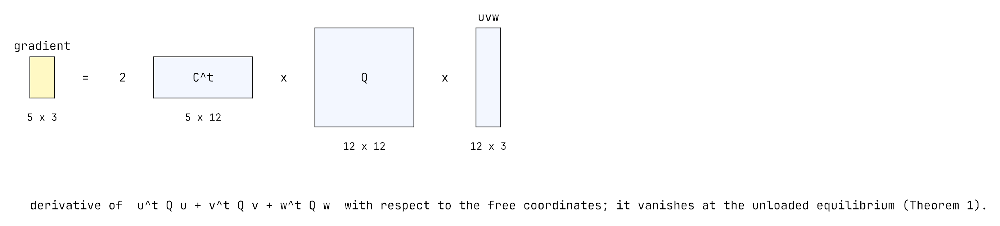

**Reading the code.** `np.zeros((n, 3))` is a zero load. `uvw0 = C @ xyz0 + C_f @ xyz_fixed` is (1) on the unloaded solution. `gradient = 2 * C.T @ np.diag(q) @ uvw0` is the derivative of $u^{t} Q u$ with respect to the free coordinates (the paper's (37) and (38)), one column per axis; it is zero to $10^{-15}$. `q_const = 1.0 / l0` and `l0 * q_const` show Theorem 2: equal forces.

Example output:

```text
Theorem 1: gradient of the weighted squared lengths at the unloaded equilibrium: 1.3322676295501878e-15
Theorem 2: forces with q = 1 / l: [1. 1. 1. 1. 1. 1. 1. 1. 1. 1. 1. 1.]
```

## Part F. Additional conditions

### F.1 Additional conditions and their linearisation (section 3.1)

**Build this step.** Start the nonlinear extension only after the linear solver works. Select four branches, give them target lengths, and subtract those targets from their current lengths. This residual vector describes what is missing from the current equilibrium shape.

The linear method satisfies nothing but equilibrium. To prescribe, say, the lengths
of some branches, the paper keeps the linear solve and iterates on $q$. Write the
$r$ conditions as functions that must vanish (11); through (9) they depend on $q$
alone (12): $g^{\ast}(q) = 0$. Starting from the linear solution $q^{(0)}$,
linearise (13) to (16):

$$
G^{t} := \frac{\partial g^{\ast}}{\partial q}, \qquad r := -g^{\ast}(q^{(0)}), \qquad G^{t}\,\Delta q = r
$$

$G^{t}$ is $r \times m$: one row per condition, one column per branch. With fewer
conditions than branches there are many solutions $\Delta q$.

**Add to your program:**

```python
length_rows = np.array([0, 1, 2, 3])
target_lengths = np.full(4, 1.2)
g_lengths = l[length_rows] - target_lengths
```

### F.2 Three ways to pick the step, equations (17) to (25)

**Build this step.** Write the function that converts a condition residual and its Jacobian into a change in q. Test its sign with a single simple condition: a positive error should produce an update that reduces that error.

The paper picks the $\Delta q$ that minimises $\Delta q^{t} \Delta q$ (17), or with
"damped" conditions $G^{t}\Delta q = r + a$ (18, 19), or, best in practice, with the
"modified damped" conditions $G^{t}\Delta q = A r$ where the damping factors
$a_j$ sit on the diagonal of $A$ (20, 21). All three lead to a small $r \times r$
system for the Lagrange multipliers $k$ (22 to 24) and the update (25):

$$
T = G^{t} G + P^{-1} A^{2}, \qquad k = T^{-1} A r, \qquad \Delta q = G k, \qquad q^{(0)} := q^{(0)} + \Delta q
$$

($P^{-1}$ drops out for the plain least squares, $A$ for the first damped variant.)
The number of equations is $r$, not the number of nodes.

**Add to your program:**

```python
def damped_step(G_t, g, a=0.8, P_inv_scale=1e-6):
    """One modified damped least-squares step, eqs. (20) to (25).  Returns dq (shape (m,))."""
    G = G_t.T
    A = np.diag(np.full(len(g), a))
    T = G_t @ G + P_inv_scale * A @ A              # eq. (23), third case
    k = np.linalg.solve(T, A @ (-g))               # eqs. (15), (24)
    return G @ k                                   # eq. (25)
```

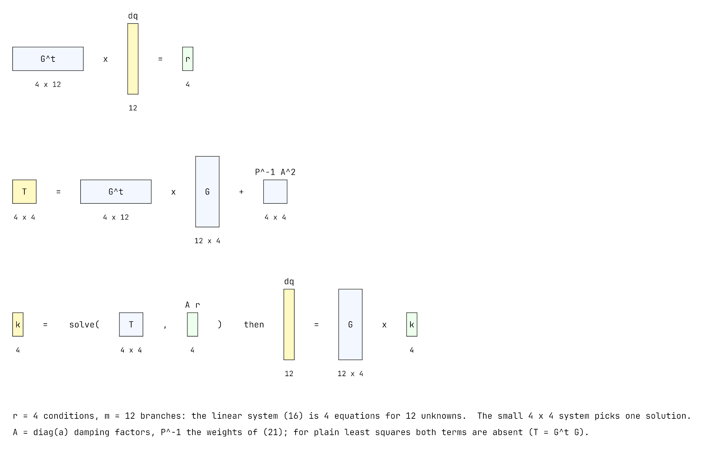

**Reading the code.**

- `G = G_t.T`: the paper writes the conditions with $G^{t}$ $(r \times m)$ and the step with $G$ $(m \times r)$; the transpose is free.
- `A = np.diag(np.full(len(g), a))`: the diagonal matrix of damping factors, all equal to `a`.
- `T = G_t @ G + P_inv_scale * A @ A`: equation (23), third case. $P^{-1}$ is taken as a scalar times the identity, the simplest weighting; `A @ A` is $A^{2}$.
- `k = np.linalg.solve(T, A @ (-g))`: equations (15) and (24); `-g` is $r$ and `A @ (-g)` the damped right-hand side of (20).
- `return G @ k`: equation (25), the change of all 12 force densities from 4 multipliers.

### F.3 How the coordinates react to the force densities (section 3.2)

**Build this step.** Differentiate the equilibrium coordinates with respect to q. Add the three coordinate Jacobians, then perturb one force density and compare the actual coordinate change with the derivative prediction.

To form $G^{t}$ one needs $\partial x / \partial q$. Inverting $D$ symbolically is
hopeless, so differentiate the equilibrium (5) implicitly: a change $dq$ with a change
$dx$ must keep $C^{t} U q = p_x$ true,

$$
C^{t} U\, dq + C^{t} Q C\, dx = 0
\qquad\Longrightarrow\qquad
\frac{\partial x}{\partial q} = -D^{-1} C^{t} U, \quad
\frac{\partial y}{\partial q} = -D^{-1} C^{t} V, \quad
\frac{\partial z}{\partial q} = -D^{-1} C^{t} W
$$

(27, 28). Then the chain rule (26) gives any condition's Jacobian:
$G^{t} = \partial g/\partial x \cdot \partial x/\partial q + \ldots + \partial g/\partial q$.

**Add to your program:**

```python
def coordinate_jacobians(D, u, v, w):
    """Eq. (28): dx/dq, dy/dq, dz/dq, each (n, m)."""
    D_inv = np.linalg.inv(D)
    return -D_inv @ C.T @ np.diag(u), -D_inv @ C.T @ np.diag(v), -D_inv @ C.T @ np.diag(w)
```

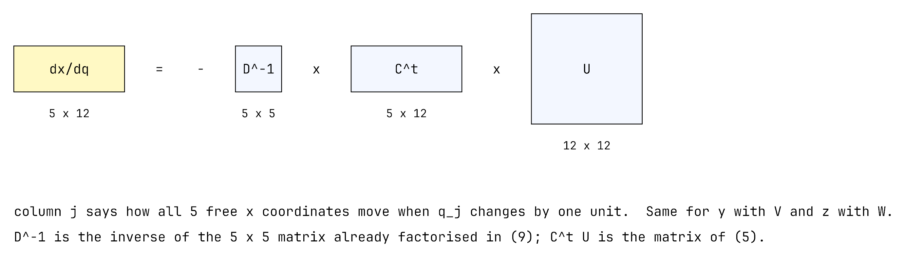

**Reading the code.** `np.linalg.inv(D)` forms the explicit inverse of the small $(5 \times 5)$ matrix (for large nets one would factorise instead). `-D_inv @ C.T @ np.diag(u)` is $(5 \times 5)(5 \times 12)(12 \times 12)$, a $(5 \times 12)$ table: column $j$ tells how all five free $x$ coordinates move when $q_j$ changes by one unit. The other two return values use $V$ and $W$.

### F.4 Distance, force and unstrained-length conditions (sections 3.3 to 3.6)

**Build this step.** Use the coordinate derivatives to build derivatives for branch lengths and forces. Each constrained branch contributes one row and every force density contributes one column. Check a length derivative by perturbing q before trusting the iteration.

Prescribed strained lengths $\bar l_v$ for a set of branches (a bar means "rows of
the constrained branches only"): $g = \bar l - \bar l_v$ (29). With
$\partial l / \partial x = C^{t} U L^{-1}$ from (3) and $\partial x / \partial q$ from
(28), the chain rule gives (31):

$$
G_d^{t} = -\bar L^{-1}\left(\bar U \bar C D^{-1} C^{t} U + \bar V \bar C D^{-1} C^{t} V + \bar W \bar C D^{-1} C^{t} W\right)
$$

Prescribed forces $\bar s_v$: $g = \bar L \bar q - \bar s_v$ (32); the direct
derivative is $\partial g / \partial q = \bar L$ (33), and (34):

$$
G_f^{t} = \bar L - \bar Q \bar L^{-1}\left(\bar U \bar C D^{-1} C^{t} U + \ldots\right)
$$

Prescribed unstrained lengths with Hooke's law $l_u = h\,l / (h + s)$ and stiffness
$h$ give (35), which tends to (31) as $h \to \infty$. Mixed conditions (3.6) stack the
rows: $G^{t} = [G_d^{t};\ G_f^{t};\ G_u^{t}]$. All three share the kernel
$C D^{-1} C^{t}$.

**Add to your program:**

```python
def distance_jacobian(D, u, v, w, l, rows):
    """Eq. (31) for the branches in `rows`.  Returns g's Jacobian G_d^t of shape (r, m)."""
    D_inv = np.linalg.inv(D)
    C_bar = C[rows]
    K = (np.diag(u[rows]) @ C_bar @ D_inv @ C.T @ np.diag(u)
         + np.diag(v[rows]) @ C_bar @ D_inv @ C.T @ np.diag(v)
         + np.diag(w[rows]) @ C_bar @ D_inv @ C.T @ np.diag(w))
    return -np.diag(1.0 / l[rows]) @ K


def force_jacobian(D, u, v, w, l, q, rows):
    """Eq. (34): L_bar on the own columns plus q_bar times the length change."""
    G_f_t = np.diag(q[rows]) @ distance_jacobian(D, u, v, w, l, rows)
    for row, j in enumerate(rows):
        G_f_t[row, j] += l[j]                      # dg/dq = L_bar, eq. (33)
    return G_f_t


def unstrained_length_jacobian(D, u, v, w, l, q, h, rows):
    """Eq. (35) with Hooke's law l_u = h l / (h + s)."""
    s = l * q
    l_u = h * l / (h + s)
    K = -np.diag(l[rows]) @ distance_jacobian(D, u, v, w, l, rows)
    G_u_t = -np.diag(l_u[rows] ** 2 / l[rows] ** 3) @ K
    for row, j in enumerate(rows):
        G_u_t[row, j] += -l_u[j] ** 2 / h[j]
    return G_u_t
```

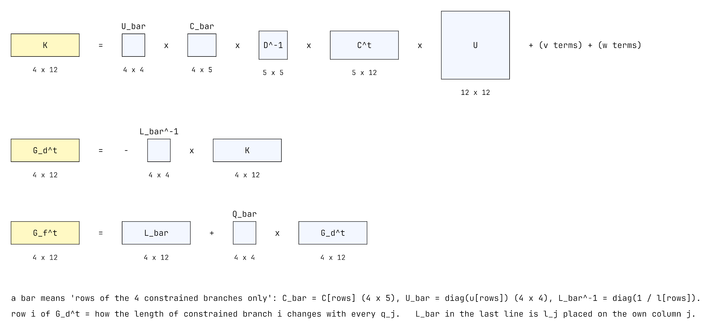

**Reading the code.**

- `rows` is the list of constrained branches (4 of the 12). `C_bar = C[rows]` picks those rows of `C`, $(4 \times 5)$; `np.diag(u[rows])` is $\bar U$, $(4 \times 4)$; `np.diag(1.0 / l[rows])` is $\bar L^{-1}$.
- `K` adds three products of the pattern $\bar U \bar C D^{-1} C^{t} U$, one per axis, each $(4 \times 4)(4 \times 5)(5 \times 5)(5 \times 12)(12 \times 12)$ giving $(4 \times 12)$.
- `return -np.diag(1.0 / l[rows]) @ K`: equation (31).
- `force_jacobian`: `np.diag(q[rows]) @ distance_jacobian(...)` is $-\bar Q \bar L^{-1} K$; the loop `G_f_t[row, j] += l[j]` adds $\bar L$, which as a $(4 \times 12)$ matrix has $l_j$ in row `row` at the own column `j` and zeros elsewhere: equation (34).
- `unstrained_length_jacobian`: `l_u = h * l / (h + s)` is Hooke's law entry-wise; `K` is recovered from the distance Jacobian by multiplying with $-\bar L$; the two terms of (35) are the loop (own column) and the product with $\bar L_u^{2} \bar L^{-3}$.

### F.5 The constrained loop assembled

**Build this step.** Assemble the outer loop in this order: solve geometry for q, compute condition errors, test convergence, build the Jacobian, compute a damped update, and accept it only if the error decreases. Check both the prescribed-length example and the mixed length/force example. Equilibrium must still be solved at every trial q.

Each iteration is one linear solve (section 2) plus one small solve (section 3):
geometry for the current $q$, evaluate the conditions, stop if they hold, else build
$G^{t}$, take a damped step, update $q$. The paper leaves the damping factors $a_j$
and the weights $P$ to the user and notes that with unattainable conditions "a damped
sequence may stop at a shape which fulfils the conditions as close as physically
possible". The loop below chooses them automatically: a step is kept only if it
reduces the largest condition error, otherwise the damping is strengthened and the
step retried; when no damping helps, the loop stops where it is. Force densities are
also kept from changing sign (a cable stays a cable). Here the four anchor branches
of the fig. 2 net are asked to be exactly 1.2 m long, then a mixed case.

**Add to your program:**

```python
def constrained_form_finding(branches, n_free, xyz_fixed, q0, p, length_rows=(), l_v=(), force_rows=(), s_v=(),
                             a=0.8, P_inv=1e-6, kmax=200, tol=1e-10):
    """Schek section 3 on any network.  Returns q, xyz, l, s, iterations, final condition error."""
    n_s = n_free + len(xyz_fixed)
    C_s = np.zeros((len(branches), n_s))
    for j, (i, k) in enumerate(branches):
        C_s[j, i - 1], C_s[j, k - 1] = 1.0, -1.0
    C, C_f = C_s[:, :n_free], C_s[:, n_free:]
    length_rows, force_rows = list(length_rows), list(force_rows)
    l_v, s_v = np.asarray(l_v, float), np.asarray(s_v, float)

    def solve(q):                                                             # section 2 for this q
        D, D_f = C.T @ np.diag(q) @ C, C.T @ np.diag(q) @ C_f                       # (8)
        xyz = np.vstack([np.linalg.solve(D, p[:, ax] - D_f @ xyz_fixed[:, ax]) for ax in range(3)]).T   # (9)
        uvw = C @ xyz + C_f @ xyz_fixed                                       # (1)
        l = np.linalg.norm(uvw, axis=1)
        g = np.r_[l[length_rows] - l_v, l[force_rows] * q[force_rows] - s_v]  # (29), (32)
        return D, xyz, uvw, l, g

    def jacobian(D, uvw, l, q):                                               # (31), (34), stacked (3.6)
        D_inv = np.linalg.inv(D)
        u, v, w = uvw.T
        def G_d(rows):
            C_bar = C[rows]
            K = (np.diag(u[rows]) @ C_bar @ D_inv @ C.T @ np.diag(u) + np.diag(v[rows]) @ C_bar @ D_inv @ C.T @ np.diag(v)
                 + np.diag(w[rows]) @ C_bar @ D_inv @ C.T @ np.diag(w))
            return -np.diag(1.0 / l[rows]) @ K
        blocks = []
        if length_rows:
            blocks.append(G_d(length_rows))
        if force_rows:
            G_f = np.diag(q[force_rows]) @ G_d(force_rows)
            for row, j in enumerate(force_rows):
                G_f[row, j] += l[j]                                           # (33)
            blocks.append(G_f)
        return np.vstack(blocks)

    q = q0.astype(float).copy()
    D, xyz, uvw, l, g = solve(q)
    damping = P_inv
    for it in range(kmax):
        err = np.abs(g).max()
        if err < tol:
            break
        G_t = jacobian(D, uvw, l, q)
        G = G_t.T
        A = np.diag(np.full(len(g), a))
        for _ in range(12):                                                   # strengthen the damping until the step helps
            T = G_t @ G + damping * np.diag(np.diag(G_t @ G)) @ A @ A            # (23), P^-1 scaled to the problem
            k = np.linalg.solve(T, A @ (-g))                                  # (15), (24)
            dq = G @ k                                                        # (25)
            flip = np.sign(q + dq) != np.sign(q)                              # keep every q on its side of zero
            if flip.any():
                dq *= min(1.0, 0.5 * np.min(np.abs(q[flip] / dq[flip])))
            trial = solve(q + dq)
            if np.abs(trial[4]).max() < err:
                q = q + dq; D, xyz, uvw, l, g = trial; damping = max(damping / 2, 1e-9)
                break
            damping *= 4
        else:
            break                                                             # stalled: return the current iterate
    return q, xyz, l, l * q, it, np.abs(g).max()


q_c, xyz_c, l_c, s_c, iterations, err = constrained_form_finding(branches, n, xyz_fixed, q, p, length_rows=[0, 1, 2, 3], l_v=[1.2] * 4)
print(f"anchor branches prescribed to 1.2 m: lengths {l_c[:4]} after {iterations} iterations; their q became {q_c[:4]}")
q_m, xyz_m, l_m, s_m, iterations, err = constrained_form_finding(branches, n, xyz_fixed, q, p, length_rows=[8, 9, 10, 11], l_v=[0.9] * 4,
                                                                 force_rows=[0, 1, 2, 3], s_v=[2.0] * 4)
print(f"mixed: spokes 0.9 m and anchor forces 2 kN: lengths {l_m[8:]}, forces {s_m[:4]} after {iterations} iterations")
```

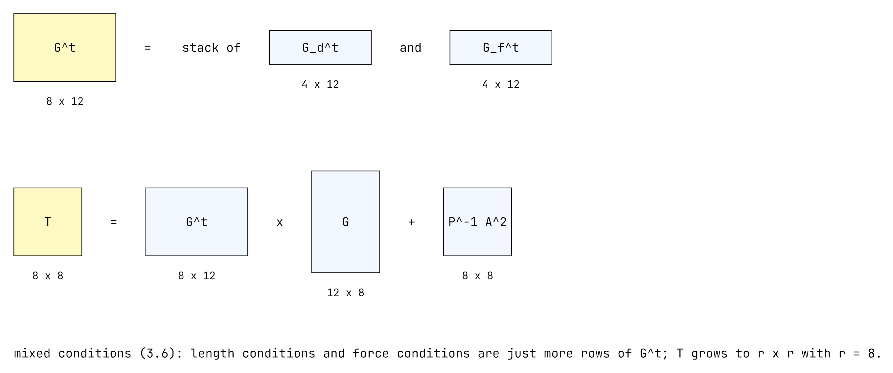

**Reading the code.**

- The first lines build `C_s`, `C`, `C_f` once for the given network and turn the condition lists into arrays.
- `solve(q)` is part C for one value of `q`: (8), (9) for the three axes at once, (1), the lengths, and the condition vector `g`. `np.r_[a, b]` concatenates the length conditions (29) and the force conditions (32) into one vector, so mixed conditions (section 3.6) need nothing special.
- `jacobian(...)` is F.4 written for the general case: `G_d(rows)` is equation (31) for any row set; the force block adds $l_j$ on the own column (33); `np.vstack(blocks)` stacks the blocks of $G^{t}$ row-wise.
- The outer loop: `err = np.abs(g).max()` is the largest condition error; stop when below `tol`.
- The inner `for _ in range(12)` loop is the damping choice. `T = G_t @ G + damping * np.diag(np.diag(G_t @ G)) @ A @ A` is (23) with $P^{-1}$ proportional to the diagonal of $G^{t} G$, so the damping is measured relative to the problem. `k` and `dq` are (24), (25).
- `flip`: if a step would push a force density through zero, the step is shortened so that no $q_j$ changes sign.
- `trial = solve(q + dq)`: the conditions after the trial step. If the largest error went down, the step is kept and the damping halved; otherwise `damping *= 4` and the step is recomputed. If twelve strengthenings do not help, the `for ... else: break` leaves the loop: the numerical iteration has stalled and returns its current shape. Failure to converge alone does not prove the conditions are unattainable.
- The return values: the final `q`, the geometry for it, lengths, forces, the iteration count and the final error.

Example output:

```text
anchor branches prescribed to 1.2 m: lengths [1.2 1.2 1.2 1.2] after 14 iterations; their q became [1.893 2.352 1.893 2.352]
mixed: spokes 0.9 m and anchor forces 2 kN: lengths [0.9 0.9 0.9 0.9], forces [2. 2. 2. 2.] after 15 iterations
```

## Part G. The paper's examples, computed and drawn

### G.1 The network of figure 5 (section 5)

**Build this step.** Build the larger network as data, preserving the same free-first ordering. Classify border and radial branches before assigning their force densities. The solver itself should require no changes.

The application is complete; part G only feeds it the paper's data, and every
picture below is rendered from what these cells compute. The first example is the
67-node radial net of figure 5, its topology traced from the printed figure: nodes
62 to 66 are the border corners, 67 the apex, all six fixed. The paper prescribes
border branches $q = 100$, radial branches to the apex $q = 0.5$, everything else
$q = 1$, and "a small vertical load in each node"; the anchor coordinates and the
load value are not printed, so they are chosen here to match the printed
proportions.

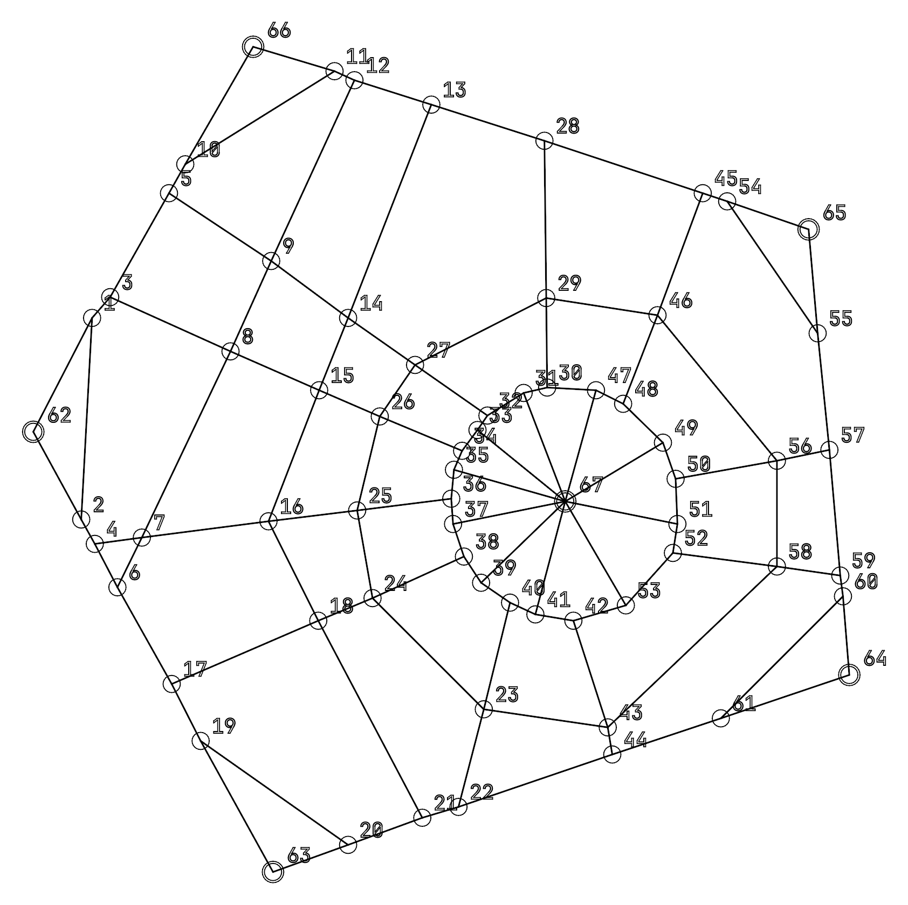

*Fig. 5, redrawn: the graph of the first example.*

**Add to your program:**

```python
FIG5_PX = {   # plan positions read off the printed figure (pixels, y down)
    1: (162, 368), 2: (150, 591), 3: (182, 345), 4: (165, 618), 5: (247, 230), 6: (190, 666), 7: (217, 611),
    8: (315, 405), 9: (360, 305), 10: (265, 198), 11: (430, 95), 12: (452, 105), 13: (537, 132), 14: (445, 368),
    15: (413, 448), 16: (357, 593), 17: (250, 773), 18: (412, 703), 19: (282, 836), 20: (445, 951), 21: (527, 921),
    22: (567, 909), 23: (595, 801), 24: (472, 678), 25: (455, 581), 26: (480, 477), 27: (519, 420), 28: (662, 172),
    29: (664, 346), 30: (665, 445), 31: (639, 451), 32: (599, 476), 33: (588, 492), 34: (571, 515), 35: (562, 536),
    36: (559, 568), 37: (561, 596), 38: (573, 632), 39: (592, 661), 40: (624, 683), 41: (652, 696), 42: (694, 703),
    43: (732, 821), 44: (737, 851), 45: (837, 230), 46: (787, 365), 47: (719, 448), 48: (749, 463), 49: (793, 506),
    50: (807, 546), 51: (809, 596), 52: (804, 628), 53: (752, 686), 54: (864, 239), 55: (964, 385), 56: (919, 526),
    57: (977, 514), 58: (919, 643), 59: (989, 653), 60: (992, 676), 61: (857, 811), 62: (97, 494), 63: (362, 981),
    64: (999, 763), 65: (954, 270), 66: (340, 68), 67: (685, 571)}
BORDER = [62, 2, 4, 6, 17, 19, 63, 20, 21, 22, 44, 61, 64, 60, 59, 57, 55, 65, 54, 45, 28, 13, 12, 11, 66, 10, 5, 3, 1]
INNER_RING = [31, 30, 47, 48, 49, 50, 51, 52, 53, 42, 41, 40, 39, 38, 37, 36, 35, 34, 33, 32]
MIDDLE_RING = [27, 29, 46, 56, 58, 43, 23, 24, 25, 26]
SPOKES = [31, 33, 35, 37, 39, 41, 53, 51, 49, 47]
OTHER = [(30, 29), (32, 27), (34, 26), (36, 25), (38, 24), (40, 23), (42, 43), (52, 58), (50, 56), (48, 46),
         (27, 14), (29, 28), (46, 45), (56, 57), (58, 59), (43, 44), (23, 22), (24, 18), (25, 16), (26, 15),
         (1, 2), (4, 7), (6, 7), (7, 8), (3, 8), (8, 9), (5, 9), (9, 12), (9, 14), (13, 14), (10, 11), (8, 15),
         (14, 15), (15, 16), (7, 16), (16, 18), (17, 18), (18, 21), (19, 20), (61, 60), (59, 58), (57, 56),
         (46, 45), (28, 29), (54, 55)]
ring = lambda nodes: [(nodes[i], nodes[(i + 1) % len(nodes)]) for i in range(len(nodes))]
seen, branches5 = set(), []
for e in ring(BORDER) + ring(INNER_RING) + ring(MIDDLE_RING) + [(k, 67) for k in SPOKES] + OTHER:
    if tuple(sorted(e)) not in seen:
        seen.add(tuple(sorted(e))); branches5.append(e)
border5 = {tuple(sorted(e)) for e in ring(BORDER)}
xy = np.array([FIG5_PX[k] for k in range(1, 68)], dtype=float) * np.array([0.04, -0.04])   # 0.04 m per pixel
xy -= xy[66]                                                                                # apex at the plan origin
free5, fixed5 = 61, [62, 63, 64, 65, 66, 67]
q5 = np.array([100.0 if tuple(sorted(e)) in border5 else 0.5 if 67 in e else 1.0 for e in branches5])
p5 = np.zeros((free5, 3)); p5[:, 2] = -0.4
is_spoke = np.array([67 in e for e in branches5])
is_border = np.array([tuple(sorted(e)) in border5 for e in branches5])
touches_border = np.array([any(k in BORDER for k in e) for e in branches5])

def anchors5(apex_dx=0.0, apex_dy=0.0, apex_h=16.0):
    A = np.c_[xy[61:67], np.zeros(6)]
    A[5] += [apex_dx, apex_dy, apex_h]
    return A

shapes = {}                                                                    # name -> (branches, all node coordinates, fixed nodes)
def keep(name, brs, xyz_free, xyz_fixed, fixed_nodes):
    shapes[name] = {"branches": [list(e) for e in brs], "xyz": np.vstack([xyz_free, xyz_fixed]).tolist(), "fixed": list(fixed_nodes)}
```

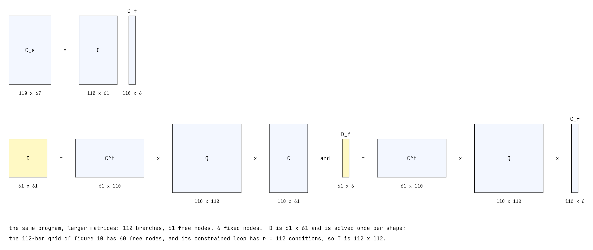

**Reading the code.**

- `FIG5_PX` holds the plan position of every node as read off the printed figure, in pixels. `np.array([...]) * np.array([0.04, -0.04])` scales pixels to metres and flips $y$ (image rows go down); `xy -= xy[66]` moves the apex (node 67, index 66) to the origin.
- `ring(nodes)` turns a list of nodes into the closed chain of branches between consecutive ones; the `seen` loop collects all branches once each, so `branches5` has 110 entries.
- `border5` is the set of border branches; `q5` assigns 100 to them, 0.5 to the branches that contain node 67, 1 to the rest, exactly the paper's prescription.
- `p5` is the $(61 \times 3)$ load table with $-0.4$ in every $z$ entry; `anchors5(...)` returns the $(6 \times 3)$ table of fixed points, the apex 16 m above the corners and optionally moved in plan.
- `is_spoke`, `is_border`, `touches_border` are boolean masks over the branches, used below to select force densities and conditions.
- `keep(name, ...)` stores a shape for the renderer: `np.vstack([xyz_free, xyz_fixed])` stacks the 61 free and 6 fixed rows into one $(67 \times 3)$ table in the paper's numbering.

### G.2 Figure 6: different fixed points

**Build this step.** Reuse the linear solver with three support layouts. Store each result under its figure name and compare the radial lengths and apex reaction. This tests changes to the known support term without changing topology or q.

Figure 6.1 is the net for the data above. Figures 6.2 and 6.3 move the apex in
plan; only the right-hand side changes, as in D.2.

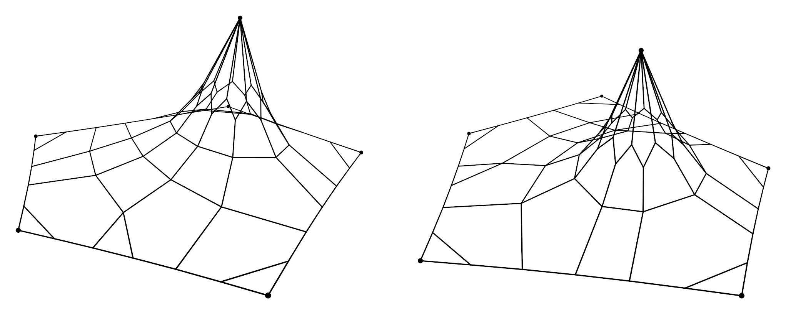

*Fig. 1, recomputed: two views of the prestressed net of this example.*

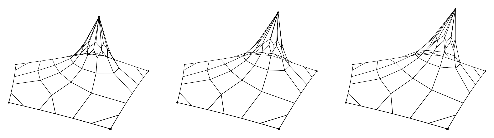
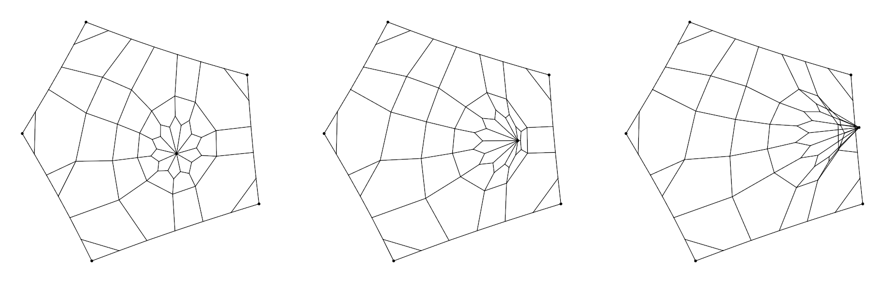

*Fig. 6, recomputed: the apex at the position of fig. 5, then moved by (6, 2) m and (12, 4) m.*

**Add to your program:**

```python
# figure 6: different fixed points (the apex moved in plan): only the right-hand sides change
for name, (dx, dy) in zip(["fig6_1", "fig6_2", "fig6_3"], [(0, 0), (6, 2), (12, 4)]):
    xyz, l, s_, R = form_finding(branches5, free5, anchors5(dx, dy), q5, p5)
    keep(name, branches5, xyz, anchors5(dx, dy), fixed5)
    print(f"{name}: apex moved by ({dx}, {dy}) m; radial lengths {l[is_spoke].min():.1f}-{l[is_spoke].max():.1f} m; apex reaction {R[5, 2]:.1f} kN")
keep("fig1", *(lambda r: (branches5, r[0], anchors5(), fixed5))(form_finding(branches5, free5, anchors5(), q5, p5)))
```

**Reading the code.** `form_finding(branches5, free5, anchors5(dx, dy), q5, p5)` is D.1 on the big net: `D` is $(61 \times 61)$. `l[is_spoke]` uses the boolean mask to pick the ten radial lengths; `R[5, 2]` is the $z$ reaction at the sixth fixed node, the apex. The second call with `(0, 0)` is stored as figure 1.

Example output:

```text
fig6_1: apex moved by (0, 0) m; radial lengths 8.1-9.0 m; apex reaction 38.9 kN
fig6_2: apex moved by (6, 2) m; radial lengths 8.0-9.3 m; apex reaction 38.9 kN
fig6_3: apex moved by (12, 4) m; radial lengths 8.4-10.9 m; apex reaction 38.9 kN
```

### G.3 Figures 7 and 8: changing the force densities

**Build this step.** Keep supports and loads unchanged. Change radial q first, then border q, rebuilding the free-node matrix for each case. Compare the resulting coordinates to distinguish the effect of each group of branches.

Raising the radial force density shortens the radial branches relative to the
rest (figure 7); lowering the border force density lets the border sag inward
(figure 8). Each change rebuilds $D$. With $q = 1$ everywhere, figure 8.3 is also
the net with the minimal sum of squared branch lengths (part E).

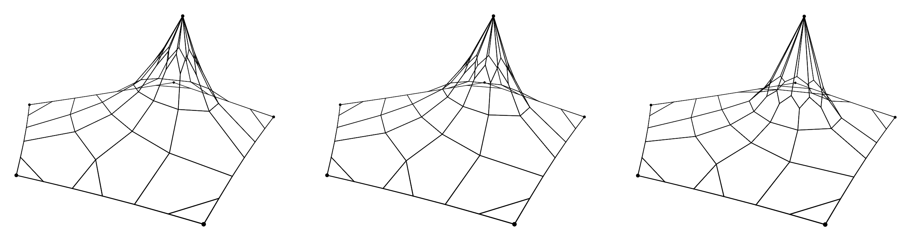
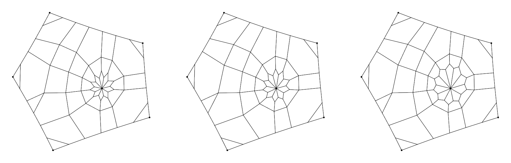

*Fig. 7, recomputed: radial force densities 1.0, 0.7, 0.3.*

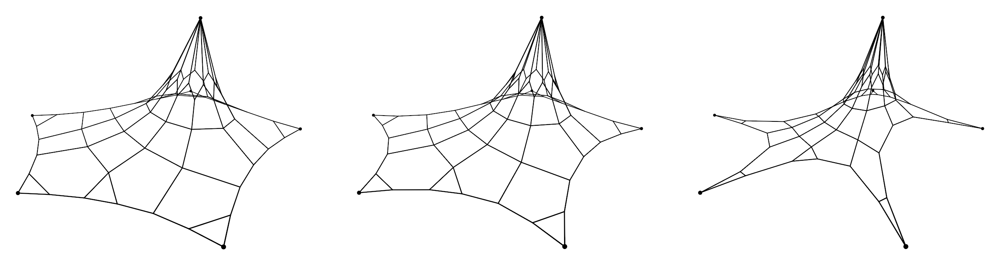
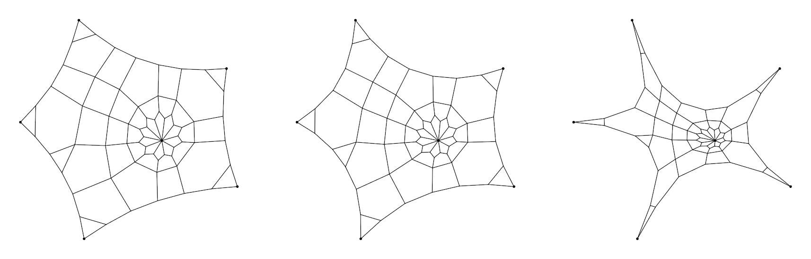

*Fig. 8, recomputed: border force densities 10, 5, 1.*

**Add to your program:**

```python
# figure 7: the radial force density 1.0, 0.7, 0.3 instead of 0.5: D is rebuilt
for name, qs in zip(["fig7_1", "fig7_2", "fig7_3"], [1.0, 0.7, 0.3]):
    xyz, l, *_ = form_finding(branches5, free5, anchors5(), np.where(is_spoke, qs, q5), p5)
    keep(name, branches5, xyz, anchors5(), fixed5)
    print(f"{name}: radial q = {qs}: radial lengths {l[is_spoke].min():.1f}-{l[is_spoke].max():.1f} m")
# figure 8: the border force density 10, 5, 1 instead of 100
for name, qb in zip(["fig8_1", "fig8_2", "fig8_3"], [10.0, 5.0, 1.0]):
    xyz, l, *_ = form_finding(branches5, free5, anchors5(), np.where(is_border, qb, q5), p5)
    keep(name, branches5, xyz, anchors5(), fixed5)
    print(f"{name}: border q = {qb:g}: border lengths {l[is_border].min():.1f}-{l[is_border].max():.1f} m")
```

**Reading the code.** `np.where(is_spoke, qs, q5)` makes a copy of `q5` with the radial branches replaced by `qs`; `np.where(is_border, qb, q5)` does the same for the border. Everything else is the D.1 call.

Example output:

```text
fig7_1: radial q = 1.0: radial lengths 5.0-5.9 m
fig7_2: radial q = 0.7: radial lengths 6.5-7.4 m
fig7_3: radial q = 0.3: radial lengths 10.6-11.6 m
fig8_1: border q = 10: border lengths 3.4-4.8 m
fig8_2: border q = 5: border lengths 3.5-4.9 m
fig8_3: border q = 1: border lengths 2.9-6.5 m
```

### G.4 Figure 9: additional distance conditions

**Build this step.** Apply length conditions to the larger network using the constrained solver. Read the final error for each case; a returned shape is not evidence of convergence. Independently measure the lengths of the converged second case.

All branches not connected with the border get prescribed lengths: 6 m for the
radial branches and a fixed multiple of their fig. 6.1 lengths for the rings. The longer-ring case stalls with a nonzero error (9.1); the shortened-ring
case converges (9.2); a third prescription gives 9.3. Check the reported error
to distinguish a converged solution from a stopped iteration.

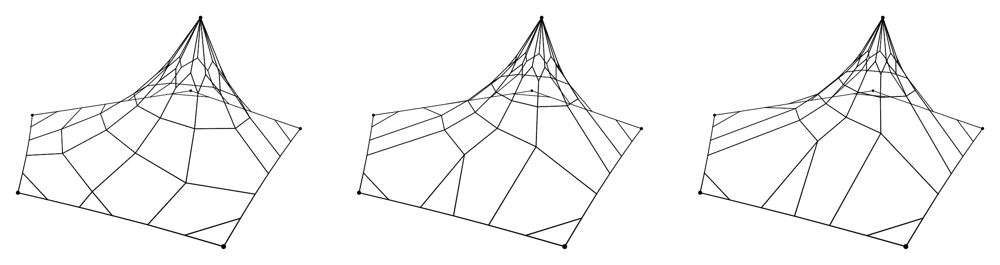
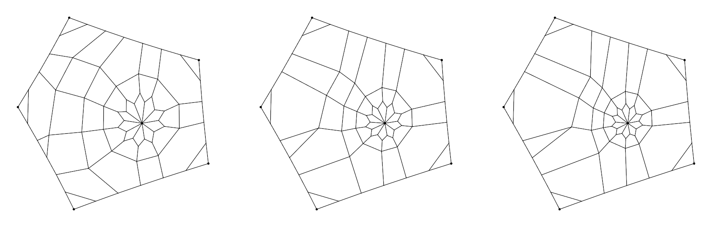

*Fig. 9, recomputed: additional distance conditions.*

**Add to your program:**

```python
# figure 9: distance conditions on all branches not connected with the border (section 3)
base_l = form_finding(branches5, free5, anchors5(), q5, p5)[1]
inner = [j for j in range(len(branches5)) if not touches_border[j]]
for name, (l_radial, ring_factor) in zip(["fig9_1", "fig9_2", "fig9_3"], [(6.0, 1.25), (6.0, 0.85), (4.5, 0.70)]):
    l_v = [l_radial if is_spoke[j] else base_l[j] * ring_factor for j in inner]
    q_k, xyz, l, s_, its, err = constrained_form_finding(branches5, free5, anchors5(), q5, p5, length_rows=inner, l_v=l_v)
    keep(name, branches5, xyz, anchors5(), fixed5)
    print(f"{name}: radial l = {l_radial} m, rings x{ring_factor}: largest length error {err:.1e} after {its} iterations"
          + ("  (not converged, stopped)" if err > 1e-6 else ""))
```

**Reading the code.** `inner` lists the indices of the branches that touch no border node. `l_v` is the target length for each of them: 6 m for a radial branch, otherwise the fig. 6.1 length times the ring factor. `constrained_form_finding(..., length_rows=inner, l_v=l_v)` is F.5 with $r = $ `len(inner)` length conditions; `err` tells whether they were met.

Example output:

```text
fig9_1: radial l = 6.0 m, rings x1.25: largest length error 1.2e+00 after 55 iterations  (not converged, stopped)
fig9_2: radial l = 6.0 m, rings x0.85: largest length error 2.5e-11 after 16 iterations
fig9_3: radial l = 4.5 m, rings x0.7: largest length error 1.2e+00 after 51 iterations  (not converged, stopped)
```

### G.5 Figure 10: the grid-shell model of 112 identical bars

**Build this step.** Generate a new grid topology, renumber its four supports last, and distribute half of each bar weight to each endpoint. Run the equal-length hanging case, the unloaded prestressed case, and the mixed-condition case. These applications complete the progression from arrays to a constrained form-finding method.

An 8 by 8 node grid with 112 bars of equal length. The hanging shape (10.1) needs
only the anchor coordinates, the bar length and the bar weight: all 112 bars carry
a length condition and the loads are the bar weights. Moving the anchors (two
corners raised) and dropping the load gives a prestressed net with inner $q = 1$
and border $q = 10$ (10.2). Asking for an equidistant inner net and a constant
force in the branches connected with the border, mixed conditions, gives 10.3.

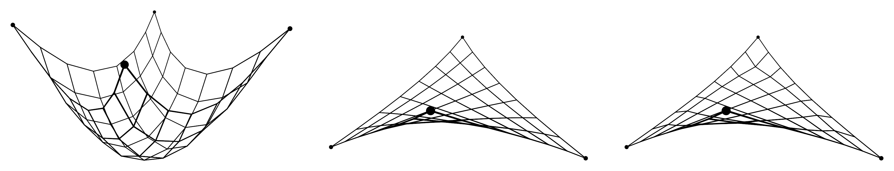
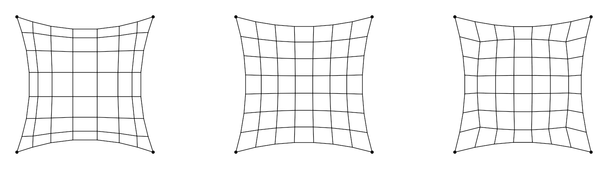

*Fig. 10, recomputed: hanging and prestressed net with the same structure.*

**Add to your program:**

```python
# figure 10: the 112-bar grid-shell model, 8 x 8 nodes
g = 8
gid = {(i, k): i * g + k + 1 for i in range(g) for k in range(g)}
grid = [(gid[i, k], gid[i, k + 1]) for i in range(g) for k in range(g - 1)] + [(gid[i, k], gid[i + 1, k]) for i in range(g - 1) for k in range(g)]
corners = [gid[0, 0], gid[0, g - 1], gid[g - 1, g - 1], gid[g - 1, 0]]
order = [v for v in range(1, g * g + 1) if v not in corners] + corners           # renumber: free nodes first, corners last
renum = {old: new + 1 for new, old in enumerate(order)}
grid = [(renum[a_], renum[b_]) for a_, b_ in grid]
flat = np.array([[(v - 1) % g, (v - 1) // g, 0.0] for v in order], dtype=float)  # 1 m spacing, in the new order
on_edge = lambda v: ((order[v - 1] - 1) // g in (0, g - 1), (order[v - 1] - 1) % g in (0, g - 1))
grid_border = np.array([(on_edge(a_)[0] and on_edge(b_)[0]) or (on_edge(a_)[1] and on_edge(b_)[1]) for a_, b_ in grid])
grid_touch = np.array([any(on_edge(v)[0] or on_edge(v)[1] for v in e) for e in grid])
weight = 0.15                                                                   # kN per bar
degree = np.bincount(np.array(grid).ravel())[1:]
p10 = np.zeros((g * g - 4, 3)); p10[:, 2] = -0.5 * weight * degree[:g * g - 4]    # half of every bar's weight at each end
anchors10 = flat[-4:].copy(); anchors10[:, :2] = (anchors10[:, :2] - 3.5) * 0.8 + 3.5   # anchors pulled in to 80 % of the span
q_k, xyz, l, s_, its, err = constrained_form_finding(grid, g * g - 4, anchors10, np.ones(112), p10, length_rows=range(112), l_v=[1.0] * 112)
keep("fig10_1", grid, xyz, anchors10, [renum[c] for c in corners])
print(f"fig10_1: 112 bars of 1.0 m hanging under their weight: length error {err:.1e} after {its} iterations; bar forces {s_.min():.2f}-{s_.max():.2f} kN")
anchors10b = anchors10.copy(); anchors10b[[0, 2], 2] = 3.0                      # two corners raised: prestressed net
q10 = np.where(grid_border, 10.0, 1.0)
xyz, l, s_, R = form_finding(grid, g * g - 4, anchors10b, q10, np.zeros_like(p10))
keep("fig10_2", grid, xyz, anchors10b, [renum[c] for c in corners])
print(f"fig10_2: corners raised, inner q = 1, border q = 10: inner lengths {l[~grid_border].min():.2f}-{l[~grid_border].max():.2f} m")
inner10 = [j for j in range(112) if not grid_border[j] and not grid_touch[j]]
link10 = [j for j in range(112) if not grid_border[j] and grid_touch[j]]
q_k, xyz, l, s_, its, err = constrained_form_finding(grid, g * g - 4, anchors10b, q10, np.zeros_like(p10),
                                                     length_rows=inner10, l_v=[l[inner10].mean()] * len(inner10),
                                                     force_rows=link10, s_v=[s_[link10].mean()] * len(link10))
keep("fig10_3", grid, xyz, anchors10b, [renum[c] for c in corners])
print(f"fig10_3: equidistant inner net and constant force in the branches connected with the border: error {err:.1e} after {its} iterations")
```

**Reading the code.**

- `gid[(i, k)]` numbers the grid nodes row by row; `grid` lists the horizontal and vertical bars, 112 in all; `corners` are the four fixed nodes.
- `order` and `renum` renumber the nodes so that the corners come last, the paper's rule from A.2; `flat` holds the coordinates in that order at 1 m spacing.
- `grid_border` marks bars lying on the outline, `grid_touch` bars with at least one node on it; `degree` counts the bars at each node, so `p10` carries half the weight of every bar at each of its ends.
- `anchors10` pulls the four corners in to 80 % of the flat span; with every bar prescribed to 1 m (`length_rows=range(112)`), the net must sag: figure 10.1.
- `anchors10b[[0, 2], 2] = 3.0` raises two opposite corners; `q10` puts 10 on the border bars and 1 elsewhere; `form_finding` with zero load gives the prestressed net, figure 10.2.
- `inner10` and `link10` split the non-border bars into those away from the border and those touching it; the last call asks the first group for one common length and the second for one common force, both taken as the mean of the 10.2 values: figure 10.3.

Example output:

```text
fig10_1: 112 bars of 1.0 m hanging under their weight: length error 4.0e-11 after 18 iterations; bar forces 0.12-2.77 kN
fig10_2: corners raised, inner q = 1, border q = 10: inner lengths 0.65-0.81 m
fig10_3: equidistant inner net and constant force in the branches connected with the border: error 2.2e-11 after 14 iterations
```

<!-- schek-app:end -->

## Implementation in compas_fd 0.5.4

Compared with the application above: `fd_numpy` performs the same linear solve as the
`form_finding` function in D.1, using sparse matrices (figure 3's loop, one call per shape). The
constrained loop of section 3, prescribed lengths or forces by iterating on $q$, is
**not** in `compas_fd`; its `fd_constrained_numpy` instead moves anchors on geometric
constraints between linear solves. The iterative solver in [compas_dr](compas_dr.md)
reaches prescribed forces and lengths through its `fpre` / `lpre` terms.


### Linear solver

```python
from compas_fd.solvers import fd_numpy

result = fd_numpy(
    vertices=vertices,          # (n_s, 3) coordinates of ALL nodes, free and fixed
    fixed=fixed,                # indices of fixed nodes
    edges=edges,                # list of (i, k) index pairs; i -> +1, k -> -1 in C
    forcedensities=q,           # one float per edge
    loads=loads,                # (n_s, 3) nodal loads, optional (defaults to zero)
)
result.vertices    # (n_s, 3) equilibrium coordinates; fixed rows unchanged
result.residuals   # (n_s, 3) p - C^t Q C x  (zero at free nodes; -reaction at supports)
result.forces      # (m, 1)   q * l
result.lengths     # (m, 1)   strained lengths
```

Internally (`solvers/fd_numerical_data.py`, `solvers/fd_numpy.py`):

| symbol in Schek | name in code | construction |
|---|---|---|
| $C_s$ | `C` | `connectivity_matrix(edges, "csr")` |
| $C$ (free columns) | `Ci` | `C[:, free]` |
| $C_f$ | `Cf` | `C[:, fixed]` |
| $Q$ | `Q` | `diags([q.flatten()], [0])` |
| $D$ | `Ai` | `Ci.T @ Q @ Ci` |
| $D_f$ | `Af` | `Ci.T @ Q @ Cf` |
| full $C_s^{t} Q C_s$ | `A` | `C.T @ Q @ C` (used only for residuals) |
| right-hand side of (8) | `b` | `p[free] - Af @ xyz[fixed]` |
| (9) | — | `xyz[free] = spsolve(Ai, b)` |
| $l$ | `lengths` | `normrow(C @ xyz)` |
| (10) | `forces` | `q * lengths` |
| residual | `residuals` | `p - A @ xyz` |

The compas-FoFin GitBook shows the same lines verbatim as the "matrix formulation".
Node ordering is free: the code selects columns by index, so fixed nodes need not
be last as Schek advises. Vertex and edge ordering of the outputs equals the input
ordering. `Result` is a `NamedTuple`; `vertices` is a new array built from the input
list, not the input list itself.

### Constrained solver

```python
from compas.geometry import Line
from compas_fd.constraints import Constraint
from compas_fd.solvers import fd_constrained_numpy

constraints = [None] * len(vertices)
constraints[k] = Constraint(Line([0, 0, 0], [1, 0, 0]))   # vertex k may slide on this line

result = fd_constrained_numpy(
    vertices=vertices, fixed=fixed, edges=edges, forcedensities=q, loads=loads,
    constraints=constraints,   # list aligned with vertices; None = unconstrained
    kmax=100, tol_res=1e-3, tol_disp=1e-3, damping=0.1,
    selfweight=None,           # optional callable xyz -> (n_s, 1) weights, subtracted from p_z
)
```

Each iteration: solve the linear system with the constrained vertices treated as
fixed; compute residuals; for every constrained vertex set `location` and
`residual` on its constraint, call `update(damping)`, which moves the vertex by
`damping × tangent` (the residual component along the constraint) and re-projects
it onto the geometry; collect the tangential residuals. Convergence requires the
largest tangential residual below `tol_res`. Constrained vertices must therefore
be listed in `fixed`; a constraint on a free vertex is ignored by the linear solve.

Constraint geometries are registered on `Constraint(geometry)`: `Vector`,
`Frame`, `Line`, `Plane`, `Circle`, `NurbsCurve`, `NurbsSurface`
(`constraints/__init__.py`). Each subclass defines `project`, `compute_tangent`,
`compute_normal`, `update`, `compute_param`.

`compas_fd.loads.SelfweightCalculator(mesh, density, thickness_attr_name="t")`
returns a callable that multiplies each vertex's tributary area (a quarter of each
adjacent face, from the current coordinates) by thickness × density.

### Caveats found while reading the source

- In `fd_constrained_numpy`, `xyz_prev = numdata.xyz` binds the same array that
  the linear solve then overwrites in place, so the displacement test
  `_is_converged_disp` compares the array with itself and is always true; only
  the tangential-residual test actually stops the loop (0.5.4).
- With `constraints` all `None`, the constrained solver returns the linear
  result after one iteration.
- `fd_numpy` has no input validation: an edge index out of range raises inside
  `connectivity_matrix`, mismatched lengths of `forcedensities` and `edges` raise in
  `diags`/`dot`, and a free node not connected to any fixed node by a positive-$q$
  path makes `Ai` singular (`spsolve` warns and returns `nan`/`inf`).
- `requirements.txt` lists only `compas`; `numpy` and `scipy` arrive through
  `compas`. Tested here with compas 2.15.1, numpy 2.4.6, scipy 1.17.1.

## Verification

**Benchmark from the chapter README.** Four fixed nodes at $(\pm 1, \pm 1, 0)$, one
free node at the origin connected to all four, $q = 1$ N/m on every edge, load
$(0, 0, -1)$ N on the free node. Vertical equilibrium gives
$4 \cdot q \cdot (0 - z) = 1$, so $z = -0.25$ m independent of the cable lengths
(that is the whole point of equation 8).

Run with `compas_fd` 0.5.4 (`fd_numpy`):

| quantity | value |
|---|---|
| free node | $(0, 0, -0.25)$; error below $10^{-12}$ m |
| residual at free node | $(0, 0, 0)$ |
| edge length | 1.436140662 m $= \sqrt{1 + 1 + 0.0625}$ |
| edge force | 1.436140662 N $= q\ l$ |
| residual at support $(-1, -1, 0)$ | $(1, 1, -0.25)$ N, the force the cable exerts on the support |

The support residuals sum to $(0, 0, -1)$, i.e. the applied load, as they must.

**Structure of D (Schek figure 4).** Building $C_s$ for the 9-node, 12-branch graph
of figure 2 and setting $q_j = j$ gives
$D_{11} = q_1 + q_5 + q_6 + q_{10} = 22$,
$D_{33} = q_3 + q_7 + q_8 + q_{12} = 30$,
$D_{55} = q_9 + q_{10} + q_{11} + q_{12} = 42$
and off-diagonals $-q_j$ exactly as printed in the paper. (Branch 5 joins nodes 1
and 4; the scanned figure is ambiguous there, but figure 4 fixes it.)

**Theorem 1.** For random anchors and random $q \in [0.5, 3]$ on that graph, the
unloaded FDM solution and a BFGS minimiser of $\sum_j q_j l_j^{2}$ agree to
$3 \times 10^{-7}$.

**Jacobian (31) and damped iteration (20 to 25).** Implemented literally for
$r = 4$ prescribed strained lengths on the same graph: the analytic $G_d^{t}$ matches
finite differences to $4 \times 10^{-7}$, and the modified damped scheme with
$a_j = 0.8$ and $P^{-1} = 10^{-6} I$ reaches the prescribed lengths to $10^{-12}$
in 19 iterations while the free-node residual stays at machine precision. These
checks are part of `examples/form_finding/schek_equations.py`.

## References and provenance

- Schek, H.-J. (1974). *The force density method for form finding and computation
  of general networks.* Computer Methods in Applied Mechanics and Engineering 3,
  115–134. <https://doi.org/10.1016/0045-7825(74)90045-0>. Read in full from the
  publisher PDF (20 pages; OCR text checked against page images for every equation
  cited above). Received 26 June 1973; work done within SFB 64, Stuttgart, for the
  Munich Olympic roofs (references 16 and 17 of the paper).
- Block Research Group. *Force Densities Method*, compas-FoFin GitBook,
  <https://blockresearchgroup.gitbook.io/compas-fofin/theoretical-background/force-densities-method>
  (read 2026-10-15). Gives the single-node motivation, the rope analogy for $q$,
  and the NumPy/SciPy snippet reproduced above. It cites Schek (1974);
  Veenendaal & Block (2012), *An overview and comparison of structural form finding
  methods for general networks*, Int. J. Solids Struct. 49, 3741–3753,
  <https://doi.org/10.1016/j.ijsolstr.2012.08.008>; and Adriaenssens, Block,
  Veenendaal & Williams (eds., 2014), *Shell Structures for Architecture: Form
  Finding and Optimization*, Routledge.
- Source read: `BlockResearchGroup/compas_fd` at commit `7ee3c5a` (0.5.4, 2024-11-10):
  `solvers/fd_numpy.py`, `solvers/fd_constrained_numpy.py`,
  `solvers/fd_numerical_data.py`, `solvers/result.py`, `constraints/*.py`,
  `loads/selfweight.py`. MIT licence.
- Verification status: benchmark and the four numerical checks above were run on
  2026-10-15 with compas_fd 0.5.4 in a throw-away virtual environment; the runnable NumPy derivation and equation checks are in
  `examples/form_finding/`. A standalone package benchmark, reusable adapter,
  MCP tool, and repository test remain to be added (see chapter README).

[Chapter README](README.md) · [compas_dr](compas_dr.md) · [compas_fofin](compas_fofin.md)
